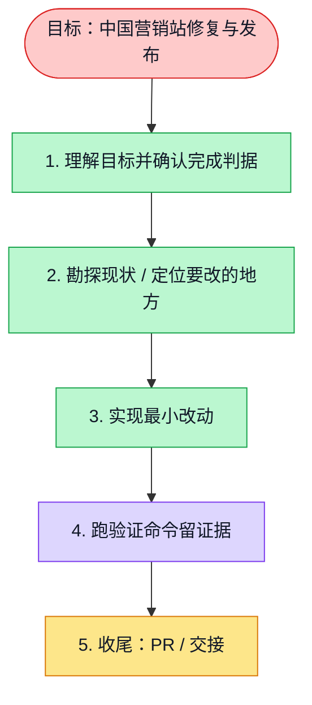

# 执行计划 — 中国营销主域与登录入口

> 规范：`.harness/instructions/execution-plan-visualization.md`。
> 改状态用 `node .harness/scripts/execution-plan.mjs set <本文件> <节点> <状态>`，
> 改完 `check` 一遍；不要手改 classDef 颜色。

## 我理解的目标
- **目标**：以 workspacex.cn 为中国主域，展示 -2 备案号并修复旧登录入口
- **完成判据**：实际公网首页、旧域与登录、HTTPS、中文、备案、手机通过
- **不做什么**：只限中国营销站；保留版本与美国站
- **假设与待确认**：现有阿里云认证缺失，发布尚未执行

## 执行计划

图例：⬜ 灰=未开始 · 🟨 黄=已开始 · 🟩 绿=已完成 · 🟪 紫=已测试（有证据） · 🟥 红=被堵塞

## 进度日志（append-only，每次改颜色追加一行）
| 时间 | 节点 | 状态变化 | 依据（命令 / 证据 / 堵塞原因） |
|---|---|---|---|
| 2026-10-30T02:47:01.810231+00:00 | G, S1 | todo → doing | 接到目标，开始理解 |
