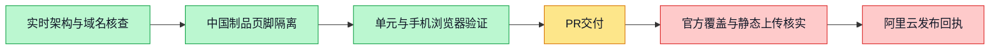

# 中国营销官网备案页脚与发布方案

## 实施范围

`apps/home` 是双语静态营销站。美国源页面与 Cloudflare Pages 发布脚本不改；
`home_cn_language_package.py` 只向独立的中国输出目录注入备案号
“粤ICP备2021115740号”及 `https://beian.miit.gov.cn/` 链接。
首页、英文入口、中文入口、隐私页、手册与 404 都静态显示，无需 JavaScript。
新增 CSS 仅存在于中国制品，14px 字号、44px 最小链接高度、允许换行。

未来域名配置在 `home-cn-domains.json`：`workspacex.cn` 仅为禁用的未来跳转入口，
目标为 `https://www.boardx.com.cn`。不增加该域名到现有营销包的 canonical 或 sitemap。
配置中的备案状态不是官方备案结果；显示备案号也不等于新增域名获准上线。

## 2026-10-14 实时核查

只读证据在 `evidence/home-icp-20261014/`。

| 项目 | 实际结果 |
| --- | --- |
| 中国营销入口 | `https://www.boardx.com.cn/` 返回 200，Server ESA，无备案号 |
| 中国根域 | `http://boardx.com.cn/`、`https://boardx.com.cn/` 返回 404 |
| 中国营销 TLS | SAN `www.boardx.com.cn`，有效至 2027-01-07 |
| 美国入口 | `https://workspacex.us/` 返回 200，Server cloudflare，无备案号 |
| 阿里云 ESA 站点 | `boardx.com.cn`，SiteId `182657519556832`，国内加速、active |
| 阿里云营销应用 | `workspacex-home-cn`，绑定 `www.boardx.com.cn` |
| 当前生产制品 | `1791865525336254983`，Available、HasAssets=true；平台保留此版本 |
| workspacex.cn | 云 DNS 已有 A `47.116.87.136`，TTL 600，RecordId `2110299639349437440`；本机公共解析失败 |
| www.workspacex.cn | 本机公共解析失败；本次未发现已有 www 云 DNS 记录 |

本任务没有写入上述 DNS 记录。工信部公共查询浏览器返回
`net::ERR_BLOCKED_BY_CLIENT`。随后只读进入阿里云 ICP 代备案管理系统，
“我的ICP备案信息”列出 `boardx.com.cn`，主体号 `粤ICP备2021115740号`、
网站号 `粤ICP备2021115740号-1`，已完成首次备案订单为管局审核通过。
账号内整改提示还明确要求已完成备案的 `www.boardx.com.cn` 页脚展示
`粤ICP备2021115740号` 并链接工信部，故按用户及接入商明确要求展示主体号。
脱敏摘要见 `icp-record-summary.json`；不保存负责人、证件或完整订单页面。
该页面还显示新增服务申请的整改提示，包括公司介绍需与主办单位相符；
这不证明 `workspacex.cn` 已取得备案覆盖，未来入口保持禁用。没有修改或提交备案订单。

`GetRoutineCodeVersion` 的 `RoutineCode` 解码后是 OSS `NoSuchKey` 错误，
因此 `rollback-code-version.json` 是失败的源码下载证据，不是可用源码备份。
可用的回退依据是平台保留的 Available 静态版本及其只读状态回执。

## 发布执行与回退

本次不触发 `.github/workflows/deploy-cn-production.yml`，不操作应用容器、数据库或 sudo。
现有中国官网已经在阿里云 ESA，不需要为本次页脚变更新建 ECS 或迁移 Cloudflare。

1. 旧域名覆盖和展示编号已依据阿里云账号内实际备案记录核实；发布前保留该记录摘要。
2. 从通过回归的精确提交打包独立 US 基础包，再生成独立 CN 包：

   ```sh
   node apps/home/scripts/package-pages.mjs /tmp/home-us-<commit>
   python3 deploy/aliyun/home_cn_language_package.py /tmp/home-us-<commit> /tmp/home-cn-<commit>
   ```

   保存 CN tar 制品 SHA-256、提交 SHA 与逐文件清单。US 基础包逐字节保持不变。
3. 在既有 ESA 应用 `workspacex-home-cn` 的静态资产发布入口上传 CN 包；
   上传前再次查询当前版本/域名绑定，若与核查结果不符则重新核实，避免覆盖其他发布。
   只发布该营销应用，不修改域名绑定、DNS、缓存安全策略或美国 Pages 项目。
4. 保留 `1791865525336254983` 及所有既有版本，不执行清理。
   发布失败或公网验证不通过时，先确认没有竞争发布，再将该应用 production 恢复到发布前的 Available 版本。
5. 交付必须包含新版本 ID、发布 RequestId、发布时间、制品 SHA-256；
   公网读取 `.well-known/workspacex-release.json` 核对提交、项目、地区，
   验证中国首页/隐私/手册在手机和关闭 JavaScript 时显示链接，
   验证美国 `/`、`/zh/`、隐私及手册没有备案号。没有实际回执不宣称发布完成。

控制台显示应用未连接 Git 仓库，新增构建不可用；已核实官方
`aliyun esa-cli` 兼容入口可用现有 OAuth，只读列出已有应用成功，未新建凭据。
官方 CLI 1.0.13 支持仅设置 `assets.directory` 的静态 Pages；
`commit` 只生成版本，不切换生产，`deploy --version ... --environment production --no-preview`
才执行指定版本发布。

对提交 `7b27357492e42ea099085bc6637854449763a57c` 的独立 CN 包执行一次 commit，
在 `CreateRoutineWithAssetsCodeVersion` 步骤收到 InvalidParameter，
RequestId `01A139DF-9511-5E24-9CFA-45EF4CD6471A`。
随后查询确认没有新版本，仍为 5 个 Available 版本，生产仍是旧版本 100%，未执行 deploy 或回退。
完整状态摘要见 `publication-attempt.json`。本次上传尝试被拒绝，不是发布回执。

当前账号控制台明确为免费模式，[官方版本额度](https://help.aliyun.com/en/edge-security-acceleration/esa/user-guide/functions-and-pages-billing)
为每应用 5 个，现有应用已占满。API 通用错误未明确写出额度原因；额度已满本身
仍是继续发布前必须解决的条件，不能盲目重复调用或擅自扩大收费。
可审阅的后续动作二选一，均等待用户确认：

- 删除已有营销应用的最旧历史版本 `1791721267107804086`，释放一个名额；
  当前生产及回退版本 `1791865525336254983` 保留。风险为失去该最旧平台制品，
  本次未取得其完整源码/资产备份，不宣称可完整恢复。
- 将函数和 Pages 账号从免费切换付费模式，版本额度升至每应用 20 个。
  此操作是账号级，可能引入额外请求费用（官方函数请求价格为人民币 5 元/百万次），
  不保证只影响营销站；不得未经用户确认执行。

没有删除任何版本、切换收费模式、调整 DNS、安全配置或备案订单。

官方依据：[ESA CLI 文档](https://help.aliyun.com/en/edge-security-acceleration/esa/user-guide/functions-and-pages-cli-tool)、
[官方 CLI 配置与版本发布说明](https://github.com/aliyun/alibabacloud-esa-cli#configuration)。
执行时只设置已有应用名称和独立 CN `assets.directory`，沿用当前 `404Page` 策略；
不执行 `init`、`login`、域名增删或账户安全操作。如果现有 OAuth 认证不能用于
静态上传，先报告所需凭据配置及范围，不自行新建 AccessKey。

## workspacex.cn 跳转变更边界

目标使用 `https://www.boardx.com.cn`，避免跳到当前返回 404 的根域。
DNS 别名不是 HTTP 跳转，不能只把 A 记录换成 CNAME 后就宣布完成。
未来入口需拥有有效的 `workspacex.cn` TLS 证书，才能在 HTTPS 请求后返回永久跳转；
目标域名不得反向跳回来源，路径与查询参数应保留。

当前不改 RecordId `2110299639349437440`，不接入未备案域名。
在官方覆盖、来源 TLS 和已有重定向服务核实前，没有安全可执行的 DNS 目标值。
下一次变更提案必须明确：源域名、现有记录 ID/值/TTL、新记录类型/值、
具体 HTTPS 服务及证书、301/308 规则、回退记录、费用影响和是否触及共享应用。
任何新增收费资源、DNS/网络安全配置、sudo 或凭据配置均先交回用户确认。

## 验证命令

```sh
python3 -m unittest discover -s deploy/aliyun -p test_home_cn_language_package.py
node apps/home/scripts/check-all.mjs --static-only
node --test apps/home/tests/pages-deploy.test.mjs
node deploy/aliyun/test-home-cn-icp.mjs
```

浏览器工具按现有 `home-gates` 工作流装入 `apps/home/node_modules`。
本地也可用 `PLAYWRIGHT_MODULE` 指定已安装的 Playwright 模块，
`ICP_EVIDENCE_DIR` 指定手机截图目录。测试不得因为未安装工具而静默跳过。
完整页面在 320px 且禁用 JS 时存在既有横向溢出；本次断言页脚不增加溢出、
链接自身位于视口内且可见，不把整个营销站的既有布局问题当成本次已修复。


