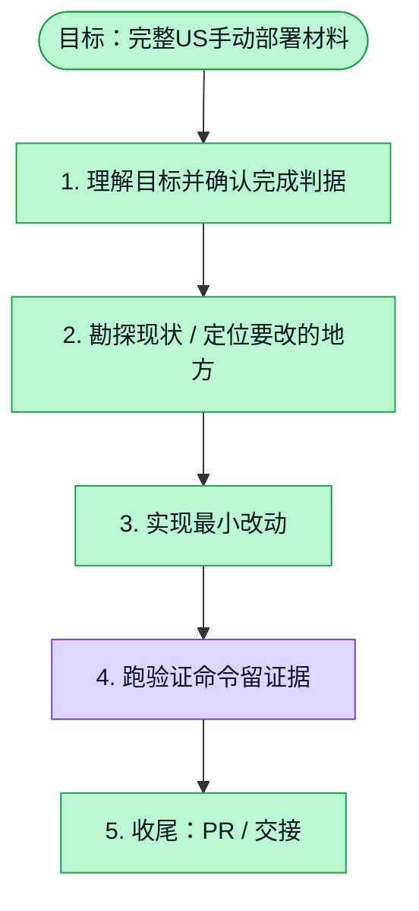

# 执行计划 — US手动部署交付包

> 规范：`.harness/instructions/execution-plan-visualization.md`。
> 改状态用 `node .harness/scripts/execution-plan.mjs set <本文件> <节点> <状态>`，
> 改完 `check` 一遍；不要手改 classDef 颜色。

## 我理解的目标
- **目标**：在指定deploy/us目录交付他人可使用的完整部署材料与逐值说明。
- **完成判据**：python3 -m unittest discover -s deploy/us/tests -v；package.py生成无密钥独立包。
- **不做什么**：不实际部署US，不修改业务代码；发布接线仅交付补丁。
- **假设与待确认**：默认独占Ubuntu24.04/x86_64、同机PG/Redis与本地文件存储；真实主机待验收。

## 执行计划

图例：⬜ 灰=未开始 · 🟨 黄=已开始 · 🟩 绿=已完成 · 🟪 紫=已测试（有证据） · 🟥 红=被堵塞

## 进度日志（append-only，每次改颜色追加一行）
| 时间 | 节点 | 状态变化 | 依据（命令 / 证据 / 堵塞原因） |
|---|---|---|---|
| 2026-10-25 | G, S1 | todo → doing | 接到目标，开始理解 |
