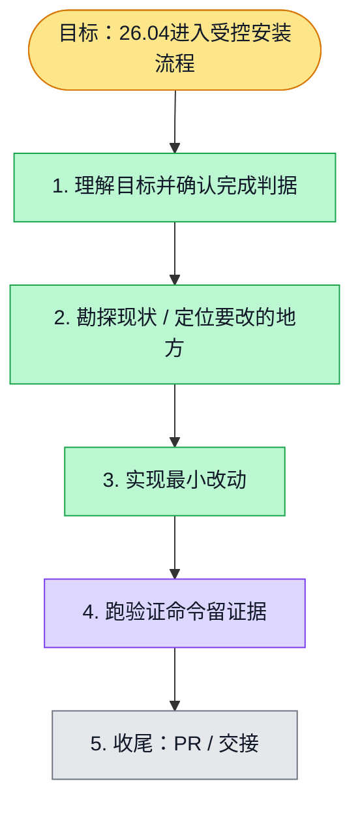

# 执行计划 — Ubuntu 26.04 镜像安装兼容性修复

> 规范：`.harness/instructions/execution-plan-visualization.md`。
> 改状态用 `node .harness/scripts/execution-plan.mjs set <本文件> <节点> <状态>`，
> 改完 `check` 一遍；不要手改 classDef 颜色。

## 我理解的目标
- **目标**：允许用户已准备依赖的Ubuntu26.04主机进入镜像安装链路。
- **完成判据**：安装器离线套件通过、共享版本判断拒绝非支持系统、独立包校验通过。真实US安装另验。
- **不做什么**：不接触目标机、不改模型密钥/容器资源限额/沙箱策略、不声称生产验收。
- **假设与待确认**：用户提供了真实主机版本和依赖输出。7.5GiB是有限容量；现有Nginx站点内容和DNS待用户确认。

## 执行计划

图例：⬜ 灰=未开始 · 🟨 黄=已开始 · 🟩 绿=已完成 · 🟪 紫=已测试（有证据） · 🟥 红=被堵塞

## 进度日志（append-only，每次改颜色追加一行）
| 时间 | 节点 | 状态变化 | 依据（命令 / 证据 / 堵塞原因） |
|---|---|---|---|
| {{CREATED_AT}} | G, S1 | todo → doing | 接到目标，开始理解 |
