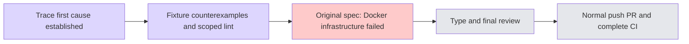

# CK-P8 archived fixture lifecycle (#6215)

Main explicitly assigned an independent test-only maintenance PR. BASE c49fee15b89f2621d8ceaa582ef6a9c0f6c931cc, target develop. Chat i18n WIP is safely stashed and excluded.

- [x] Read exact failing job/report/trace. All six readonly/history assertions succeeded. A child `/agents` GET entered the broad route at 773033.700; context teardown started773102.990; fetch returned773174.347 and JSON parsing raced disposal. Case43.714s, not the300s case budget being exhausted.
- [x] Preserve Chat66 files using SHA256 manifest/named stash and verify every saved hash; ignored18 diagnostic logs remain unchanged.
- [x] Semantic counterexamples: unrelated/agents/other-thread excluded, writes not replayed, real body only archived changes, non200 passthrough, in-flight settlement, errors propagate.
- [x] Exact current-thread getThread matcher (query supported) and fixture-specific unregister/settle before context teardown; no catch/ignoreErrors or timeout expansion.
- [x] Original complete registered persona+archived spec, one worker/retries0, real API/PG/browser on standard chat-read lane; review images when produced and clean own scope.
- [ ] Appropriate type/lint, fresh independent review, normal hooks/push, automatic PR Closes6215, own source/candidate CI through actual merge.
- [ ] Restore exact original Chat branch/stash and verify all manifest hashes; resume Task3/4/5 and the entire authorized i18n phase.

Unchanged legacy handler extraction produced actual3 RED/4 GREEN (suite1.08s). Exact endpoint and tracked cleanup now produce7/7 GREEN (suite690ms/tests6ms), scoped3-file ESLint exit0. Original complete spec is currently running; browser/type/CI are not yet verified. Frozen static independent review found no Critical/Important findings, reviewed three source hashes, and ran no tests/browser/private-trace review. Public timeline contains no request headers, credentials, raw model content or private trace. Full diagnostics remain private under /tmp.

## First real-spec attempt: infrastructure failure, not acceptance

The original complete registered file declares three tests (CK-P6, template recommendation, CK-P8), not two. Standard isolation/chat-read config, workers1/retries0 ran with unchanged300s per case. It reached Running3tests but emitted no case verdict before child processes exited; wrapper exit1, execution2m27, cleanup2m49, total5m16. Docker query reported `Docker Desktop is unable to start`; compose cleanup failed. No browser pass is claimed.

Main independently observed root disk nearly full (185Mi available/99%). After dynamic verification that this checkout had no active Next/Playwright, main explicitly authorized deletion of only its two ignored regenerable build caches (.next-chat-read-e2e1.5G and .next-fullstack-e2e2.4G). Actual df after cleanup:7.8Gi available/60%; do not attribute all concurrent filesystem change solely to these caches. No test-results, evidence, source, stash or other checkout cache was removed.

The wrapper's two Docker cleanup clients exited naturally before attempted SIGTERM (kill reported absent). Five own provider processes and Next plus their six parents were verified by this run's log, ports, cwd and parent chains, then SIGTERM terminated. Fresh12PIDs/all11listeners0. Docker containers under own scope wsx-2e9db9d56316e29a1575 remain unverified until main restores daemon access; never claim containers0. No blind browser rerun.

### Daemon recovery and verified own cleanup
Main recovered Docker (fresh info exit0/Server29.2.0) after disk cleanup. This worker then ran compose down-v only for its own wsx-2e9db9d56316e29a1575. Fresh exact-label container and volume queries both exit0 with zero items; all eleven reserved listeners absent. Evidence: recovered-cleanup.json. This resolves cleanup uncertainty, not the failed browser acceptance. Next authorized sequence: third-phase mock25s, first-phase counterexample15s, then this worker type60s; fresh original browser needs a separate coordinated window.

Cumulative `pnpm --filter web typecheck` completed with actual exit0 after fresh main-authorized serial window; evidence typecheck.log. Original-spec fresh browser is still pending a separate window after Docker recovery.

## Fresh recovered original spec: acceptance passed

After main recovered Docker and all parties explicitly granted the new exclusive window, a fresh own scope ran the original entire registered three-case file, workers1/retries0 and original300s per case. Actual3/3PASS (CK-P6 3.0m; recommendation26.5s; CK-P8 29.7s), command7m20/cleanup1/total7m21. Fresh own scope containers0/volumes0/all11listeners0; actual exit and cleanup were broadcast immediately. Initial infrastructure failure remains in evidence and is not reclassified as pass. Source three hashes did not change between scoped/type/static review and this browser run.

Next: freeze commit, final exact readback, normal push hooks in fresh serial window, automatic PRCloses6215, source/candidate CI and actual merge. Then restore the original Chat WIP by exact stash and verify every manifest hash.
