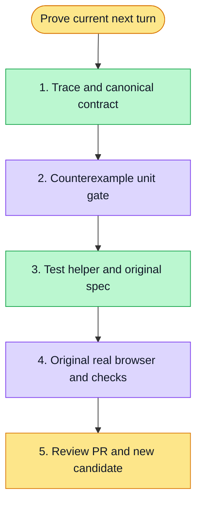

# 执行计划 — HITL next-message gate — #6189

> 规范：`.harness/instructions/execution-plan-visualization.md`。
> 改状态用 `node .harness/scripts/execution-plan.mjs set <本文件> <节点> <状态>`，
> 改完 `check` 一遍；不要手改 classDef 颜色。

## 我理解的目标
- **目标**：Accept a real next turn after denial via SDK or durable queue, only after correlated persisted completion.
- **完成判据**：Proof counterexamples, original real chat-read spec, init, scoped lint/typecheck, independent review, normal push/PR.
- **不做什么**：Test-only helpers/spec; no product/API/permission/timeouts, no i18n source edits.
- **假设与待确认**：Main assigned inline execution and strict dual-path proof. Queue clientMessageId is canonical queue row id, not clientRequestId.

## 执行计划

图例：⬜ 灰=未开始 · 🟨 黄=已开始 · 🟩 绿=已完成 · 🟪 紫=已测试（有证据） · 🟥 红=被堵塞

## 进度日志（append-only，每次改颜色追加一行）
| 时间 | 节点 | 状态变化 | 依据（命令 / 证据 / 堵塞原因） |
|---|---|---|---|
| 2026-11-03 | G, S1 | todo → doing | 接到目标，开始理解 |

## Design and implementation plan

Native inline execution; final independent reviewer. Base b7be8e0e6e2d12d70a0b7023193073013a6f7a45.

- Create e2e/support/hitl-next-turn.ts: classify only current thread queue or exact SDK run POST; parse real receipt, observe matching queue dispatch where used, and verify canonical succeeded run/input/result identities against authenticated persisted messages.
- Create tests/e2e-hitl-next-turn.test.ts: literal valid direct/queued proof; reject failed/pending/not-executed queue, wrong status/thread/run/client identity, duplicate human rows, wrong reply linkage or text. No mock UI can satisfy the proof.
- Modify original copilotkit-v2-hitl-dialog-dismiss.spec.ts only to use an authoritative fresh thread and this strict next-turn observer. Keep all Escape/no-decision/deny200/duplicate-deny/approval/overlay assertions and150s test budget.
- Verify pure gate red→green, original registered real chat-read spec, targeted lint/typecheck, independent exact-SHA review, normal push and standalone PR Closes6189.

### Task 1: strict next-turn proof
- [x] Write counterexamples and watch the SDK-only/missing-proof baseline fail semantically.
- [x] Implement real route, receipt and canonical correlation checks; run all proof tests.
- [x] Integrate original spec and run it with real API/DB/browser.
- [ ] Preserve trace-derived evidence, update mod-chat live knowledge, review and normal push/PR.

Review focus: queued201 without dispatch; wrong message success; same-text duplicate; stale previous run; failed/cancelled run. All receive explicit negative tests.

Execution ledger: original candidatea24/run41606226684 attempt1 is real browser RED at next-run request predicate. Trace proves queue201→dispatched→canonical succeeded current reply. No local product code changed. init quick path exits0; no full init claim.

Task1 Ruling: original real browser SDK path exposed that SDKthreadId is not canonicalChatthreadId. Existing panel forwarding contract uses forwardedProps.chatThreadId. Preserve SDK identity presence, validate forwarded canonical identity and then canonicalrun.threadId; add a negative case rejecting missing forwarding even if top SDK id equals expected Chat id. Firstrealrun failed at this new strict guard (34s case,total7m41s,45s admission,2s cleanup), not a product failure/pass. Artifacts retained privately at/tmp/chat-hitl-6189-first-browser (trace may contain ephemeral auth; do not commit raw archive).

Task1 Ruling: local originalcase chose the supportedSDKpath; add one deterministic busy-queue case in the same registeredspec using real visible QueueNextTurnAction while approval remains undecided, assert pending201/no run before decision, then perform the original deny200/once/overlay checks and prove dispatch+same-message completion. Originalcase and150s per-test budget remain. This prevents SDK-only local green from hiding an unexecuted queue helper branch. No route mocking or manual queued-message POST.

Task1 browser proof: originalregisteredfile2/2 passed withactual SDK and real busyqueue UI paths,49.8s/2.0m cases,total8m6s cleanup1s. queue201pendingbeforedenial,canonical dispatched/succeeded/current-message unique+reply linkage+reload asserted. New SDK identity regression2RED→38GREEN; relatedrun-settled suite4 gives42/42. No product/API/permission changes; both original150s test budgets retained.
