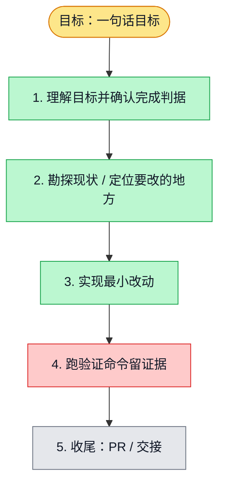

# 执行计划 — GitHub 只读导入瞬时故障有界恢复 #6194

> 规范：`.harness/instructions/execution-plan-visualization.md`。
> 改状态用 `node .harness/scripts/execution-plan.mjs set <本文件> <节点> <状态>`，
> 改完 `check` 一遍；不要手改 classDef 颜色。

## 我理解的目标
- **目标**：同一已校验 GitHub GET 遇502/503/504/ECONNRESET时有界恢复，不能放过持续失败或SSRF
- **完成判据**：先反例RED，恢复/耗尽/取消/deadline/RetryAfter/host/redirect反例GREEN；真实原导入单spec、正常hooks、新PR CI
- **不做什么**：不改i18n头、不POST重放、不跳过公网GitHub验收、不增超时或盲rerun
- **假设与待确认**：main授权；一三期明确空窗；固定总预算10s、最多两个transient重试，现有quota只一次且共同受总deadline限制

## 执行计划

图例：⬜ 灰=未开始 · 🟨 黄=已开始 · 🟩 绿=已完成 · 🟪 紫=已测试（有证据） · 🟥 红=被堵塞

## 进度日志（append-only，每次改颜色追加一行）
| 时间 | 节点 | 状态变化 | 依据（命令 / 证据 / 堵塞原因） |
|---|---|---|---|
| 2026-11-03 | G, S1 | todo → doing | 接到目标，开始理解 |
