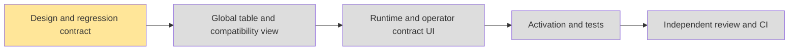

# Deployment-global native credit tariffs — #6290

The user requires one retail tariff for each provider/model/native unit, shared by personal and enterprise payers and all current/future organizations. ASR is supplier cost ×3; image profiles retain ×10. Different models retain different product prices. Canonical approved retail snapshots are promoted across CN/US; endpoint geography is supplier-cost metadata, not an automatic trigger to change retail prices.

## Change and compatibility

- Add `credit_global_native_tariffs` keyed only by provider/model/unit and an append-only global audit. Keep version, exact integer quantum/rate and canonical pricing metadata. Runtime reads only this global source; payer identity, permissions, wallet and request price snapshots stay tenant scoped.
- Rename the old table to `credit_native_tariffs_legacy`. Normalize each old rational rate with gcd; identical prices with different versions/quantum representations merge deterministically. Conflicting rational prices abort migration and list the conflicting model/unit keys. No lowest/latest/first price is selected.
- The old table name becomes a `security_invoker`/`security_barrier` compatibility view: the current trusted tenant context × global rows. Explicitly revoke all legacy table privileges and all view INSERT/UPDATE/DELETE from `app_rw`; grant view SELECT only. Old runtime and new runtime use the same source, and newly created organizations need no copied price row.
- Existing global consumption settings already use `app_rw` table writes behind authoritative platform-operator checks and append-only audit. Reuse this deployed pattern and minimum table grants; ordinary runtime performs only SELECT. This is not a claim of a separately credentialed database writer. No unconfigured writer role or secret is introduced.
- Platform contract/UI and image activation drop organization pricing inputs. Strict schemas explicitly reject legacy `orgId` query/body fields, including at global endpoints, rather than silently turning an old scoped write into a global write. Canonical image ×10 prices and ASR ×3 remain separate.

## Switch and rollback

Migration is one transaction. It validates all old prices before publishing the global rows/view, so existing runtime continues using a single rate through the compatibility view after commit. Deploy new API/UI after migration. An API rollback can retain the migration and read-only compatibility view; old model calls still use global prices, while old organization mutation endpoints fail closed. Do not restore legacy writes. A schema rollback requires a separately reviewed quiesced conversion from current global prices and is not part of ordinary app rollback.

Already admitted requests retain their own `native_quantum`, `native_rate`, `tariff_version` and wallet identity; settlement/replay do not query either tariff source. Changing the global tariff cannot reprice historical usage. Estimated ASR usage remains pending until authoritative reconciliation; this feature does not relabel estimates as vendor receipts.

## Verification contract

1. Real PostgreSQL: equivalent old rational prices merge despite metadata/version differences; differing prices abort with keys. Existing personal/team/new-organization admissions use identical rates but separate wallets. Legacy view reads are tenant scoped and old repo writes/view UPDATE/legacy table access fail without changing global prices.
2. Existing request settlement/replay uses its saved price after a global update. Nonoperator writes are denied before repository access. Legacy org-shaped requests fail validation.
3. UI has one deployment-wide model-price entry, no organization selector. Image activation sends global URLs/body and retains ×10 quote checks, Bearer authorization, exact fixed profile costs and dry-run safety.
4. CN/devapp/US publication uses reviewed canonical snapshots, preserves existing request snapshots and records global audit. No production schema or pricing writes are performed merely by implementing this branch.

