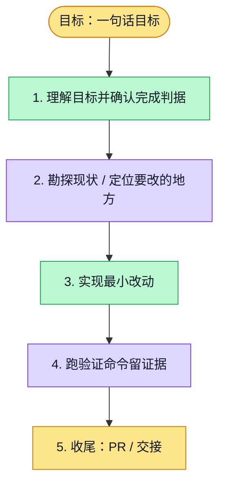

# 执行计划 — PR6147 notification response lifecycle repair

> 规范：`.harness/instructions/execution-plan-visualization.md`。
> 改状态用 `node .harness/scripts/execution-plan.mjs set <本文件> <节点> <状态>`，
> 改完 `check` 一遍；不要手改 classDef 颜色。

## 我理解的目标
- **目标**：修复候选930331的真实profile验收在导航后读取旧home通知body的时序错误，保所有功能断言。
- **完成判据**：原self-service-profile.spec.ts单worker/retries0真实登录/API/PG/browser通过；原断言保留；normalhooks及新source/完整candidate真绿actualmerge。
- **不做什么**：不改产品/接口/fixture/超时/retry，不吞CDP错误，不复跑旧candidate碰运气，不混Chat源码。
- **假设与待确认**：main已明确授权；Chat私有WIP9f6bd5979保存于原6200分支；一期/三期已释放当前串行窗给本修复。

## 执行计划

图例：⬜ 灰=未开始 · 🟨 黄=已开始 · 🟩 绿=已完成 · 🟪 紫=已测试（有证据） · 🟥 红=被堵塞

## 进度日志（append-only，每次改颜色追加一行）
| 时间 | 节点 | 状态变化 | 依据（命令 / 证据 / 堵塞原因） |
|---|---|---|---|
| {{CREATED_AT}} | G, S1 | todo → doing | 接到目标，开始理解 |

## Exact baseline failure

Candidate930331a3a44b382bee6b66f301d8f962851716e3 / run41682815784 / attempt1 / job126084666955. The first two real200 /notifications requests have Referer /home and no retrievable body; the later two have /profile and stored bodies. Old Promise.all captured the former, then navigation invalidated Chromium body access. Failure at originalspec76;3passed1failed1interrupted. Safe trace summary only; rawartifact/trace/auth stays private/tmp.

## Minimal repair and verification

Arm the landing request before this test's real login; require GET, /home referer, Bearer. Assert fixture userId/orgId and boolean equality to the current authenticated bearer without printing credentials. Read actual status/NotificationListOutput/unread0 completely before navigating. Preserve all remaining profile/locale/popup/activity structured+legacy/password/logout assertions exactly.

Command: `pnpm exec tsx .harness/scripts/with-test-isolation.ts -- pnpm --filter web exec playwright test --config playwright.self-service-profile.config.ts e2e/self-service-profile.spec.ts --workers=1 --retries=0 --max-failures=1`. This standard lane uses Next dev and real API/Postgres; no next-start production claim. Original240s webServer and30s expect budgets are unchanged. Fresh isolated resources must be dynamically cleaned before releasing the window.

## Verified local result (source eff37872)

Original registered self-service profile file:1/1 PASS, case23.2seconds, command1m7/cleanup1s/total1m8, retries0. It executed notifications authenticatedfixture/schema/unread0, pending-name locale continuity, popupgeometry/Escape, profile save/reload,375/768/1280 nooverflow, activity structured+legacy+invalidformat400+EN/zh raw-name preservation, password change/newsuccess/oldfailure/logout. The standard config is Next dev, not next-start. Four screenshots inspected: supplied Chinese display-name suffix remains original content; controls and activity prefix English; no horizontal overflow.

Fresh webtype3/3,2cached,57.301s; targetspecESLint0; actual reachability70configs/12live. Own scopewsx-5b0c2bfdd7c7ee4ebf30 containers0 and all11allocatedlisteners0. Readonly independent exacteff37872 review found noC/I, no tests run byreviewer/private rawtrace not independently inspected. Normalpush and new source/candidate CI still pending.
