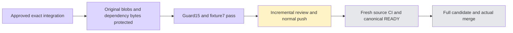

# User-priority PR6147 maintenance integration

The user explicitly prioritized actual merge of6147 after repeated queue failures. Main authorized this round to integrate the already independently reviewed minimal fixes from6210 and6216 into the original activity branch; this supersedes the earlier no-cherry-pick dependency strategy for this round. No Chat i18n source is included; its67WIP files/modes and21ignoredlogs were SHA256-verified in a named retained stash before branch switch.

Approved source commit order:634106b95→899ec7946→25832f652→20e051e63→267252216→6a891ce1c→26cfbfdae.2672522 alone only fixes API test-shards;899ec is necessary for the original gates-runtime checkout failure. The two guard commits pin both jobs.25832 retains required existing review/README context; skipping it causes only a README conflict in inert-index proof.26cf only normalizes two public evidence logs. No unrelated product feature was copied. Inert-index simulation and actual seven cherry-picks were clean.

Combined source100fb26d2888ca25d13df9d5e2c567955596badb retains every originald984 blob in the two-point comparison set (78paths,20apps/packages; not to be confused with GitHub PR delta). The actual three-point originalapps/packages delta has17paths, all unchanged. The historically used14business/test/config grouping is not relabeled as these wider counts. CI workflow+guard are byte-identical to reviewed6210@5ad; three CK source files are byte-identical to reviewed6216@26cf. Full blob protection and path lists are in the receipt.

Fresh combined-head tests: CI guard15/15PASS1.28s and7CK fixture casesPASS577ms; merge-tree with actualdevelopc49 exit0. Root incremental review found no P1/P2; thirdphase full incremental review pending. The prior6216 original3case realbrowser proof is retained as dependency evidence; no claim of rerunning7m on this compositehead. Normalhooks and freshsourceCI remain necessary before canonicalREADY and a complete new candidate. Oldd984 green is historical.

Before push, native queue unexpectedly has oldd984 candidate57166ff644d22a3df0ddeb2fdfaca4b6ed51c1a1 AWAITING_CHECKS. Worker reported exact state to main, did not assume an actor or cancel/requeue, and has not pushed the queued protected branch. Main alone controls queue/merge. Push awaits actualentrynull and completed incremental review, then normalhooks without skips/forcepush. FinalsourceCI and candidate exactrun/attempt must truly pass; no blind rerun or borrowed artifacts.

