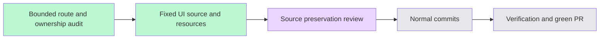

# Blueprint UI localization

Issue: #6305. FIRST owns `/tpl`, `/tpl/list`, `/tpl/designer` and dedicated tpl/tpl-designer fixed UI. SECOND owns save-as-org-template-action.tsx and its existing live-workflow-orchestration error formatter; both are excluded. MAIN explicitly assigned these confirmed B7 omissions during source-first work.

Keep blueprint names, edited content, prompts, model output, identifiers, enum values, parser/serializer behavior and API arguments original. Localize new system copy-name suffixes only before creation. Pure translation resources never import live data or generated catalogs. Runtime data only reaches explicitly owned display adapters.
