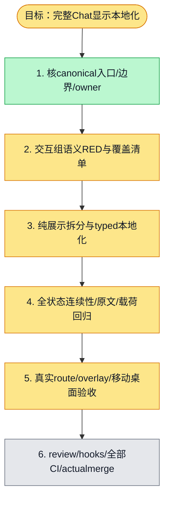

# 执行计划 — 完整Chat主界面与全部交互子界面国际化 #6200

> 规范：`.harness/instructions/execution-plan-visualization.md`。
> 改状态用 `node .harness/scripts/execution-plan.mjs set <本文件> <节点> <状态>`，
> 改完 `check` 一遍；不要手改 classDef 颜色。

## 我理解的目标
- **目标**：按design.md完成canonicalChat路由和所有真实overlay的zh-CN/en显示，保全部原文/执行与会话连续性
- **完成判据**：语义RED/GREEN、完整route+overlay验收、邻接regressions/type/lint/实际reachability扫描、真实browser/API/PG及375/1280图、review/hooks/CI/actualmerge
- **不做什么**：不改模型/工具指令、API/权限/run队列语义、不用legacy/mock替代canonical界面、不把单组件当全阶段
- **假设与待确认**：用户已持续授权；已有provider/zh-CN/en/typednamespace为既定方案；共享文件按owner协调，重任务串行

## 执行计划

图例：⬜ 灰=未开始 · 🟨 黄=已开始 · 🟩 绿=已完成 · 🟪 紫=已测试（有证据） · 🟥 红=被堵塞

## 进度日志（append-only，每次改颜色追加一行）
| 时间 | 节点 | 状态变化 | 依据（命令 / 证据 / 堵塞原因） |
|---|---|---|---|
| 2026-11-04 | G, S1 | todo → doing | 接到目标，开始理解 |
| 2026-11-04 | S4 | todo → doing | Task3 current-source provider27/27 GREEN17.24s; next8 actualRED before display implementation. Original approval/trace regressions, cumulative latest type/lint and browser acceptance still pending. |
