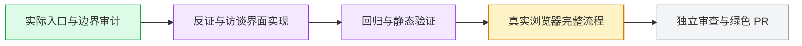

# Complete interview journey — #6206

Explicit user assignment. Original checkout, `worker/i18n-interview-journey-6206`, develop target; parent research PR #6205/source `4aa2a1e08443d9cfa1bec718a15e282126098899`. Latest main/develop fetched at start; develop c49fee15b is an ancestor. Parent integration and a pure interview PR delta are required before merge. Main alone operates the native queue. No extra worktree or agent.

## Behavior and scope

Localize fixed interface text at `/itv`, new interview, private expert create/detail/avatar, canonical intake→analysis→experts→outline→runs→report, reachable `/setup` fallback and quick/live. Include loading/errors/empty states, overlays, management, source quotation scaffold and statuses. Language changes retain edited drafts, selection, rationale, source identity and saved data without issuing extra writes. User shortcuts fill an editable draft and require explicit Send.

Keep authored/private/model content, canonical Markdown headings, model prompts/seeds, enum/ID/CAS/revision/version/hash, source/span attribution guards and cache/job/session identities unchanged. Creation defaults translate before editing; existing saved values do not. Fixed taxonomy filters localize labels while retaining explicit canonical option values. Known quality reasons translate by code; unknown diagnostics and authored goal text remain raw. Chinese server diagnostic messages remain verbatim. Evidence-mode Chinese labels have one presentation source, reused by the unchanged-default export helper.

The HTTP test-model helper is limited to recognized interview operation/system/context combinations. It preserves generic provider behavior for unknown contexts. It generates deterministic outline, simulation and grounded-report responses through real product parsing, execution and validation. It does not prove real-model quality, external ASR, native Skill execution, or downloaded report bytes.

## Verification and remaining work

Passed: 38 affected UI files,327/327 tests (including42 localization counterexamples); API and web types; changed-file ESLint; wiring with18 existing shell routes unchanged; static testid gate; deterministic fixture6/6; dictionary/export/legacy/workspace21/21 after actual dictionary RED. Source comparisons confirm reportFor/analysisMarkdown/buffersFrom/skillContext unchanged. Historical failures and command receipts remain in `evidence/i18n-interview-6206`.

Pending: normal init, commit/source freeze, exact isolated browser discovery, fresh production browser with actual login/API/Postgres and saved private profile→six steps→report citations→history,375/1280 screenshots and bounds, resource cleanup, independent exact-source review, normal push/PR Closes6206, current checks/review to green and main-controlled merge. Subsequent separate journeys remain recording, then B6 survey.

Heavy windows serialize with phase2/phase3. No browser/completion/merge claim is made before actual evidence.
