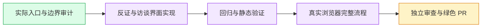

# Complete interview journey — #6206

Explicit user assignment. Original checkout, `worker/i18n-interview-journey-6206`, develop target; parent research PR #6205/source `4aa2a1e08443d9cfa1bec718a15e282126098899`. Latest main/develop fetched at start; develop c49fee15b is an ancestor. Parent integration and a pure interview PR delta are required before merge. Main alone operates the native queue. No extra worktree or agent.

## Behavior and scope

Localize fixed interface text at `/itv`, new interview, private expert create/detail/avatar, canonical intake→analysis→experts→outline→runs→report, reachable `/setup` fallback and quick/live. Include loading/errors/empty states, overlays, management, source quotation scaffold and statuses. Language changes retain edited drafts, selection, rationale, source identity and saved data without issuing extra writes. User shortcuts fill an editable draft and require explicit Send.

Keep authored/private/model content, canonical Markdown headings, model prompts/seeds, enum/ID/CAS/revision/version/hash, source/span attribution guards and cache/job/session identities unchanged. Creation defaults translate before editing; existing saved values do not. Fixed taxonomy filters localize labels while retaining explicit canonical option values. Known quality reasons translate by code; unknown diagnostics and authored goal text remain raw. Chinese server diagnostic messages remain verbatim. Evidence-mode Chinese labels have one presentation source, reused by the unchanged-default export helper.

The HTTP test-model helper is limited to recognized interview operation/system/context combinations. It preserves generic provider behavior for unknown contexts. It generates deterministic outline, simulation and grounded-report responses through real product parsing, execution and validation. It does not prove real-model quality, external ASR, native Skill execution, or downloaded report bytes.

## Verification and remaining work

Passed: 38 affected UI files,327/327 tests (including42 localization counterexamples); API and web types; changed-file ESLint; wiring with18 existing shell routes unchanged; static testid gate; deterministic fixture6/6; dictionary/export/legacy/workspace21/21 after actual dictionary RED. Source comparisons confirm reportFor/analysisMarkdown/buffersFrom/skillContext unchanged. Historical failures and command receipts remain in `evidence/i18n-interview-6206`.

Passed normal init and source freeze df1de9e87; initial full independent review and final incremental review found no static P1/P2. Two fresh browser failures are preserved: a locale-bound parent dialog selector, then an incorrect assumption that generated confirmed questions were directly editable. The latter now follows the actual revision action, retaining confirmed-source guards. Screenshot QA also exposed shared history copy and singular count gaps;13 actual RED cases preceded fixes and128 relevant tests passed across interview/research/transcription callers and catalog. Final webtype/lint/wiring/testid passed.

Pending: exact isolated discovery and a fresh production browser at df1 with actual login/API/Postgres, saved private profile→six steps→real revision→report source document references→history,375/1280 screenshots and bounds, resource cleanup, normal push/PR Closes6206, current checks/review to green and main-controlled merge. Subsequent separate journeys remain recording, then B6 survey.

Heavy windows serialize with phase2/phase3. No browser/completion/merge claim is made before actual evidence.

Current-route correction after third actual browser RED: generate-stream uses the professional published-skill protocol and stores source document/version references, not per-answer locators. Main verified and approved the test contract correction. Test-only strict professional fixture + actual service analysis/storage unit coverage43/43 and affected types/static gates pass. Fourth fresh browser and this test-only increment review remain pending. Per-answer grounding is confined to the separate canonical fixture/source-guard lanes and is not claimed for this browser.

Final runtime02bc3e0d: fourth fresh production browser1/1PASS(case9.7s,total4m4,cleanup1),22images375/1280individually viewed, own containers and11ports dynamically0. All independent static increments clean. Remaining delivery is normal push/PR/current CI+reviews and main-controlled integration. Recording then survey remain separate journeys.
