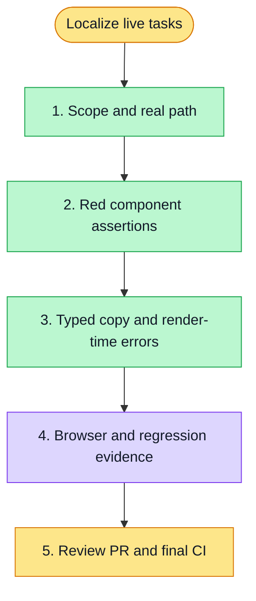

# 执行计划 — Live My Today localization — #6167

> 规范：`.harness/instructions/execution-plan-visualization.md`。
> 改状态用 `node .harness/scripts/execution-plan.mjs set <本文件> <节点> <状态>`，
> 改完 `check` 一遍；不要手改 classDef 颜色。

## 我理解的目标
- **目标**：生产 /tasks 随 zh-CN/en 显示系统文案与日期，保持用户内容、草稿及任务流转。
- **完成判据**：typed locale component regressions + existing task suites; registered seeded browser create/reload/advance/block, raw payloads and 375/1280; normal affected gates, review and final PR CI.
- **不做什么**：preview/tasks、任务路由/API/权限/锚点选择/审计原因与执行值不变。
- **假设与待确认**：沿用已确认国际化方案；仅表示层迁移。describeFailure 增可选 locale，保留 default zh-CN 和原闭集优先顺序。

## 执行计划

图例：⬜ 灰=未开始 · 🟨 黄=已开始 · 🟩 绿=已完成 · 🟪 紫=已测试（有证据） · 🟥 红=被堵塞

## 进度日志（append-only，每次改颜色追加一行）
| 时间 | 节点 | 状态变化 | 依据（命令 / 证据 / 堵塞原因） |
|---|---|---|---|
| 2026-11-03 | G, S1 | todo → doing | 接到目标，开始理解 |
