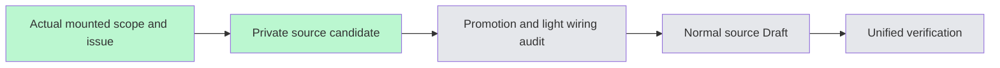

# Project brain and evidence source flow — #6296

User-authorized source-first batch. This coherent page flow covers general-project Brain and workshop research's shared project-memory/evidence panels. Candidate base hashes are frozen before editing; promotion checks the actual accepted source hashes in the same worktree and adds only its own namespace registry entries.

Owned UI includes memory groups, conflicts/gaps/chains, source citation links, source type labels/locators, disabled-source badges, evidence filters/pagination, adoption rationale and organization-promotion result copy. Accepted graph-kind/tri-state and source-drawer implementations are reused; contract Chinese evidence labels remain single source with a typed English display projection. One display-only membership guard leaves unknown tri-state labels raw before calling the accepted typed formatter; it does not change tone or permission/state predicates. The legacy fixed “five types” heading becomes count-neutral copy, avoiding a second enum count without changing data or filters.

Raw claims/excerpts/suggestions/rationale/names/IDs/versions and request choices remain unchanged. All status/permission predicates and state discriminator values stay fixed. Local error-display fields retain raw causes or a stable owned-message key; they are formatted only at render. Locale does not enter request callbacks/dependencies, rewrite a draft, retry, persist, refetch or change prefetch scope/order. Missing-result handling and unknown Error.message preserve their existing semantics. Adoption trim/max-length/CAS/permission behavior and promotion choices remain unchanged. No new business state, API, model prompt or request.

Evidence locator adds optional locale defaulting to Chinese for page copy only; ordinal and msToClock math stay unchanged. Shared-from-personal display preserves the contract's trim/anonymous behavior through the existing accepted dictionary. Source-kind and AI-permission mappings stay in contracts. Scope helpers/classifiers/reasoning sorts remain byte-exact.

Private candidate syntax/key/structural audit is not a type/unit/browser PASS or independent review. Registry wiring/promotion receives its own light audit, then normal mandatory hooks. Focused tests/source review/native/viewport acceptance are deferred to unified closure. First publication failure is recorded without bypass or repeated check-repair loops. Source Draft is not READY or stage completion.
