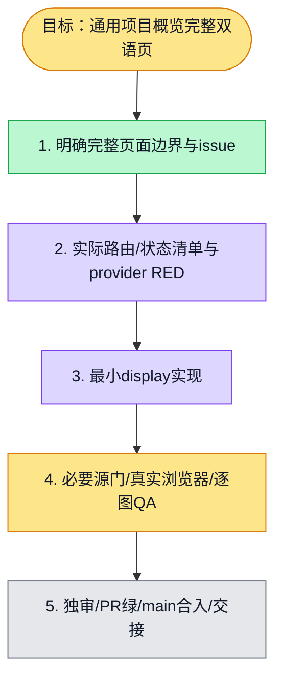

# 执行计划 — General project overview i18n — #6258

## 我理解的目标
通用项目概览完整正文及已有状态按current locale显示；保真实请求、权限、raw名字、数量、日期事实与链接。Chat冻结head不改，同WT新branch从accepteddevelop独立开发。

## 执行计划

## 进度日志
| 时间 | 节点 | 状态变化 | 依据 |
|---|---|---|---|
| 2026-11-05 | S1/S2 | done/doing | main认可page scope、issue6258、actual route读取；无测试/产品实现 |
