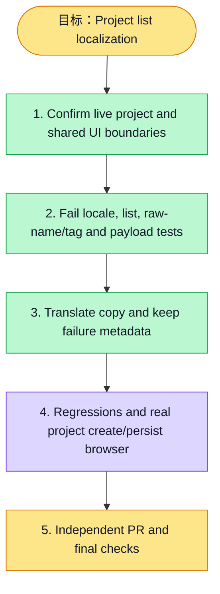

# 执行计划 — Project list localization / #6160

> 规范：`.harness/instructions/execution-plan-visualization.md`。
> 改状态用 `node .harness/scripts/execution-plan.mjs set <本文件> <节点> <状态>`，
> 改完 `check` 一遍；不要手改 classDef 颜色。

## 我理解的目标
- **目标**：Localize project list and create dialog while preserving original names, tags, payloads and role boundaries
- **完成判据**：Project/list/create/tag regressions, typed resources, real API/DB browser and role denial, affected static gates
- **不做什么**：No auth policy, API, schema, token consumption, cooldown or routing changes
- **假设与待确认**：Explicit parallel #6160, existing global zh-CN/en provider; new branch includes latest develop/main ancestry

## 执行计划

图例：⬜ 灰=未开始 · 🟨 黄=已开始 · 🟩 绿=已完成 · 🟪 紫=已测试（有证据） · 🟥 红=被堵塞

## 进度日志（append-only）
| 时间 | 节点 | 状态变化 | 依据 |
|---|---|---|---|
| 2026-11-03 | S1 | todo → done | Fresh main/develop; actual contract and membership source, shared primitive scope |
| 2026-11-03 | S2 | todo → doing | Define direct API-boundary locale and original-value acceptance |
