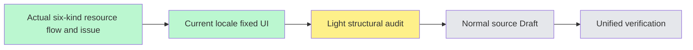

# Project resource create/link/remove flow — #6293

User-authorized SOURCE-FIRST batch, accepted BASE84cf50deb63e003cbed97acbe4314d727b59991b. Fetched origin main/develop before branching in the existing worktree. Actual ProjectResourceSection serves workshop research subpages and general-project content filters for surveys, interviews, deep research, transcriptions, whiteboards and designs. No unmerged peer source copied.

Scope covers type descriptions, new/attach/remove controls, candidate selection, loading/empty/errors and owned timestamp labels/ARIA. Accepted contract Chinese kind metadata remains the single source; a pure helper projects English and retains default Chinese. Raw titles, opaque Studio status strings, candidate IDs, persisted unnamed creation defaults, routes/query strings and request payloads remain unchanged. Dates retain timestamp/host timezone/invalid-raw fallback.

All metadata factory/detail/candidate functions, pagination, permission gates, Studio navigation, callback sequencing, selected IDs and request/effect dependencies are preserved. Error carriers retain raw causes and format only at render. Existing reason/status predicates and unknown Error.message remain. describeProjectResourceFailure adds only optional locale defaulting to Chinese for existing consumers. No API, encoding, permission, model prompt or state-machine repair.

The general content combined-list shell is included in this coherent create/link flow: filters, menus, counters, empty states and relative-time metadata use current locale. Public CONTENT_FILTERS/default Chinese labels, selection keys/order, index sorting/count calculations and public error:string|null return shape remain unchanged. The index stores the raw failure internally and projects only its returned message at render, with no locale request dependency. Existing formatRelativeTime receives optional third locale while now/threshold math stay in its accepted single source. Shared content-card and project-conversations implementations stay unchanged; the latter already has source completed in #6291 without copying its unmerged source. Independent source review and focused unit/type/native/viewport acceptance are deferred to unified closure. Normal mandatory hooks stay enforced; first failure is recorded without bypass or repeated check-repair cycles. Source Draft is not READY/stage completion.
