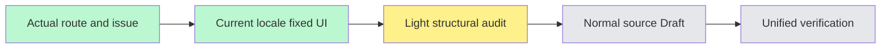

# Project results and audit source — #6285

The actual shared results tab is mounted for both workshops and general projects. Accepted BASE84cf50deb63e003cbed97acbe4314d727b59991b; fetched origin main/develop before branching in the existing worktree. Source-first pass authorized by the user through main; no independent branch code copied.

Scope covers backflow output metadata, immutable project audit events and honest future/unavailable sections. Titles, version numbers, actor/target identifiers, unknown event types/reasons, counts/cursor-plus marker, role gates and test/React keys are preserved. No requests, API functions, permission rules, state machine or actions change. Dates use current locale with the same timestamp and host timezone.

Accepted Chinese BACKFLOW_BADGE_LABEL remains its existing single source; English has a typed display-only mapping in the new namespace. This independent branch does not copy #6277's unmerged namespace or alter its default-label integration. Known unauthorized-attempt display becomes a message key; unknown audit types remain raw.

Light syntax/key/structural audit only. Focused tests, independent source review, type acceptance and native/viewport QA are deferred to the unified closing pass. Normal mandatory hooks remain enabled; first publication failure is recorded without bypass or check-repair loops. Source Draft is not READY or stage completion.
