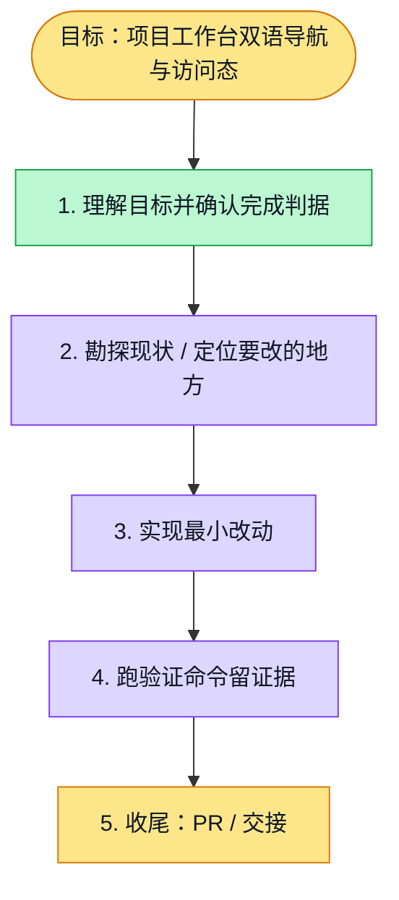

# 执行计划 — Project workbench navigation and access — #6178

> 规范：`.harness/instructions/execution-plan-visualization.md`。
> 改状态用 `node .harness/scripts/execution-plan.mjs set <本文件> <节点> <状态>`，
> 改完 `check` 一遍；不要手改 classDef 颜色。

## 我理解的目标
- **目标**：Localize the project shell without changing kind-specific navigation, access or requests.
- **完成判据**：Provider continuity/access tests, existing kind/permission regressions, real seeded navigation/access, review, normal push, CI.
- **不做什么**：Tab body modules, project operations and server permissions remain separate.
- **假设与待确认**：Existing approved display-only zh-CN/en approach; actual refreshed main/develop, independent dec5223e5.

## 执行计划

图例：⬜ 灰=未开始 · 🟨 黄=已开始 · 🟩 绿=已完成 · 🟪 紫=已测试（有证据） · 🟥 红=被堵塞

## 进度日志（append-only，每次改颜色追加一行）
| 时间 | 节点 | 状态变化 | 依据（命令 / 证据 / 堵塞原因） |
|---|---|---|---|
| 2026-11-03 | G, S1 | todo → doing | 接到目标，开始理解 |

## 2026-11-04 resumed execution

User resumed remaining i18n; main assigned this saved issue first, then complete B2/B3 flows. Merge actualdevelop44aeac6e10b688471fe03536fc8490a353824976, preserving9owned source/helper/spec/test blobs frombccc15f8a. Both aggregators reconstructed from currentbase plus own namespace afterworkflowRuns. Final responsive-source browser remains required; initial3/3 is historical and the cancelled geometry round is not a pass.

2026-11-04: main-authorized normal sync of actual merged developdc9, product-source79d1, protected10nonsharedblobs unchanged; global roots retain both namespaces. New-base34focusedGREEN4.67s+canonicalreachability70/12actual0. Root incremental review clean; normalhooks/newheadCI/candidate/actualmerge still pending. See develop-dc9-sync.md; old9096 cancelled aggregate job is not counted as pass, no blind third retry.
