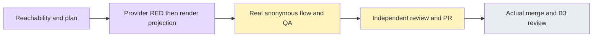

# Public design share #6260

Base: actual accepted develop a00287a86c411c13148294cc2ed4379852949c5d. Branch `worker/i18n-public-design-share-6260`, same existing worktree. Fresh main/develop fetch completed before development. #6258 published branch remains edec1f1 unchanged.

Ruling: existing design-share.spec.ts fulfills public routes and mocks the publishing workbench. It is useful regression evidence, not actual API/PG publication evidence; Task2 must use canonical seeded real API setup. Cost if ignored: a false real-flow acceptance claim.

Ruling: locale only crosses the canvas via a dedicated optional chrome context, never HtmlPageCtx which is serialized into srcdoc. Public default drawing=false/onRegenerate=null stay unchanged; editor controls are excluded. Cost if wrong: reloading or rewriting user HTML on a language change.

Task1 brief read at BASE a00287a86c411c13148294cc2ed4379852949c5d. Nine provider cases and a private one-shot runner/manifest are prepared, UNRUN; product implementation is unchanged. External pricing6259 and FIRST6263 have actually ended; ROOT6257 normal publication is now the sole granted batch, then SECOND6260 initial RED. SECOND holds all local gates and commits until fresh handoff.

#6258 Draft6262 existing harness-verify run41961108236 attempt1 at edec1f1, fullstack-smoke127027595394 job completed SUCCESS at 2026-11-05T03:47:29Z. Actual report/PNG artifact download is in progress; no native4 or visual verdict has yet been claimed. That run's first real failure takes priority. No new dispatch or local Next is requested.

Initial provider attempt: 9 genuine missing-English RED, native3.56s/wrapper4.893s. All process exit and exact own cleanup0 confirmed before dual release. Display keys, raw-independent failure classification, optional default-ZH canvas chrome context and optional third humanTime locale are now implemented but UNVERIFIED. Added boundary regression tests; no GREEN/type/lint claim. Main corrected next FIFO to external pricing6259 publication, then FIRST6263 GREEN batch, then our prepared batch when freshly granted.

Interruption evidence boundary: subsequent actual filesystem checks found the old initial-RED and prepared-GREEN private directories absent. The initial 9-RED result above remains a historical tool observation; its raw file cannot currently be read back. No receipt/hash is reconstructed. The executed initial attempt must never be replayed, even though its sentinel path is now absent. The GREEN batch never began; a future explicitly granted batch needs a new unique attempt directory and current eight-file hash freeze. Current product/test candidate remains unverified.

#6258 author runtime observations subsequently completed: main report 221 passed, four new cases each passed on actual retry0, and all20 scope PNGs were individually viewed without a new scope-owned finding. The original private artifact directory subsequently became unavailable, so final independent binding is still not claimed. Main is taking over that binding; allowlisted history and the existing artifact13385689940 locator are recorded in PR6262 comment6650179286. No rerun or head refresh is requested.

Current resource status: no local batch has begun, no services/init/commit are active. FIRST supplied actual-END confirmation; main has priority for pricing6259 and the necessary6257 cloud-failure repair. Continue HOLD until actual completion and fresh explicit peer handoff.

Task1 necessary GREEN attempt2 ACTUAL session94311 exit0: nine related suites73/73PASS(native17.67s/wrapper18.908s), eight changed-fileESLint0/3.167s/no diagnostics, canonicalwebtype0/56.066s/no diagnostics. Current eight-source SHA freeze is bound in evidence/task1-source-gates-receipt.json; original log hashes are recorded while logs remain private. No skip or browser result is claimed. Processes naturally exited; exact prior own scope Docker containers0/volumes0, no new services/advertisedports, pgrep empty, dual/root release completed before reading native log totals. Source checkpoint and real API anonymous flow remain pending.

Task1 actual normal checkpoint be794898378e9dc18f8f757a1963bf8dbfd1c207 committed exactly12 paths with unchanged8tested sourceSHA. Actual exit0 and no services; immediately handed FIRST its authorized6263 tail batch. Task1 ledger closure checks the actual73PASS/lint0/type0 receipt and frozen hashes without replaying tests; Task2 started once at BASEbe79489.

Task2 new source-only driver candidate is UNRUN. Existing seeded config adds only i18n-public-design-share.spec.ts, two inherited-budget cases for1280/375. Actual owner login/create→canonical addScreen/setLinks prototype patch→full publish; separate anonymous context checks EN/ZH rawtitle/problem/content, navigation/back-stack and sameDOM, HTMLsrcdoc bytes/currentARIA, no locale-triggeredGET, xbounds, frozen snapshot after owner rename, actual revoke404/no retry. Ten per-attempt screenshots planned. This uses authored test trees through existing public contracts, not model-generation evidence, and does not mock routes/responses. Temporary failure stays provider coverage; no new transient-browser claim. Driver/config type/lint/resources/wiring/selection and real runtime/PNGQA remain UNRUN.

Task2 necessary source batch session79200 ACTUAL exit0: two-driver/configESLint2.016s, canonicalwebtype9.545s, testid3.991s, wiring4.346s, specgate48.879s, canonicalisolatedlist2.621s. After actualEND/root+dualrelease, actualJSON confirms exactly2titles/onefile/seeded/30000ms/zeroerrors; discovery is not execution. Scope containers0/volumes0/all13advertisedlisteners0 and processes naturally exited. Ten sourceSHA freeze binds task2-driver-source-receipt.json. Existing73Task1 results remain separate. Real native2/tenPNGQA and final independent whole review/publication are still pending. No product source changed after Task1 checkpoint.

The one whole-source review found two actionable driver P2s before publication: the new setup used html-page instead of canonical html, and a manually created anonymous browser context omitted the seeded baseURL needed by relative navigation. Both were verified against current contracts and existing context callers. Minimal driver-only correction now uses canonical html and passes the fixture baseURL to the separate anonymous context; no auth storage is copied and no product/parser/budget changes. Corrected lint/type/discovery are pending; previous source-gate receipt binds the pre-fix source only. Native2/PNG remain UNRUN. Reviewer report original is private0700/0600; its requested sdd/.archive location is actually unignored, so it is excluded from staging.

Review-fix covering attempt2 session92558 ACTUAL all0: driverESLint2.339s, canonicaltype8.778s, isolatedlist2.954s. Actualreport retains the same two seeded30000ms cases/zeroerrors. Exact own containers0/volumes0/all13listeners0 and pgrepempty; immediate root+dualrelease before parsing. Only driver changed; earlier production8source/related73 and unchanged config guards remain bound to their actual snapshots. Final source review delta and native browser verdict are separate requirements.

The existing reviewer completed the single whole review and only the necessary corrected-driver delta. Both driverP2 are statically addressed, no new executableP1/P2; other9sourceSHA match. Safe source-review-summary.md records report hashes/limits, while original source reports remain private with0700/0600 and explicitly unignored/excluded from staging. Actual native2/tenPNGQA remain pending standardCI. Proceeding with normal precise Draft publication under main authorization, without a local Next build or extra dispatch.

First actual PR runtime41981418944 attempt1 at published52c272, fullstackjob127092305109 failed. Native report85expected/1unexpected/133skipped/0flaky; global1 is explicitly maxfail1 earlystop. Only unexpected is new1280: both actualattempts failed2614/2821ms at setup patch.parse, beforepublish, because HTML fixture was not canonical-sanitized. New375 has no results and is unexecuted. Two failurePNG were actually viewed and show only ownerhome before setup, not public-share QA. Single artifact13394900914 download actualexit0; full report/log/trace/context/PNG stay private0700/0600. Safe first-failure receipt records the exact boundary.

Minimal driver-only repair reuses existing designHtmlPage.sanitizeHtmlPage(...).html and moves the same SHARE_PATCH.parse to module load so exact discovery validates the actual refinement. No product/parser/API/budget/assertion change. Newattempt3 session83514 actuallint0/2.433/type0/9.350/list0/2.929; actualexact2seeded30000/zeroerrors. Owncontainers0/volumes0/all13listeners0 and pgrepempty; actualEND immediately handed FIRST its accepted-ancestry batch before analysis. Native repaired2/tenPNGQA remain UNRUN. Existing reviewer is checking only this necessary delta, not a repeatedwhole review.

Existing reviewer necessary sanitizer delta is STATIC CLEAN/no new executableP1/P2; corrected driver and other9SHA independently match, same parsearray and all assertions/auth/cleanup suffix remain byte-exact. Source-review-summary.md binds its private report hash and limits. FIRST accepted-ancestry publication has now ACTUALended; normal precise5path fix publication follows under main authorization, then freezes the new head for existing standardCI.
