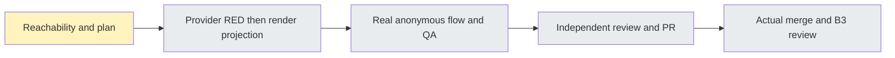

# Public design share #6260

Base: actual accepted develop a00287a86c411c13148294cc2ed4379852949c5d. Branch `worker/i18n-public-design-share-6260`, same existing worktree. Fresh main/develop fetch completed before development. #6258 published branch remains edec1f1 unchanged.

Ruling: existing design-share.spec.ts fulfills public routes and mocks the publishing workbench. It is useful regression evidence, not actual API/PG publication evidence; Task2 must use canonical seeded real API setup. Cost if ignored: a false real-flow acceptance claim.

Ruling: locale only crosses the canvas via a dedicated optional chrome context, never HtmlPageCtx which is serialized into srcdoc. Public default drawing=false/onRegenerate=null stay unchanged; editor controls are excluded. Cost if wrong: reloading or rewriting user HTML on a language change.

Task1 brief read at BASE a00287a86c411c13148294cc2ed4379852949c5d. Nine provider cases and a private one-shot runner/manifest are prepared, UNRUN; product implementation is unchanged. External pricing6259 and FIRST6263 have actually ended; ROOT6257 normal publication is now the sole granted batch, then SECOND6260 initial RED. SECOND holds all local gates and commits until fresh handoff.

#6258 Draft6262 existing harness-verify run41961108236 attempt1 at edec1f1, fullstack-smoke127027595394 job completed SUCCESS at 2026-11-05T03:47:29Z. Actual report/PNG artifact download is in progress; no native4 or visual verdict has yet been claimed. That run's first real failure takes priority. No new dispatch or local Next is requested.

Initial provider attempt: 9 genuine missing-English RED, native3.56s/wrapper4.893s. All process exit and exact own cleanup0 confirmed before dual release. Display keys, raw-independent failure classification, optional default-ZH canvas chrome context and optional third humanTime locale are now implemented but UNVERIFIED. Added boundary regression tests; no GREEN/type/lint claim. Main corrected next FIFO to external pricing6259 publication, then FIRST6263 GREEN batch, then our prepared batch when freshly granted.

Interruption evidence boundary: subsequent actual filesystem checks found the old initial-RED and prepared-GREEN private directories absent. The initial 9-RED result above remains a historical tool observation; its raw file cannot currently be read back. No receipt/hash is reconstructed. The executed initial attempt must never be replayed, even though its sentinel path is now absent. The GREEN batch never began; a future explicitly granted batch needs a new unique attempt directory and current eight-file hash freeze. Current product/test candidate remains unverified.

#6258 author runtime observations subsequently completed: main report 221 passed, four new cases each passed on actual retry0, and all20 scope PNGs were individually viewed without a new scope-owned finding. The original private artifact directory subsequently became unavailable, so final independent binding is still not claimed. Main is taking over that binding; allowlisted history and the existing artifact13385689940 locator are recorded in PR6262 comment6650179286. No rerun or head refresh is requested.

Current resource status: no local batch has begun, no services/init/commit are active. FIRST supplied actual-END confirmation; main has priority for pricing6259 and the necessary6257 cloud-failure repair. Continue HOLD until actual completion and fresh explicit peer handoff.

Task1 necessary GREEN attempt2 ACTUAL session94311 exit0: nine related suites73/73PASS(native17.67s/wrapper18.908s), eight changed-fileESLint0/3.167s/no diagnostics, canonicalwebtype0/56.066s/no diagnostics. Current eight-source SHA freeze is bound in evidence/task1-source-gates-receipt.json; original log hashes are recorded while logs remain private. No skip or browser result is claimed. Processes naturally exited; exact prior own scope Docker containers0/volumes0, no new services/advertisedports, pgrep empty, dual/root release completed before reading native log totals. Source checkpoint and real API anonymous flow remain pending.
