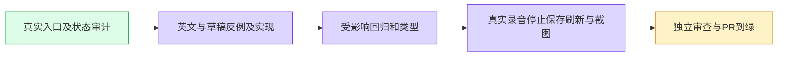

当前状态（2026-11-04）：冻结视觉源码f8dfac711已通过33针对用例、完整webtype、数据旧值等值及全部剩余静态门。第三轮原2case browser实际0/237.830s，48张375/1280截图逐张QA通过；此前真实移动端问题已修复，录音回执和动态scope清理0已保存安全证据。源码与增量独立静态审查CLEAN；安全证据终审、正常push、Draft stack PR及CI/实际develop交付待完成。研究父PR6205候选实际失败，仍Draft，不把feature-base合并计交付。以下旧状态保留为历史记录。

理解与边界：按用户 B5 交办，完整覆盖个人录音/转录历史、新建、实时采音/停止收尾、逐字稿改名编辑保存刷新、设备/错误/权限及项目模式各子界面。保留原音频、ASR/逐字稿/私有与模型内容、协议枚举、状态机、停止与重连 Promise、缓存/会话身份和编辑草稿。项目示意 UI 与真实 ASR 验收分开。

原checkout复用，无新worktree；开工已fetch main/develop，当前develop c49fee15b为父源码祖先；沿访谈#6213（ec3d35d3）stack，不覆盖未合源码。此队列外工作来自用户明确指派，main已确认继续。

重验证与其他两期串行，先 RED 再修改。录音协议只读审计；仅翻译呈现层，所有错误码和机器字段保持原值。

2026-11-04 当前证据：首轮四文件24例实际通过（7.75s），十个项目源文件 scoped lint 0；类型首跑有重复词典键与测试handler推断三条诊断，修复待重跑。新增七条默认名/状态/撤回反例已实际有效RED（7.83s）后实现，待GREEN；另四条明细文案反例待RED，未应用其实现。真实browser两例已编写并接入seeded，未运行。

共享环境事故：Docker Desktop unable to start，根卷仅185Mi。按主协调明确指令，确认原checkout无活Next/test后，仅清理两份ignored可再生Next缓存；源码、test-results、截图与证据保留，可用4.0Gi。没有启动本任务容器，无新scope；暂停unit/type/lint/container/browser重门，等待主协调恢复后重新分配窗口。不能据此记验证完成。

最终ui-wiring门实际RED：全局词典依赖mock模块。已light提取无mock依赖的固定显示copy，mock与词典同源引用；原数据exports、同意书函数probe、zh/en词典值已编辑前保存baseline，待机械等值比较与门重跑。没有扩大豁免。此前成功门均属于提取前源码，不代表新提取已验证。

提取后结果：15files206/206 PASS（32.45s）、可复现数据等值脚本0、webtype0（42.74s）、ui-wiring/withdrawal/scopelint0。用户优先6147实际合并；当前只保存本地源码提交，浏览器/推送未运行，功能仍未完成。
