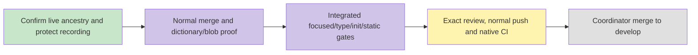

# Actual stack integration — #6198 / #6206

Preserve the actual merged research/interview feature stack and normally merge latest develop before subsequent recording work. PR #6213 is merged into the research branch only. PR #6205 now carries the integrated research and interview journeys; delivery to develop remains pending.

Frozen source 902da4b5a9d4faaac425b41d4d58c6cdca169939, parents baf5eb97bcf776f507c1deeced9ff1f93dc9fdf9 and dc9bc31b5658aacd4376ffa3f66e6794293ac953. No text conflict occurred. Proofs are in evidence/i18n-research-6198/stack-integration. Prior browser source boundaries are preserved by the 326 worker blob/mode checks; the two registries additionally contain eleven activity keys. Current integration tests are still required. No extra worktree or service was created.

Recording branch HEAD74023575940ff3b654fe2a7ffbdfd0edaaae8c36 is separate. Caption follow-up stash98653ef0837ce6f2977ba41b39a800703d7ab5d2 has a verified 17-file hash/mode manifest in /tmp/6214-caption-wip-files.json; restore by exact stash SHA only after this integration is safely carried forward. Caption full typecheck and recording browser remain unverified.

Current integration checks completed at evidence-only8e865/runtime902da: web/API types exit0,54files538UI/resource cases and3files43API cases pass,104fileweb ESLint/init/testid/wiring/Vitest registration/fullspec exit0. Independent bounded integration review found no new actionableP1/P2. Final evidence-only commit, normal push, native CI and develop merge remain pending; no new browser is claimed.
