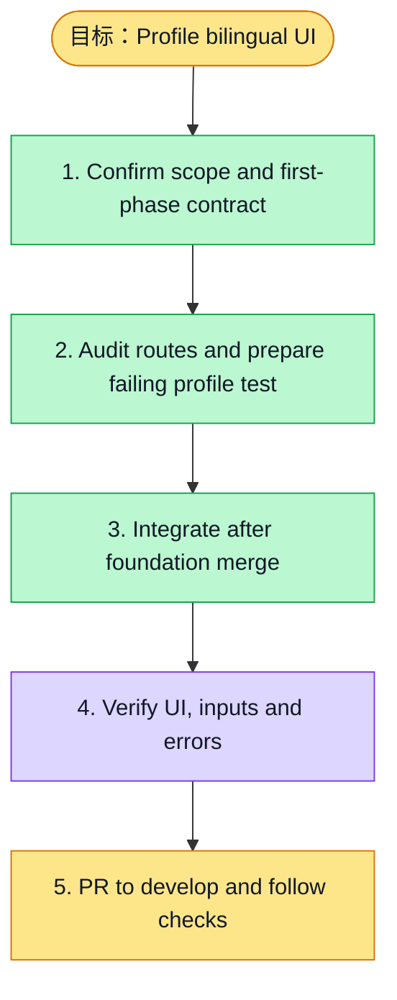

# 执行计划 — Profile i18n / #6133

> 规范：`.harness/instructions/execution-plan-visualization.md`。
> 改状态用 `node .harness/scripts/execution-plan.mjs set <本文件> <节点> <状态>`，
> 改完 `check` 一遍；不要手改 classDef 颜色。

## 我理解的目标
- **目标**：让个人资料页随全局语言显示中文或英文，原始资料内容保持不变
- **完成判据**：pnpm --filter web exec vitest run tests/ui/profile-i18n.test.tsx tests/ui/profile-mobile-actions.test.tsx；web typecheck/lint及浏览器资料表单旅程
- **不做什么**：不更改账号权限/API请求协议，不替换用户名字/密码/活动原文，不改一期provider
- **假设与待确认**：基础API由一期提供，zh-CN/en；一期合入后才接续产品组件

## 执行计划

图例：⬜ 灰=未开始 · 🟨 黄=已开始 · 🟩 绿=已完成 · 🟪 紫=已测试（有证据） · 🟥 红=被堵塞

## 进度日志（append-only，每次改颜色追加一行）
| 时间 | 节点 | 状态变化 | 依据（命令 / 证据 / 堵塞原因） |
|---|---|---|---|
| 2026-11-03 | G, S1 | todo → doing | 接到目标，开始理解 |
