# Survey journey localization implementation plan

## Latest continuation — source49b537ec

Current runtime and screenshot findings are recorded once in the [acceptance ledger](../../../evidence/i18n-survey-6221/task-7/README.md#latest-actual-runtime-and-screenshot-findings--41923663240). The latest native run passed all3 original cases first try, but actual46-image QA found two minimal copy/layout issues. Their authorized four-file correction has valid RED/GREEN and scoped lint; exact four-file review is STATIC CLEAN; normal push and fresh author/governance image acceptance remain. PR6251 stays Draft; no delivery or passing claim. No third local Next build;6239 stays deferred. Historical checkpoints below remain source-pinned.

> **For agentic workers:** Use superpowers:executing-plans natively in this session. Preserve the original three-chat assignment; reuse the authorized reviewer at final review, do not create additional agents/worktrees.

**Goal:** complete B6 fixed UI localization without modifying authored content, wire formats or runtime continuity.
**Architecture:** shared zh-CN/en provider, typed resource namespaces and pure display descriptors; locale-independent request and persistence lifecycles.
**Tech Stack:** existing React/Next/TypeScript, Vitest/Testing Library, Playwright canonical isolation, real API/PostgreSQL.
**Spec:** docs/design/i18n-survey-journey/design.md and GitHub issue6221, parent matrix6133.

## Global Constraints

- Original checkout only; Task1 initial baseline recording746+developd5 was40a438262. Current protected parent sync is a864d04fc (recordingf998 includes accepteddevelopec169); baseline receipts pin the exact trees. Recording6220 delivery is tracked separately in GitHub.
- No API/contracts/schema/permission/currency/sample-math changes. All authored/model/template/question/answer/raw legal/file content and canonical serialization stay literal.
- Locale never changes autosave/CAS/collection batch/public token/submissionId/upload session/timer/lock identity, or causes a load/write/retry.
- New defaults only on explicit creation; edited, existing and copied content survives language changes.
- Unknown errors remain raw. Semantic notices render with current locale; namespace imports must not reach a live client/mock.
- Heavy commands require fresh serialized ownership and actual exit/ownscope cleanup before release. Preserve original timeouts/retries.
- Raw artifacts private0700/0600; public evidence allowlisted. Actual sourceCI and develop delivery are required, never inferred from local PASS.

## Review Focus

1. Mixed-language/braced authored titles, options and validation row labels: raw preservation and original focus target.
2. Language change while request/upload/autosave is pending: same promises/locks/IDs, exactly the intended write.
3. Re-publish/closed token/anonymity lock: immutable source and batch identity unchanged.
4. Unknown/prototype-looking diagnostic strings and late responses: no accidental key lookup, stale copy or wrong resource write.
5. Narrow dialogs/nested menus/public pagination: real labels and actions readable with focus and state retained.

```mermaid
flowchart LR
 A[Audit and baseline] --> B[Library creation import] --> C[Question design] --> D[Workspace publish] --> E[Anonymous form] --> F[Responses reports templates] --> G[Whole proof PR CI merge]
 classDef todo fill:#e5e7eb,stroke:#6b7280,color:#111827
 classDef doing fill:#fde68a,stroke:#d97706,color:#111827
 classDef done fill:#bbf7d0,stroke:#16a34a,color:#111827
 classDef tested fill:#ddd6fe,stroke:#7c3aed,color:#111827
 classDef blocked fill:#fecaca,stroke:#dc2626,color:#111827
 class A done
 class B tested
 %% evidence B: evidence/i18n-survey-6221/task-1/green.json
 class C tested
 %% evidence C: evidence/i18n-survey-6221/task-2/green-final.json
 class D tested
 %% evidence D: evidence/i18n-survey-6221/task-3/green-affected.json
 class E tested
 %% evidence E: evidence/i18n-survey-6221/task-4/green-affected.json
 class F tested
 %% evidence F: evidence/i18n-survey-6221/task-5/green-affected.json and task-6/green-affected-final.json
 class G doing
```

### Task 1: Live library, creation and input

**Files:** components/survey/live/{survey-library,create-survey-dialog,survey-import-workspace,ai-proposal}.tsx; components/survey/library/survey-library-nav.tsx; lib/i18n/namespaces/survey-library.ts; both resource registries. Test: tests/ui/survey-library-i18n.test.tsx and survey-import-i18n.test.tsx (all paths below apps/web/).
**Interfaces:** consume useI18n/current raw API data and neutral InterviewVoiceInput. Produce registered survey.* library/create/import keys; preserve existing component props and create/navigation payloads. Any shared pure message descriptor has `{key: MessageKey, params?: MessageParams} | {raw: string}` shape and renders via current t.

- [x] Write RED tests for English/Chinese accessible library/search/status/menu/create/mode/template/input/error controls, literal raw `{count}` titles/tags; same row/input DOM, search/tag/mode/template/pending draft after switch; no extra GET/POST/project link; literal encoded route and exact persisted raw title/tags. Creation report default uses locale only on explicit create.
- [x] Run `pnpm --filter web exec vitest run tests/ui/survey-library-i18n.test.tsx tests/ui/survey-import-i18n.test.tsx`; Expected: missing-English assertions fail, no collection errors.
- [x] Implement render-only resources/labels/messages with original IDs/handlers/effect deps; input text, selected recording/file and proposal contents remain raw.
- [x] Run new tests plus survey-live-library, survey-import-page, survey-ai-proposal, survey-inline-voice and i18n-resources suites; Expected: all PASS, original Chinese behavior retained.
- [x] Commit exact scope and record actual command/source/results in ledger; task-done runs the same affected suite.

### Task 2: Question editing, all question types and trial fill

**Files:** components/survey/live/{question-editor,question-settings,question-renderer,question-material,inline-question-text,markdown-survey-editor,responsive-designer-panel}.tsx; namespace survey-design.ts with pure metadata/diagnostic projections and creation-only question-display helper. Tests: survey-designer-i18n.test.tsx and survey-question-controls-i18n.test.tsx.
**Interfaces:** existing canonical question/option/row/field IDs and config APIs unchanged; consumes Task1 resource registration only. Produces fixed type/config/preview/validation chrome, raw question/answer state.

- [x] Write RED tables for actual supported question types and advanced/logic/attachment controls, inline edit, Markdown view, trial fill. Assert literal question/options/row labels with braces, unchanged canonical enum/IDs and onChange body, same field DOM/selection across locales; trial fill never saves/submits.
- [x] Run new suite; Expected: valid missing-English failures. Then implement only fixed rendered copy and creation-only labels; existing drafts and canonical source headings remain raw.
- [x] Run new suite plus survey-question-types, survey-inline-question-text, survey-markdown-editor and survey-responsive-designer; Expected: all PASS.
- [x] Commit scope and task-done actual affected suite.

### Task 3: Workspace, publishing and recovery

**Files:** components/survey/live/{survey-workspace,collection-settings,collection-schedule,collection-overview,share-code,workflow-timeline,survey-draft-copy}.tsx; lib/survey/use-unsaved-navigation.ts; pure survey display-copy/message helpers; namespace survey-workspace.ts. Keep runtime-client Error.message/class semantics if copy source is shared. Test: survey-workspace-i18n.test.tsx and survey-unsaved-navigation.test.tsx.
**Interfaces:** consumes existing question props/Task2 rendered labels. Shared semantic error/notice descriptors render without locale-dependent requests. No locale in autosave identity/accept/load/collection effect dependencies.

- [x] Write RED for fixed workflow/publish/blocker/loading/empty/error/recovery copy and current-language async notices; same draft/step/template/schedule/selection and no re-fetch/write on locale. Assert immutable publication/source version/batch/anonymity values and old token routing unchanged.
- [x] Add unsaved navigation RED: change locale with pending approval/expiry; original listeners and approval survive, next confirmation uses new fixed copy; explicit custom message remains raw.
- [x] Run new tests; Expected: meaningful missing English/continuity failures. Implement semantic rendered keys, locale-only date display and latest-message ref preserving lifecycle. Do not translate exported/canonical Markdown.
- [x] Run new suites plus survey-live-workspace, survey-live-publishing, survey-collection-settings, survey-share-code, survey-draft-copy, survey-unsaved-navigation and runtime-client; Expected: all PASS.
- [x] Commit and task-done affected suite.

### Task 4: Anonymous form, validation and uploads

**Files:** components/survey/live/public-survey-form.tsx and shared question/material display helpers; pure known validation display mapper; namespace survey-public.ts. Test: survey-public-i18n.test.tsx.
**Interfaces:** reuse shared LanguageSwitcher. Preserve token-only load effect, submissionId, uploadSession Promise/token, started/locked refs and original validation/focus calculation. Mapper translates fixed templates only after original errors are calculated; authored label interpolation stays raw.

- [x] Write RED for anonymous switcher/loading/pagination/required/format/error/retry/success UI. Fill raw mixed-language answers, switch mid-upload/pending-submit and assert stable DOM/answers, one upload-session/submit payload and same submissionId; custom success Markdown literal. Assert invalid matrix row focuses original raw target.
- [x] Run new suite; Expected: valid missing-English failures. Implement render-only copy and header switcher, preserving all existing lifecycle deps/locks/raw labels.
- [x] Run new suite plus survey-public-form, survey-question-types and response download regressions; Expected: all PASS. Include alreadySubmitted/closed/retryable responses without duplicate submit.
- [x] Commit and task-done affected suite.

### Task 5: Responses and report presentation

**Files:** components/survey/live/response-list.tsx; components/survey/report/{report-document,report-chart,template-editor}.tsx and report-format.ts; only reachable workflow response/analysis views; namespace survey-results.ts. Test: survey-results-i18n.test.tsx.
**Interfaces:** preserve filter enum all/normal/review/excluded and raw exclusion reasons. Optional locale argument for rendered number formatting retains default zh for canonical serializers; report/response Markdown exports unchanged.

- [x] Write RED for fixed table/filter/pagination/audit/download/analysis/empty/error/report-editor/chart labels. Assert raw answers/model/template text and edit selection unchanged; excluded sample math exactly unchanged; late responses do not overwrite another selection; canonical exported Markdown bytes stable.
- [x] Run new suite; Expected: valid missing-English failures. Implement rendered resources and locale formatting only, keep report generation/publish/download payloads and content raw.
- [x] Run new suite plus response-review/download, report-document/chart/markdown, workflow-model and flexible-template; Expected: all PASS.
- [x] Commit and task-done affected suite.

### Task 6: Question/report template libraries and reuse

**Files:** components/survey/library/{template-library,builtin-template-cards,template-actions,template-workspace}.tsx; templates/survey-template-editor-shell.tsx; actual reachable resource-library components only; namespace survey-templates.ts. Test: survey-template-i18n.test.tsx.
**Interfaces:** preserve kind values question/report, template IDs/provenance and structuredClone independence. Built-in and custom template contents/titles/descriptions remain authored data; only fixed controls/metadata/status/defaults translate.

- [x] Write RED for actual library/workspace tabs/search/create/edit/copy/delete/preview/error, preserving raw selected template and unsaved fields/focus across locale. New defaults translate once; copied/existing template data never rewritten; source template remains independent after editing reuse.
- [x] Run new suite; Expected: missing-English failures. Implement fixed rendered copy on actual route graph without translating stale mock contents.
- [x] Run new suite plus template-library-live/workspace-live/actions/reuse/builtin-template-integration/template-editor-shell/resource-library; Expected: all PASS.
- [x] Commit and task-done affected suite.

### Task 7: Whole scope and real journey acceptance

**Files:** new registered e2e/i18n-survey-journey.spec.ts, seeded config; evidence/i18n-survey-6221; design plan progress. No new API/contracts behavior.
**Interfaces:** consumes complete rendered journey. Use owned survey organization fixtures and canonical isolation; real requests/PostgreSQL, public token and immutable batch/source facts.

- [x] Write registered original-budget real author→create/edit/save/reload→publish→anonymous fill/upload/submit→author review/exclude/report plus templates/import journey; raw braced/mixed content remains byte-exact. Assert no locale-only requests, real publication/source/batch and response/hash evidence.
- [x] Revalidate whole affected survey Vitest (existing Chinese assertions retained), full webtype, scopedlint, init, key/placeholder parity, testid, wiring, Vitest reachability and fullspec gate. Expected: all actual0; record failures honestly and repair within scope.
  Evidence: task-7/green-survey-visual-fixes.json (56/669), current *-b992.json source gates/resource5/canonical selftest4/list3, and protected accepted-parent union. All preceding failures remain separate. Independent AI intake subsequently passed at62c7637 (native1PASS, retry0, original180s); all10 actual screenshots individually viewed. Template/CAS and author/public/report browser acceptance remain pending; see separate intake-* receipts. After accepted ef494 normal merge, source232421f full webtype, existing2file24-test report-editor/resource subset and5filelint passed; author startup subsequently hit original600s before any case (infra only,0PNG). That approved two-case retry also hit original600s startup before any spec. Latest coordinator instruction: no third local Next build; normally push one explicit Draft PR and use existing CI, whose original3case selection is structurally confirmed; see author-browser-1* and post-ef494-* receipts.
- [x] Original three cases actually passed retry0 in existing remote run41933129696, original180000ms budgets, effectiveCIworkers2/defaultretry1. Individual prior attempts remain separate; no stitched result or third local build. See final acceptance ledger.
- [x] Individually reviewed all46 fresh375/1280 screenshots; count/detail/header findings corrected and freshly accepted, actual detail-local/allbutton bounds passed.
- [x] Existing whole/incremental source reviews and original reviewer final bounded safe-receipt/comment binding CLEAN; exact reports remain scope-limited.
- [x] Normal hook-enabled source push and sourceCI green; coordinator actualdevelop merge5832cdb62c08fe4f8917776760626d71c74fea11 at2026-11-05T01:00:43Z. Historical prematurequeue/GH006 preserved and corrected, not counted as earlier completion.
- [x] Issue and globalB6 status updated by coordinator, ownresources0; final exact public/hash-bound receipts and closure docs consolidated in the next planned6253 batch per coordinator. No manual feature status changes.

## Current Draft checkpoint — remote run 41914710802 and source72b0

Draft [PR6251](https://github.com/boardx/workspacex/pull/6251) remains **not READY**. Its first existing remote fullstack run checked out merge0c3302f (parent includes published fbbd0beb). Native total96PASS/1unexpected/119skipped/0flaky/global1; the author case failed on both original CI attempts (19.183s/19.239s), while template and intake were maxfail-unrun. This is not native3PASS.

The upload's actual published file-question allowlist was pdf/png/jpg, so the unchanged text/plain TXT fixture was rejected as invalid_file. Source72b0 explicitly checks the existing txt checkbox through real Advanced rules, waits for autosave and verifies the published allowlist; defaults and size/count limits stay intact. Original ASCII filename,55 original UTF-8 bytes and every author assertion from file bytes onward are byte-exact. Template and intake complete case bodies are only moved before author; all180000ms budgets and CI configuration remain unchanged. No API/parser/encoding change;6239 remains deferred.

One remaining fixed signature help paragraph now uses the shared namespace with the original Chinese and equivalent English copy. The existing continuity test produced a valid semantic RED, then2files46PASS (no skips); exact4filelint passed. Canonical --list discovers all3 original seeded cases, discovery only. The original independent reviewer judged the exact four-file source/test delta STATIC CLEAN at72b0, not browser acceptance. Whole669, prior24 and current46 are separate source-pinned results.

All28 actual remote PNGs (both author attempts) were individually viewed; captured states have no new material copy/layout finding. This does not cover template, intake or the unexecuted author remainder. Raw traces/capabilities/screenshots remain private; public manifests retain only safe metadata/hashes. Fresh remote original3case execution, all actual PNG QA, sourceCI/review green and MAIN actual merge remain required. No third local Next build.
