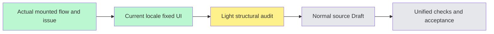

# Workshop live collaboration source — #6282

Source-first authorization: complete fixed display text before unified verification. Accepted BASE84cf50deb63e003cbed97acbe4314d727b59991b, fresh fetched main/develop in the existing worktree. Separate branch from the preserved #6271 and #6277 source Drafts; no unmerged code copied.

The live tab includes stage/group viewer selection, group cards, check-in attendance/roster/invitation clipboard states and timers, agenda display/advance controls, permission/read-only gates, loading/empty/errors and the honest parallel-groups unavailable state. Raw group names/scenarios/aliases, link bytes, segment titles and unknown server text/codes are preserved.

The server viewer prompt is displayed in locale only when its explicit server role and exact known owned Chinese source phrase agree. Unknown prompt text remains raw. This is display projection, not an authorization/state classifier; server options, selection IDs/defaults and lock rules remain untouched. The pure computeViewerOptions function and effect/callback dependencies remain unchanged. Known group/segment labels have dictionary single sources while legacy exports preserve default Chinese.

Advance failure state retains the raw existing code/message or an unknown-cause marker so switching locale can update only the owned fallback. Empty Error.message keeps the old hidden-error behavior. Requests/actions/callbacks/permissions and retry semantics do not change. No API, state machine, request, model or encoding repair.

Independent source review, focused unit/type validation and native/viewport acceptance are deferred to unified closure. Mandatory normal hooks remain enabled; first failure is recorded without bypass or repeated check-fix loops. Source-only Draft is not READY or stage completion.
