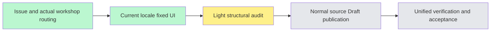

# Workshop overview source completion — #6277

User-authorized source-first pass. BASE84cf50deb63e003cbed97acbe4314d727b59991b; fetched origin main/develop before creating worker/i18n-workshop-overview-6277 in the existing worktree.

Scope is the actual workshop overview body: both data blocks, error access-scope/failure copy, loading/empty/read-only states, role counts, backflow labels, blueprint metadata, observer explanation, honest unavailable sections and work-surface navigation. General overview source belongs to #6258/PR6262 and is not copied.

Reason-code lookup, muted/destructive tone, retry booleans, reload callback, href construction, role visibility and raw project/agenda/blueprint names remain unchanged. Reason text becomes a message key and is translated only when rendered. Known backflow labels have one dictionary source; existing legacy label export keeps default Chinese. Surface Chinese copy derives from the existing pure PROJECT_SURFACES configuration. Role and project kind/status labels reuse accepted dictionaries. Contract agenda state values remain raw, as before.

No new API, request, state, permission, enabled gate or fabricated data. The shared observer badge is already implemented in #6271/PR6276; this independent branch does not copy that unmerged source. Source review/units/types/runtime/viewport QA are deferred to the unified closing pass. Mandatory normal hooks remain enforced; failures must be recorded without bypass or retry loops. Source-only completion is not READY, actual delivery or stage completion.
