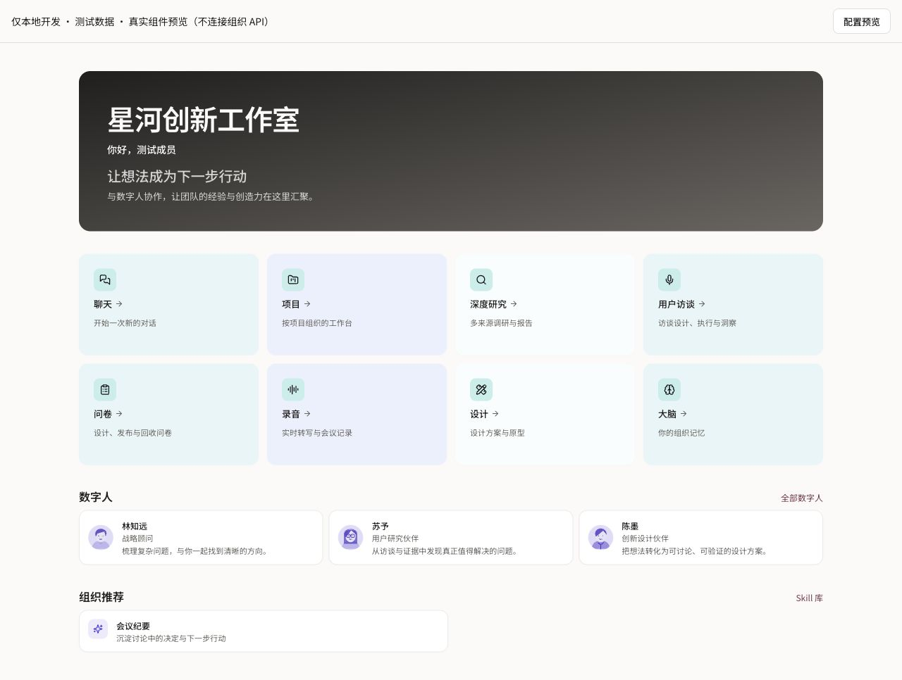
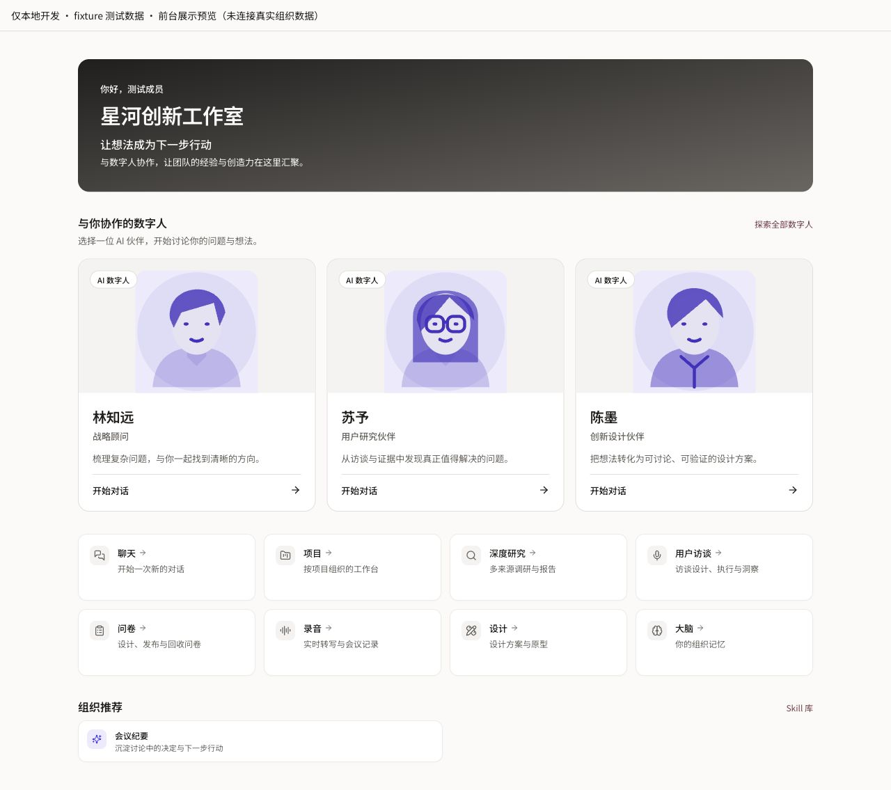

# 组织首页：数字人协作体验重设计

基线：最新远端 main `98168015c`。既有首页追踪项：Refs #4634。草稿 PR：https://github.com/boardx/workspacex/pull/5699。

## 范围与证据

用户确认后台配置后列表已经可见，本次改善的是人物形象、角色/能力说明和首次互动入口，不把可见性当 Skill/Workflow 执行验收。参考附件未收到，不声称看过。

现状 /home 在本地跳到登录页；现有 Mac Chrome 页签仅有正式应用域名，没有可确认的非生产会话。没有读取密码/令牌或进入生产数据。后续由用户明确授权使用本地 fixture 继续。所有截图均是实际 HomeView、BasicFieldsSection 与 RecommendedAgentsSection 渲染，搭配明确标注的测试数据，**不是真实组织截图，也不是完整后台鉴权页面截图**。

## 审查步骤

1. 修改前首页（01-before-home-fixture.png）：功能入口可识别，但八个大卡占据首屏；数字人只有小头像，人物和角色权重弱，互动没有清晰动词。
2. 修改后首页（02-after-home-fixture.png）：欢迎区更紧凑，数字人优先；完整人物插画、角色、介绍与“开始对话”形成连贯入口。快捷入口改为中性小面板，减少颜色和视觉噪音。
3. 后台配置组件（03-after-config-fixture.png）：人物形象与前台共用；介绍输入具有明确可访问名称和能力说明提示。编辑介绍立即更新预览。
4. 手机配置预览与首页（04-config-mobile.png / 05-home-mobile.png）：375px 无横向溢出，文本完整换行，人物入口有可见焦点。

## 设计原则与实现

- 数字人是 AI 协作伙伴，有形象、有角色、有说明、有行动入口；明确标注 AI，无真人在线状态。
- 只使用现有第一方插画/静态头像，不引入真人视频、模型调用、付费服务或新头像数据协议。
- 未知头像继续保留首字母回落；通用机器人辅助表现 AI 身份，不猜测人物外貌。
- 让协作对象优先，工具入口退为紧凑中性面板。所有交互使用语义主题 token 和焦点环。
- Grid 根据容器实际宽度自动排版，后台窄预览不会沿用整屏桌面列数。
- 组织 Logo 在手机上也可呈现；现有鉴权图片读取、Logo 上传、自动计算配色、保存与主题应用链路保持原有实现。
- 同一 HomeView 继续服务首页与后台预览；权限守卫、API、契约、数据库和发布管线均没有修改。

## 验证

- ./init.sh 快速路径通过。
- Web typecheck、完整 lint（含设计 lint、light scope token 检查）通过。
- 72 项测试通过：现有首页/后台配置/主题/表单测试，加两项介绍编辑与移除绑定测试及三项 fixture 开发/生产门禁测试。
- 实际内置浏览器测量：首页和配置预览在 375/768/1280px，documentElement.scrollWidth 均等于 viewport width（browser-checks.json）。
- 键盘 Tab 到数字人入口后 activeElement 有姓名+角色名称、明确焦点环（keyboard.json）。
- 深链保留 /chat?agent=；组件测试验证 agentId URL 编码，未调用模型或执行 Skill。

## 验证边界

fixture 只在 NODE_ENV=development 且 WSX_HOME_FIXTURE=1 时可访问，生产/未启用时 notFound。它不改变认证逻辑，也不保存真实配置。

真实 API 的 Logo 上传→组织头像持久化→自动主题→配置保存→成员重载、真实 Agent 对话启动仍待非生产全栈环境验证。当前结论是组件数据绑定、呈现、入口和响应式验证通过，不声明端到端持久化、Skill/Workflow 执行或完整 WCAG 合规。

本地复核：`WSX_HOME_FIXTURE=1 pnpm --filter web dev --hostname 127.0.0.1 --port 3048`，打开 `/dev/org-home-fixture`。所有命令日志与截图在 evidence/。

## CI 修复与附件交付

精确提交 bcdd228f0 的 CI 曾失败于新增开发路由未登记、fixture 能力样例位于产品扫描目录。两者均属于本次改动，已修复：明确测试数据移入 tests/fixtures，给开发路由登记精确 previewPrefix，并使用正式生成器产出的路由事实；没有放宽生产守卫。新增生产即使开关开启也拒绝、开发未启用开关拒绝的负向测试。完整 API lint、ui-wiring、Web lint/typecheck 和 72 项测试均通过。

Library 上传入口在当前执行连接不可用（没有准备上传会话或创建文件）。两张已在 PR 中交付的不可变截图下载链接已成功下载且与本地原图 SHA-256 一致：

- 首页：`f10d337273ac4638cc98bbeab728b5d7c9f2049a0798ffbb370bc6317ff90d29`
- 配置：`cb2d535c41e4f57967a814db41fb726fdc50862662c613630cc9e7e7a1ea18de`

[首页附件（fixture 测试数据）](https://raw.githubusercontent.com/boardx/workspacex/bcdd228f0cc815b099455f006a4915f605dd6fdf/docs/design/org-home-page/redesign-20261014/evidence/02-after-home-fixture.png)

[配置附件（fixture 测试数据）](https://raw.githubusercontent.com/boardx/workspacex/bcdd228f0cc815b099455f006a4915f605dd6fdf/docs/design/org-home-page/redesign-20261014/evidence/03-after-config-fixture.png)
