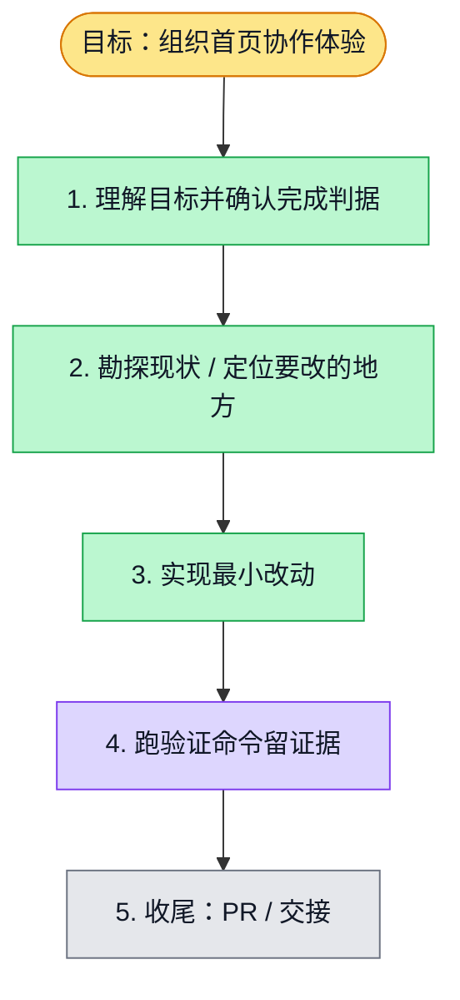

# 执行计划 — 组织首页协作体验重设计

> 规范：`.harness/instructions/execution-plan-visualization.md`。
> 改状态用 `node .harness/scripts/execution-plan.mjs set <本文件> <节点> <状态>`，
> 改完 `check` 一遍；不要手改 classDef 颜色。

## 我理解的目标
- **目标**：用完整人物形象、角色说明和明确互动入口改善组织首页与配置体验
- **完成判据**：Web 类型检查、完整 lint、69 项相关测试与三档浏览器布局检查通过，草稿 PR 可审查
- **不做什么**：不部署、不合并、不修改认证/API/数据库，不执行模型、Skill 或 Workflow
- **假设与待确认**：用户已授权 fixture；真实 API 绑定待非生产环境验证

## 执行计划

图例：⬜ 灰=未开始 · 🟨 黄=已开始 · 🟩 绿=已完成 · 🟪 紫=已测试（有证据） · 🟥 红=被堵塞

## 进度日志（append-only，每次改颜色追加一行）
| 时间 | 节点 | 状态变化 | 依据（命令 / 证据 / 堵塞原因） |
|---|---|---|---|
| 2026-10-14 | G, S1 | todo → doing | 接到目标，开始理解 |
