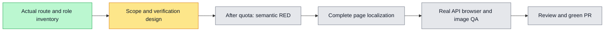

Complete B8 slice under issue #6224 and the continuing full-project internationalization goal #6133. Quota #6227 is handed to main for CI/queue; this is the sole active implementation in the reused worktree. Root retains quota first-failure repair responsibility.

The real route `/platform-admin/members` renders `PlatformMembersScreen`, not the similarly named organization preview. Localize the entire page: shared shell copy, roster/counts, superuser/platform-admin/unverified badges, registered/joined dates, multiple organization memberships, role popovers, inline grant/revoke controls, pending/disabled states, success banners, loading/empty/denial/retry and action errors. Preserve canonical IDs/roles, names/emails/org names/braces, timestamps, request bodies and actual authorization.

Verified source boundary at accepted develop4119fc3d:
- `GET /platform/members` and role `PATCH /platform/members/:userId/organizations/:orgId/role` use `PlatformOperatorGuard`: canonical environment superuser or persisted platform administrator.
- Platform-admin `POST`/`DELETE` additionally use `PlatformSuperuserGuard`. The same `NOT_PLATFORM_SUPERUSER` code has different operation context. Existing stale screen comments/role-denial copy must follow actual guards without changing authorization.
- Grant/revoke currently execute inline; do not invent a confirmation dialog. Role selection uses the existing `PopoverSelect` and canonical `consultant/lead/compliance/admin` IDs.
- Source has localized strings stored as banner/error state and a4000ms banner expiry. Store semantic intent/raw failure and translate during rendering; language changes preserve in-flight operation state and original remaining banner lifetime. Loading callbacks/effects retain their existing dependencies.
- Reuse `adminNavigation.item.platform`, shared `role.*` and existing common fallback keys. Add page-owned namespace only for new meaning; registered/joined dates change display locale while retaining the current timestamp/date interpretation.

Observable acceptance cases:
1. Given a real superuser roster, switching Chinese/English updates the complete visible boundary and open role popover while preserving raw authored values, selected role and GET/PATCH/POST/DELETE counts.
2. Given multiple memberships, selecting one canonical role sends the exact existing path/body, updates only that membership from the server result and renders the previous→next banner in the current language without refetching the roster. A locale switch2000ms into a4000ms banner does not restart expiry.
3. Given deferred list/action replies, language switches update loading/pending/error copy without restarting the request, clearing selection or enabling a busy mutation twice. Network,503 and unknown-code failures remain distinct from empty/forbidden and do not render private diagnostic text.
4. Given the last organization administrator, the actual role PATCH returns409/LAST_ADMIN; role and persisted state stay unchanged and the inline next-step explanation retranslates.
5. A real superuser grants platform-admin to the dedicated target; the badge and persisted role survive reload. That target can read/change organization roles as an operator but has no superuser grant/revoke controls and receives actual403 for those protected APIs. Superuser revoke persists; the revoked target subsequently receives a real roster403.
6. A valid ordinary organization administrator receives the dedicated platform-denial explanation rather than an empty roster/retry state. Existing non-platform navigation/guard tests keep their original actors and expectations.
7. At375 and1280, role popovers, long raw names, badges, inline errors and full action controls remain readable/reachable. Capture the page plus relevant action states and visually inspect every final image; navigation coverage alone does not satisfy this issue.

Verification design (not executed yet):
- New `apps/web/tests/ui/platform-members-i18n.test.tsx` meaningful semantic RED→GREEN, preserving the existing nine cases in `admin-platform-members.test.tsx`; include deferred replies, shared role labels, known/unknown failures, raw braces, exact calls and fake-timer banner expiry. Existing resource key/placeholder guards also run.
- Planned command after test creation: `WORKSPACEX_WEB_TEST_MAX_WORKERS=1 pnpm --filter web exec vitest run tests/ui/platform-members-i18n.test.tsx tests/ui/admin-platform-members.test.tsx tests/lib/i18n-resources.test.ts`.
- A real API/PostgreSQL/browser case belongs in the existing entity-localization CI chain. Use strict operation schemas and independent persisted state/reload checks; do not substitute screenshots, static source or canned request results for actual mutations.
- Positive-actor prerequisite needs a dedicated synthetic superuser in the canonical test fixture/seed/config, with only that synthetic email in the actual `PLATFORM_SUPERUSER_EMAILS` setting. Seed identities/initial memberships only; grant/revoke and expected role changes must be produced by the real UI/API. Keep the existing organization-admin denial actors unprivileged. A local-only config that never runs in CI is insufficient; no auth bypass or new product permission mechanism.
- Boundary tests may control fetch timing to prove loading/failure semantics; describe them as component evidence. Real browser evidence proves actual authorization, mutations, reloads and physical control reachability, not a real infrastructure outage or all timing branches.
- Before implementation, finalize the exact private-fixture fields and screen-state screenshot matrix against the canonical seed. Run native source/type/lint/init/list gates, independent reviews, canonical tracked credential scan and normal hooks; automatically open one PR targeting develop after actual acceptance. Main owns queue/merges; passing is never manually assigned.

Expected ownership: page/helper/namespace and focused tests form one implementation task; canonical private test prerequisites and the real browser case form its verification task. Quota #6212 local acceptance and publication are complete; main explicitly permits this next slice while owning #6227 CI/queue. This page is the sole active implementation. Raw browser logs/traces remain private; only inspected images and curated receipts enter `evidence/platform-members-i18n-<issue>/`.

