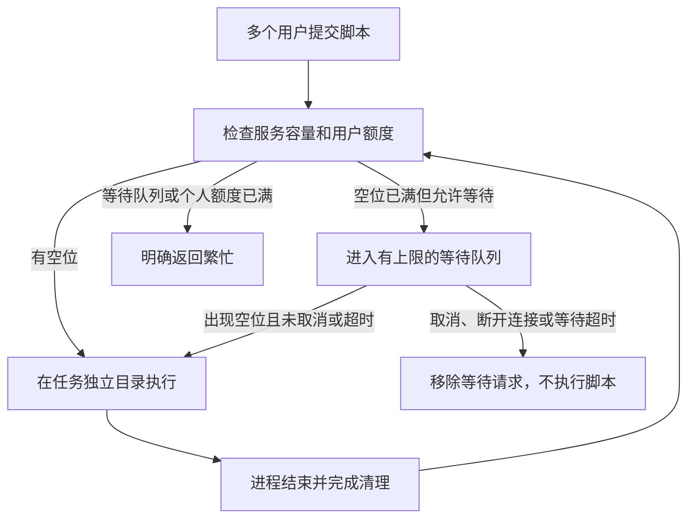

# Sandbox 多用户容量控制

本轮实现对应 issue #5966。本文描述带有本改动的新版本；不能据此断言 devapp、CN 已经部署或可承载某个用户数。

## 给使用者的说明

Sandbox 是共享的执行服务，每个用户任务拥有自己的目录和执行上下文。用户增加时不会为每个人创建一个常驻容器。

本轮给共享服务加上有限的执行空位和等待队列：有空位就执行，没有空位先等待；队列或个人额度满了，明确返回繁忙。任务完成、失败或取消后，等进程和目录清理结束再释放空位。

普通聊天在等待期间继续轮询持久化 run 的取消检查点；其节奏复用现有 [poll-budget](../../../apps/api/src/application/agent-run/poll-budget.ts)，因此取消传播存在一个检查周期及数据库/传输延迟，不能承诺取消点击与子进程启动之间的原子性。检查点失败同样中止请求，不重放脚本。

等待使用现有请求连接，不新增前端排队页面；当前聊天界面不承诺显示排队位置或预计等待时间。排队时间计入原有命令超时，避免用户请求已经超时，后台却刚开始执行。

## 实现范围与边界

- 普通 `/run` 和 Native Session 命令在服务入口申请容量；Native 的能力探测也在取得执行空位后进行。
- 限额按**服务进程**计算。普通 sandbox 与 sandbox-sessions 各有自己的队列、计数器与用户额度，尚非跨服务的全局用户额度。
- Native 用户身份来自已通过可见性检查的触发消息作者；普通聊天来自已领取 run 的请求者，Skill 试跑来自其持久化 actor。API 将组织、用户组成的键哈希后，通过私有传输头绑定，模型参数不能指定配额身份。
- 无法归属到具体用户的 Native 子任务使用组织桶；旧的未传身份调用使用共同的未归属桶。不会通过随机生成用户键逃避配额。
- 队列按入队顺序选择符合个人并发额度的请求，不被一个暂时达到个人并发上限的用户挡住所有空位。不是按组织权重调度。
- 创建 Session 和占用执行空位是两回事：Session 仍受原有数量、TTL 与文件大小限制；空闲 Session 不占执行空位。
- 队列保存在内存中，服务重启会中断请求和丢失 Session；不会恢复或自动重放脚本。这是短请求的资源保护，不是持久化任务系统。
- 容器内存限制仍由多个任务共享。本轮不提供逐任务 cgroup，不保证并发高于保守值时单任务不会影响同容器其他任务；请求体、输入文件及结果缓存也占资源。
- 没有新增服务器、实例路由或自动扩缩容；没有修改线上配置。

## 故障语义

容量错误码的单一来源是 [sandbox-session 契约](../../../packages/contracts/src/sandbox-session.ts)，并生成到 Node/Python 两端。

| 情形 | 行为 |
|---|---|
| 等待队列满或个人等待额度满 | HTTP 429；附固定错误码和 `Retry-After`，没有执行用户脚本 |
| 普通脚本等待超时 | HTTP 503，固定等待超时码，没有执行用户脚本 |
| Native 命令等待超时 | 返回该 executionId 的 `timedOut` 结果并缓存，重复读取不执行 |
| Native 排队命令取消 | 返回并缓存 `cancelled` 结果；同 ID 不会稍后再次执行 |
| 客户端断开 | 移除排队请求；已执行的命令请求终止，清理结束后释放空位 |
| 已执行请求的传输故障 | 结果可能不明确，不自动重放，沿用现有错误处理 |

`Retry-After` 只表示可以稍后重新申请容量，不构成对已经提交命令的自动重试授权。

## 后续扩展

观察实际等待时间、失败率和资源使用后，再决定是否引入 PostgreSQL 持久化任务队列、全局组织额度、实例注册与 Session 固定路由。跨机扩容需要节点代理和基础设施控制器，不能直接给当前有状态服务增加随机分流副本。

运维和容量验证步骤见 [操作说明](../../../.harness/instructions/project/sandbox-capacity-operations.md)。测试与尚未验证的边界见 [证据](../../evidence/sandbox-capacity-5966/README.md)。
