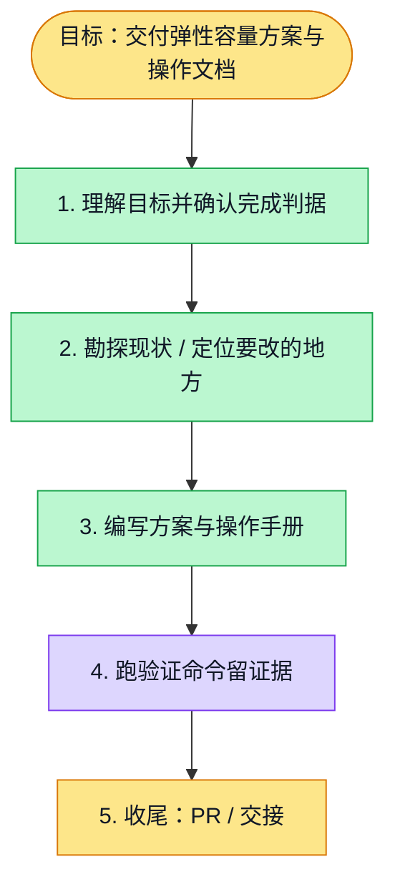

# 执行计划 — 500 人弹性容量方案与操作文档

> 规范：`.harness/instructions/execution-plan-visualization.md`。
> 改状态用 `node .harness/scripts/execution-plan.mjs set <本文件> <节点> <状态>`，
> 改完 `check` 一遍；不要手改 classDef 颜色。

## 我理解的目标
- **目标**：交付提前检测、自行扩容的最终实现方案与阿里云操作手册。
- **完成判据**：文档独立审阅；本地链接校验、git diff --check、执行计划格式校验通过；建立文档 PR 并检查 CI。
- **不做什么**：本次不实现或部署集群，不创建云资源，不修改生产配置。
- **假设与待确认**：500 人正常使用的候选负载明确标注为建议，真实服务能力须压测；不承诺任意突发零等待。

## 执行计划

图例：⬜ 灰=未开始 · 🟨 黄=已开始 · 🟩 绿=已完成 · 🟪 紫=已测试（有证据） · 🟥 红=被堵塞

## 进度日志（append-only，每次改颜色追加一行）
| 时间 | 节点 | 状态变化 | 依据（命令 / 证据 / 堵塞原因） |
|---|---|---|---|
| 2026-10-29 | G, S1 | todo → doing | 接到目标，开始理解 |

## 本轮进度与交接

- issue：https://github.com/boardx/workspacex/issues/5980；工作分支 `codex/sandbox-elastic-capacity-design`。
- 已沿用本会话 worktree，将 main 快进至 `dad8d7634`。#5968 已合入 main；线上版本仍需独立验证。
- `./init.sh` 快速路径退出 0，未声称完整全仓测试。`pnpm harness readiness` 退出 0；本任务为用户直接交办，队列外原因已在 issue 说明。
- 用户明确免除本会话协调网关接入；不创建网关凭据、租约或周期自动任务。
- 仅变更 Markdown，未启动 Docker 栈，未修改云账号或生产环境。
- 设计文件：`elastic-implementation.md`；操作手册：`elastic-operations.md`。
- 下一步实际开发须建立协议、隔离与节点池等实现 issue，先验证设计契约，再执行分阶段实施。文档交付不能作为500人验收证据。

## 文档验证证据

2026-10-29 本轮验证：

- Python 对四份相关 Markdown 校验：13 个本地链接存在、代码围栏闭合，退出 0。
- `git diff --check` 退出 0。
- `node .harness/scripts/execution-plan.mjs check docs/design/sandbox-capacity/elastic-delivery.md` 退出 0。
- `pnpm run lint:execution-plan` 退出 0；日志 `/tmp/workspacex-5980-plan-check.log`（本地临时证据，不作为远程可访问产物）。
- 无业务代码变更，未以静态检查冒充真实扩缩容或500人压测。
