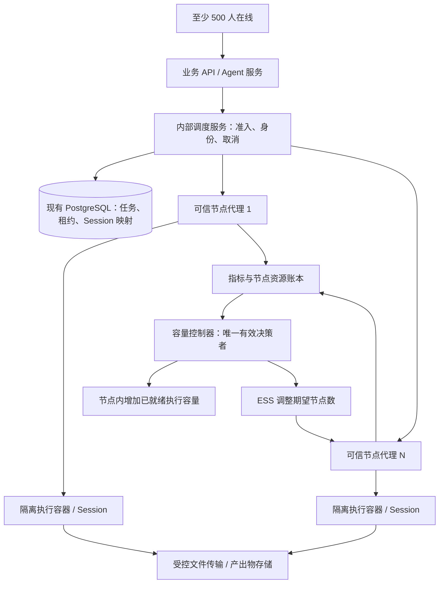

# Sandbox 弹性容量最终实现方案

状态：待实施的设计基线；issue #5980；2026-10-29。本文不表示已上线或已通过 500 人验收。

用户目标：至少 500 人正常同时使用；系统在容量接近不足前自行扩容，减少固定闲置成本，正常负载无需明显排队。交付本方案和[操作手册](elastic-operations.md)；本次只改文档。

## 1. 决策与边界

采用现有 Docker + 阿里云 ECS 专用执行节点池 + ESS 弹性伸缩。应用侧负责容量需求、任务状态、Session 路由；ESS 负责创建、回收 ECS。保持少量动态余量，扩容前判断需求，不固定常驻 500 个用户容器。

备选：单台大服务器无法消除单机故障和容量上限；ACK 可提供成熟调度，但现阶段迁移成本更高，500 人在线本身不足以证明迁移收益。后续执行协议应独立于 ECS，以保留迁移空间。

“无需明显排队”定义为本节验收负载内，从 API 接受 sandbox 命令到实际子进程启动的 P99 ≤ 1 秒；不能用 HTTP 接收成功或返回任务 ID 代替开始执行。文件准备和 Session 冷启动计入该时间。上传耗时、模型首字和任务完成时长分别统计，不混入 sandbox 准入指标。

500 人在线不等于 500 个脚本并行。支持的任务资源规格、到达率、突发规模必须随压测报告公布；未验证前不得宣传“500 人任意任务瞬时启动”。不承诺任意突发、云资源售罄或故障下绝对零等待。

## 2. 当前事实与改造范围

现状来源：[当前设计](README.md)、[容量配置](../../../.harness/instructions/project/sandbox-capacity-operations.md)、[Compose 生成器](../../../packages/cloud-deploy/src/compose.ts)。#5966 / PR #5968 已合入 main，实际环境版本仍须检查。

当前两个 sandbox 服务通过本机 Unix Socket 调用，使用进程内短队列和各自用户额度；Native Session 和工作目录有本机状态。`/capacity` 不报告宿主机可用资源。共享容器的多个任务没有逐任务资源隔离。

因此不直接对现有 Compose 执行 scale，不将 Unix Socket 暴露成公网 HTTP，不把多个有状态副本放到随机负载均衡后，不单靠调高并发变量扩到 500 人。

## 3. 目标架构

API 和数据库不承载不可信脚本。执行节点置于同地域专用 VPC 子网；devapp 和 CN 使用独立节点池、队列命名空间与预算，不跨环境共享执行目录。

### 调度、持久化与并发一致性

- 内部调度入口保留上层 SkillSandbox / Native transport 契约，由新适配器转发到节点代理；现有本机 UDS 模式作为回滚通道。Python 端和普通、Native 两条链路同时纳入。
- PostgreSQL 增加 execution、node、session-route、reservation 和控制器租约数据；具体 schema 和 DTO 在实现前进入 contracts 单源。选择 PostgreSQL 是延续现有设施，避免同时引入新消息中间件。
- 接受请求时，以组织 + 请求者 + executionId 为幂等范围，在同一事务内检查全局用户额度、节点健康、空位并创建 reservation；使用行锁/条件更新防止重复分配。DB 事务不持有到脚本结束。
- 全局用户额度覆盖普通与 Native 服务；默认每人一条活动命令，额外并发政策单独配置。按组织公平分配，不能让少数用户耗尽集群。新 Session 的创建数、空闲 Session 内存/磁盘另设额度。
- 建议状态：accepted → reserved → starting → running → succeeded/failed/cancelled/timedOut；无法确认是否执行的任务为 unknown，状态枚举实施前审定。不将 unknown 自动重放。客户端重复提交查询同一个 execution，不生成第二次执行。
- reservation 有有界 TTL；节点必须核对有效租约和 fencing generation 才能启动。租约过期不能单凭数据库记录释放活动进程的资源；先确认节点已杀进程或隔离失联节点，再允许复用相应容量。
- Session 固定到 node + sandbox + generation。活跃 Session 不搬迁；节点丢失时显式失败并清理路由，不在其他节点悄悄恢复执行。持续空闲的 Session 可按 TTL 释放；输入输出经受控传输持久化，恢复为新 Session 必须有明确语义。
- 取消先持久化，再通知节点；节点在启动前再次核对，运行后杀整个进程组，清理完成才释放空位。取消与启动竞态必须用租约/节点状态机处理并测试，不能只依赖轮询。
- 正常路径不靠排队提高吞吐。保留有界短队列仅作突发保护，受请求 deadline 约束；容量拒绝和队列超时在验收中计为失败，不能从延迟样本里删除。

### 执行隔离与节点安全

每个普通任务使用独立执行容器；Native 使用独立 Session 容器，同一 Session 内命令串行。预热基础镜像和干净执行环境，分配前确认清洁，跨用户复用前销毁旧环境并创建新环境。

可信节点代理持有本机容器管理权限，不向脚本挂载 Docker Socket、云 RAM 凭据、宿主目录或数据库凭据。代理走 VPC 私有 mTLS 通道，仅调度服务可访问；执行容器维持默认禁网、非 root、只读根目录、资源限制及受控临时目录。文件由代理按已有资产权限取入/取出，不让脚本直连对象存储。

容器不是完整的恶意代码安全边界。若面向不可信任租户或任意代码，发布前必须选择并验收强化运行时（如受支持的轻量 VM 沙箱），不能声称仅目录隔离已实现多租户安全。CPU、内存、PID、临时磁盘均按容器设硬上限；监控宿主内存压力和 OOM。

## 4. 怎么判断资源够不够

每 5 秒采集一次（初始试验值，压测后调整）：节点心跳、已就绪/占用/预留/预热空位、容器分配与实用 CPU/内存、MemAvailable、磁盘及 inode、PID、OOM、重启、任务到达率、执行时长和启动延迟直方图。

节点增加空位必须同时通过：

1. 账本：操作系统、代理和安全余量之外，CPU、内存、PID、磁盘预留能容纳新执行规格；已分配空闲 Session 和预热环境也计费占额。
2. 实测：无内存/磁盘压力，无近期 OOM，持续 CPU 负载在压测得到的安全范围内。
3. 就绪：镜像缓存、运行时、文件通道和自检任务通过，空位才计入 ready。

可增加数量取各资源剩余可容纳数量的最小值，再受节点压测最大并行数约束；不能把“当前低 CPU”当作未承诺资源。不同任务规格分别核算，重任务不能占轻任务配额却消耗多倍内存。

## 5. 扩缩容算法

以下是实施起点，不是已实测生产参数。每 10 秒决策，单个有效控制器使用数据库租约及 fencing；独立 CPU/内存保护规则只向同一个决策者提出需求，不与 ESS 目标追踪规则同时改同一节点池的期望数量。

按资源规格分别定义：

- A：活动任务和已预留任务占用的空位。
- λ：短窗口和长窗口任务到达率的较大值，单位任务/秒。
- S：近期任务执行时长 P95；异常任务另按 deadline 处理，不无限扩大估计。
- T：从发起扩容到节点自检可接单的近期 P95，加采集和决策延迟；包括镜像、冷启动和云失败重试。
- B：约定的额外突发空位，依据压测流量而非凭空填常数。
- u：目标占用率，初始试验 0.65；W：时间窗口至少为 T 的可信需求预测峰值，历史不足时不用预测替代实时规则。

保守需求参考值：`C = max(ceil(λ × S / u), A + ceil(λ × T) + B, W)`。

第二项为扩容窗口内不计任务完成释放的保守估计，可能增加成本；上线前回放调优，但不能未经证据就用乐观完成率抵扣。500 在线连接数作为业务监控，不直接当 λ 或执行并发。

- ready + 启动中的容量低于 C：申请差额；启动中的容量只用于避免重复购买，不能用于接单。启动超时则标失败并补容量、告警。
- ready 不足以覆盖扩容窗口需求：立刻扩容，不等队列变长。先使用节点内已验证余量，否则申请 ECS。
- 有限额、配额、售罄、镜像或网络问题：限次退避重试并告警，保留准入保护，不在已满机器上无限堆任务。
- 只有 ready 容量持续富余、无任务和有效 Session 的候选节点才可排空；初始缩容稳定窗口 15 分钟。释放最大节点后仍满足 C、最小节点数和故障余量。
- 单节点故障保护：计算从 ready 中扣掉最大节点后的剩余容量，确保仍覆盖压测确定的基础需求；单机损失不代表所有活动任务均可恢复。
- 最小/最大节点数、每小时新增节点上限、RAM 配额、费用预算强制约束决策。预算到顶时告警，不能承诺继续无等待。

ESS 控制器调整 DesiredCapacity；节点代理自检通过才注册 ready。缩容使用受保护实例与指定候选实例移除流程，生命周期挂钩做最后拦截；不能仅降低期望数让 ESS 随机杀一个有 Session 的节点。具体 ESS 参数和操作顺序需以 devapp 验证的 API 契约固化到适配器。

## 6. 分阶段实现与完成门

| 阶段 | 交付 | 放行条件 |
|---|---|---|
| A 观测 | 宿主资源账本、延迟直方图、流量记录、任务规格 | 指标与真实 PID/容器状态可对照，缺测可告警 |
| B 跨机执行 | 内部协议、PG 状态/租约/路由、节点代理、逐任务/Session 隔离、文件通道 | 两节点真实执行、跨租户隔离、取消/失联/幂等全部通过 |
| C 自动容量 | ESS 适配器、唯一控制器、ready 自检、排空与预算 | 真增减测试 ECS、配额失败/重复决策不重复购买 |
| D 500 人验收 | 混合负载、突发、长稳、故障、费用证据 | 下节全部通过；再走 devapp → CN 标准发布 |

预估起始机器数必须在 A/B 的实测后计算：`ceil(所需容量 / 每节点验证容量)`，然后校验最大节点故障余量。本文不提供未经测试的采购规格或价格。

### 实现接入点

| 位置 | 要改什么 |
|---|---|
| `packages/contracts/src/sandbox-session.ts` 与 Native binding 契约 | 保持既有结果语义，新增内部节点协议与资源规格单源，生成 Node/Python 产物 |
| `apps/api/src/infrastructure/skill/http-skill-sandbox.ts` | 普通执行接入集群适配器，保留原本机实现用于灰度/回滚 |
| `apps/api/src/infrastructure/agent-run/native-session-transport.ts`、`pg-native-session-owner.ts` | Session 绑定与固定路由、可信组织用户身份，不由模型选择节点或配额身份 |
| `apps/deep-agent-service/src/deep_agent_service/sandbox_backend.py`、`native_sandbox_dispatch.py` | 超时/取消/容量错误贯通，禁止传输故障后重放 |
| `apps/skill-sandbox/` | 独立执行环境与清理、自检、资源计数；可信节点代理为独立服务边界，不能与脚本共享权限 |
| `packages/cloud-deploy/` | 新增节点池部署描述和灰度配置；保留原 Compose 路径，不直接随机复制本机 Session 服务 |

新增服务的目录名和数据库迁移编号由实施者按仓库约定确定；本轮不生成空壳代码或把规划配置加入当前 schema。

## 7. 500 人验收合同

以下是建议的首轮测试负载，不是用户已确认的所有业务上限；发布报告必须明确采用何种负载。若用户要求 500 条任务完全同时立即开始，则须额外测试该场景并在请求前具备对应 ready 容量，无法仅靠事后扩容达成。

- 至少 500 个独立账号/身份的真实在线连接，涵盖聊天、Agent、文件产出链路。Sandbox 初始负载：每人每分钟 1 次任务，约 8.33 次/秒；PDF/Office/数据任务按 40%/30%/30% 混合，固定输入样本大小及版本，普通和 Native 都覆盖。
- 先测单任务资源峰值、S 和每节点上限，再重放 50→100→250→500 人增长；每段至少 15 分钟，500 人阶段持续 2 小时。增长速度记录为本次支持的扩容包络。
- 单独验证约定的突发（首轮建议 10 秒内新增 100 个任务）、长任务、取消和客户端断开。另做 500 个同时提交的边界实验，如不达标必须记录，不包装成已保障能力。
- 准入启动 P99 ≤ 1 秒、有效任务成功率 ≥ 99%，容量拒绝/超时计入失败。对全部请求记录 accepted、reserved、process-start、finished 时间；节点校时并报告时钟误差，防止伪造跨机 1 秒结论。
- 保持 500 人负载，注入一个节点失联、ESS 配额拒绝、控制器切换、PG 短暂断连；验证无双重执行/越权、告警及时。单节点故障后的新请求准入另行统计，正在故障节点运行的任务显式失败，不承诺自动恢复。
- 同步验收业务 API、实时连接、数据库池、Agent worker、模型供应商并发/RPM/TPM 和文件存储，否则不能称端到端支持 500 人。真实模型限额不足时不得用回环模型通过结果替代。
- 产出 exact 镜像、节点规格、容量参数、流量曲线、P50/P95/P99、错误分母、OOM、扩容就绪时长、账单估计和故障日志。未达到目标就调整方案并重测，不跳过失败样本。

## 8. 依据与实施文件

- [阿里云 ESS 扩容规则与预热](https://www.alibabacloud.com/help/en/auto-scaling/user-guide/manage-scaling-rules)
- [ESS 最小/最大/期望数量](https://www.alibabacloud.com/help/en/auto-scaling/user-guide/create-an-ecs-scaling-group)
- [ESS 扩容响应受启动时间影响](https://www.alibabacloud.com/help/en/auto-scaling/product-overview/what-is-auto-scaling)
- [生命周期挂钩](https://help.aliyun.com/en/auto-scaling/user-guide/manage-lifecycle-hooks)
- [Kubernetes 自定义指标与缩容稳定窗口](https://kubernetes.io/docs/concepts/workloads/autoscaling/horizontal-pod-autoscale/)（机制参考，不要求迁移）

操作与排障见[操作手册](elastic-operations.md)。后续开发须先把上述协议、故障语义和资源规格变成可验证契约与独立实现 issue；本文不是可直接执行的部署脚本。
