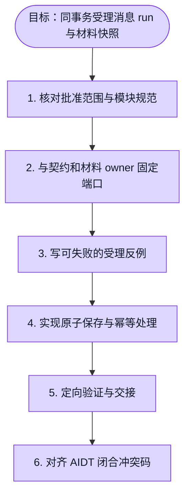

# 执行计划 — AIDT 上下文原子受理

## 我理解的目标
- **目标**：在现有消息入口同事务冻结 AIDT 材料，保留学生原文、准确 Agent/Skill 版本和普通 Chat 路径。
- **完成判据**：两层 selector 幂等、null 互换冲突、事务回滚、并发 replay、失权重验与普通无 selector 的定向反例通过。
- **不做什么**：不启动真实模型栈、不收费、不部署、不提交、不修改设计签核状态。
- **假设与待确认**：用户在本轮明确批准桥接；根协调员已确认统一 init 退出 0。历史设计页 pending 状态保留，不代签。

## 进度日志
- 2026-11-16：已确认 root init0；端口为 A2 `AidtMessageAcceptancePort`，准备、持久化与 replay 重验全部使用仓储传入的同一 TenantSession。契约 schema/hash 由 A3/A2 单源提供。
- 2026-11-16：root 批准补准确 AIDT 冲突闭码；ordinary HTTP/SSE 原边界保留，新增 S6 记录该已批准实现修正。
