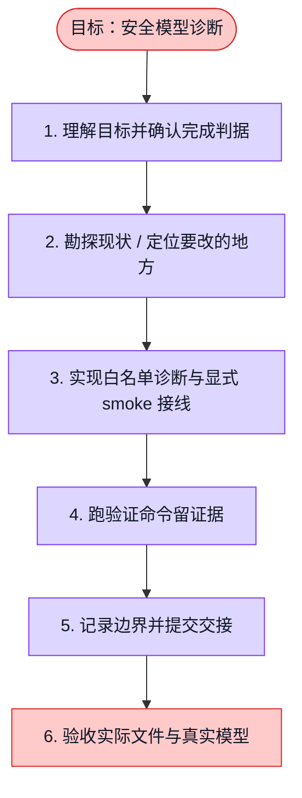

# 执行计划 — 安全读取模型配置与只读诊断

> 规范：`.harness/instructions/execution-plan-visualization.md`。
> 改状态用 `node .harness/scripts/execution-plan.mjs set <本文件> <节点> <状态>`，
> 改完 `check` 一遍；不要手改 classDef 颜色。

## 我理解的目标
- **目标**：显式读取 cn.local.env，仅提取模型字段并给出脱敏诊断。
- **完成判据**：node --test scripts/tests/real-model-config.test.mjs；现有 smoke 退出码测试；真实缺文件诊断。
- **不做什么**：不部署、不迁移、不修改签核、不将 CN 配置注入 AIDT zero-egress profile。
- **假设与待确认**：云环境未找到 cn.local.env；配置完整不代表真实连通；基础验证由主 Agent 统一执行。

## 执行计划

图例：⬜ 灰=未开始 · 🟨 黄=已开始 · 🟩 绿=已完成 · 🟪 紫=已测试（有证据） · 🟥 红=被堵塞

## 进度日志（append-only，每次改颜色追加一行）
| 时间 | 节点 | 状态变化 | 依据（命令 / 证据 / 堵塞原因） |
|---|---|---|---|
| 2026-11-16 | G, S1 | todo → doing | 接到目标，开始理解 |
