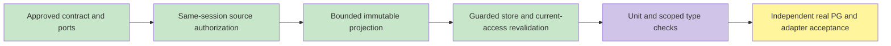

# A2 — approved server context bridge implementation

2026-11-16. Root relayed the user's explicit approval: “上下文桥接方案，继续实现”. This records implementation and engineering verification, not classroom validation or a supplier model run. No agent signed a human status field. No stack, model call, deployment or commit was performed by A2.



## Implementation and ownership

- `apps/api/src/application/aidt-run-context/{ports,errors,approved-packs,prepare}.ts` defines narrow acceptance/execution/receipt/store ports, closed errors, immutable shipped package content checks, and deterministic projection.
- `apps/api/src/infrastructure/aidt-run-context/pg-aidt-run-context-provider.ts` implements the three atomic acceptance operations, guarded execution resolution/current authorization, and metadata-only receipt. Constructor performs no IO. Existing `SkillStarterPackSource` is loaded lazily only for AIDT.
- `pg-aidt-run-context-store.ts` persists through the caller's `TenantSession`, checks canonical hashes and exact selector/source coordinates, and returns a real `Guarded` wrapper. A journal checkpoint derives inheritance only from an actual earlier dispatch journal entry; absence remains unknown.
- Existing Stage port/repository/service gain an optional exact revision read, preserving prior fake-port compatibility and existing permission decisions. The SQL uses exact organization/project/stage/revision equality; no nearest history substitution or HTTP contract change.
- `packages/contracts/src/aidt-return-reflection.ts` is the shared pure confirmation/target/prototype-binding validator. A return selector requires complete saved student confirmation and its exact chosen target. Only the whitelisted question/before-after/reason/next-action fields and historical question source revision enter the return DTO.

## Boundaries

The provider locks project, organization/member, actual group membership, then actual thread in the same tenant transaction. Organization-admin fallback does not replace explicit group membership. New dispatch and resume require an active project/organization, a writable real group member and thread access. Receipt reads retain existing authorized archive read behavior.

Initial preparation requires exactly one active AIDT focus mount, matching the requested stage/SUM and frozen base run version. Published/enabled packages are read through existing `PgAgentRunRepository.readPinnedSkills`; their complete file manifest/digests must equal an allowlisted shipped immutable release. This proves content equality, **not** platform import/account lineage. No RLS change, tenant bypass or global catalog proof was added.

Replay, execution and resume use the original stored snapshot, exact selected revisions and original focus package, while rechecking current permissions and source availability. They do not select current Stage heads or replace focus with a newer mount. Student fields are framed as untrusted material; editor confirmation, prototype labels and source metadata are not evidence or system instructions. Missing private artifacts, original bytes and teacher-comment sources are explicit omissions.

The frozen reference includes deterministic canonical hashes, visible truncation and a serialized UTF-8 message budget that reserves 1024 bytes for native message metadata beneath the final 128 KiB cap. History is capped by the approved contract; elapsed preparation is bounded at query boundaries and again after final pure computation.

## Actual verification

- `context-prepare-red.log`: 2 actual failing assertions, 2 passing. Missing/extra/duplicate/wrong-project source coordinates and a return row without its whitelisted DTO were accepted before the defensive checks.
- `context-unit-green.log`: 48 tests passed in 9 files, single worker. A2 owns 21 of these (package 3, projection 4, return validation 4, store/session 4, provider/module-off 2, application receipt 4); the other 27 are shared contract/transport unit checks. This is controlled unit/session verification, not PG or a model.
- `context-typecheck.log`: scoped TypeScript command exited 0 (successful tsc emits no text).
- `context-permission-lint.log`: existing guarded-read lint exited 0; no new exception/allowlist was added.
- `git diff --check` for A2 source files exited 0.

Commands (repository root, Node 22 / pnpm 9 already prepared by root):

```sh
pnpm --dir apps/api exec vitest run --config vitest.aidt-run-context.config.ts
pnpm --dir apps/api exec tsc --noEmit --project tsconfig.aidt-run-context.json
node apps/api/scripts/lint-permission-paths.mjs
```

Independent A6 reported its real-PG/actual-native-adapter recording attempt04 passed 21/21 in 18.39 seconds, with zero supplier calls and cleaned resources. That green run precedes the late-observation receipt reducer increment below; A6 is preparing the specific final PG recheck. It must use the approved packages via the existing importer and must not be described as a real supplier response or classroom test. Integration ownership: A1 atomic accept/idempotency, A3 contract/migration/controller, A5 execution/provider observer, A4 native host selectors, root kernel wiring.

## Feedback: a late old dispatch observation must not roll back the current attempt

The extracted prior receipt reducer selected `events.at(-1).event.attemptId`. Controlled durable-event order was: attempt `run:1` assembled, current attempt `run:5` assembled, then the first attempt's observed dispatch callback arrives late. The prior reducer incorrectly reported `run:1`/message-dispatch-observed. A second test demonstrated numeric order `run:10` versus `run:9`. `context-receipt-red.log` preserves both real assertion failures (2 failed, 1 passed).

`application-receipt.ts` now recognizes the existing server-owned execute-run attempt format `${runId}:${stepSeqBase}` and selects its highest safe numeric ordinal. It filters observation times to that attempt. All original journal entries and true old dispatch facts remain unchanged. Opaque/unidentifiable attempt coordinates produce `unknown`, never a fabricated current dispatch. Prepared remains without an attempt; resume preserves its actual inheritance and has no new message-dispatch time. Four reducer tests now pass within the 48-test run, and scoped tsc exits 0. No model task or paid retry was triggered.

A6 was asked to verify this in PG by replaying a **previously observed real recording-transport dispatch fact** after a genuinely later resume observation. This delayed duplicate does not claim a new dispatch. Final PG result is pending; the earlier 21/21 must not be attributed to the reducer increment.
