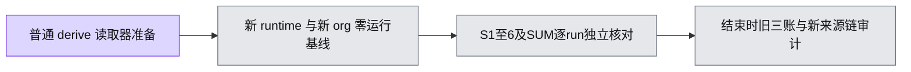

# 新 seed 原生全链独立来源审计

当前仅完成只读 QA 准备，尚未审计本轮实际 runtime/run，不能据此声明模型已收到材料或阶段教学通过。用户本轮授权不以 credit 预算限制验收；审计记录实际用量及未决状态，不执行预算门控、不修改账目。

QA 读取器为 `apps/api/tests/aidt-run-context/audit-fresh-scope.ts`。它只接受普通 `deriveTestIsolation` 派生的真实 DB/compose，一旦出现 restore receipt/checkpoint 就拒绝；通过 owned compose 发现实际 `127.0.0.1` PostgreSQL 映射，强制 `app_rw`、`default_transaction_read_only=on` 与 tenant scope。它不读取 CN 配置、启动服务或执行迁移。

新 org 基线应在首次模型发送前记录：实际组织角色及 active 状态、run/snapshot/application/physical/usage/credit 数量，并明确有无零运行起点。具体 project/thread 可见后，必须有显式 general group membership、真实 thread 授权及 active AIDT profile，才读取全部已保存阶段修订的内容哈希、来源坐标和更新者哈希。只保留哈希，不把学生材料或元数据认定为研究证据。

每个实际 run 分两路独立读取：

- 既有 `audit-real-run.ts` 普通分支核对 input human 的实际作者/thread/正文哈希、实际单一 focus、已批准课程包 digest、精确 stage/history/return 来源、冻结 question 来源版本、selector/snapshot/reference hash，以及 dispatch/resume 继承事实。期望 human hash 和 selector 应来自 A6 的实际发送附件，而不是根据 DB 事后构造。
- 新补充读取器核对 immutable Agent version 的实际 instructions SHA 与保存的 digest，并按明确期望版本/摘要对照；读取同 org/run 的 physical、usage 和 credit 状态及实际 principal/thread 绑定。存储零不能自动解释为消费零；journal 的 dispatch 不能自动解释为供应商内部消费。该读取不触发补账、退款或重试。

运行前须获得 A1 的新私密 runtime 路径及实际 principal/org；与 A6 对齐每个实际 run/project/thread、human hash、精确 pin/selector 和 receipt。S6 要单列冻结 question 的第5步来源与原型版本；SUM 要单列明确选择的 stage/history refs。旧三份 ledger 仅作前后文件哈希保护，绝不恢复、清空或复用其 pending 状态作为新链起点。

[准备验证](preparation-checks.json) 包含定向 TypeScript 退出0，以及三条实际受控负例：缺显式路径、restore runtime、foreign derive scope 均在 DB/Docker/model 前拒绝。首次临时 tsc 配置缺 node typeRoots，补准确 typeRoots 后通过；没有将该工具配置错误记为产品缺陷。真实运行证据等待 A1/A6 的新 scope 与实际 run。
