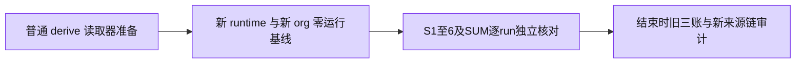

# 新 seed 原生全链独立来源审计

新 seed 的 S1–S6 与 SUM 实际服务端来源审计已完成；S5 Agent 任务实际 cancelled，完整原生链在此断开。S3 保留一条 unknown usage / pending credit；SUM 原 AI 草稿内容未通过；这些审计也不证明普通学生模型权限或教学质量。用户本轮授权不以 credit 预算限制验收；审计记录实际用量及未决状态，不执行预算门控、不修改账目。

QA 读取器为 `apps/api/tests/aidt-run-context/audit-fresh-scope.ts`。它只接受普通 `deriveTestIsolation` 派生的真实 DB/compose，一旦出现 restore receipt/checkpoint 就拒绝；通过 owned compose 发现实际 `127.0.0.1` PostgreSQL 映射，强制 `app_rw`、`default_transaction_read_only=on` 与 tenant scope。它不读取 CN 配置、启动服务或执行迁移。

新 org 基线应在首次模型发送前记录：实际组织角色及 active 状态、run/snapshot/application/physical/usage/credit 数量，并明确有无零运行起点。具体 project/thread 可见后，必须有显式 general group membership、真实 thread 授权及 active AIDT profile，才读取全部已保存阶段修订的内容哈希、来源坐标和更新者哈希。只保留哈希，不把学生材料或元数据认定为研究证据。

每个实际 run 分两路独立读取：

- 既有 `audit-real-run.ts` 普通分支核对 input human 的实际作者/thread/正文哈希、实际单一 focus、已批准课程包 digest、精确 stage/history/return 来源、冻结 question 来源版本、selector/snapshot/reference hash，以及 dispatch/resume 继承事实。期望 human hash 和 selector 应来自 A6 的实际发送附件，而不是根据 DB 事后构造。
- 新补充读取器核对 immutable Agent version 的实际 instructions SHA 与保存的 digest，并按明确期望版本/摘要对照；读取同 org/run 的 physical、usage 和 credit 状态及实际 principal/thread 绑定。存储零不能自动解释为消费零；journal 的 dispatch 不能自动解释为供应商内部消费。该读取不触发补账、退款或重试。

运行前须获得 A1 的新私密 runtime 路径及实际 principal/org；与 A6 对齐每个实际 run/project/thread、human hash、精确 pin/selector 和 receipt。S6 要单列冻结 question 的第5步来源与原型版本；SUM 要单列明确选择的 stage/history refs。旧三份 ledger 仅作前后文件哈希保护，绝不恢复、清空或复用其 pending 状态作为新链起点。

[准备验证](preparation-checks.json) 包含定向 TypeScript 退出0，以及三条实际受控负例：缺显式路径、restore runtime、foreign derive scope 均在 DB/Docker/model 前拒绝。首次临时 tsc 配置缺 node typeRoots，补准确 typeRoots 后通过；没有将该工具配置错误记为产品缺陷。新增只读工具后已实际使用普通 scope 读取 S1；后续阶段等待各自实际 run。

## S1 实际独立审计

实际 run `33945939-c856-4b46-ba35-6953c835c588` 为 succeeded。服务端冻结的是 S1V1，而学生随后保存的 HEAD 为 V2；没有按新 HEAD 替换已接受材料。A6 的原发送文本 SHA、实际作者/thread、单一 `aidt-understand` focus、批准包 digest、selector/snapshot/reference block 和唯一派发 journal 全部核对一致，resume 为 0。

独立读取到当前组织角色 admin、显式 general group owner（实际授权解析为 facilitator），active AIDT 组与非归档 thread。实际 Agent 版本是本新 seed 的 canonical v1，指令 SHA `802cf79cc20cd6861c2aa766d7a7c4b1a9094add3624f523e467dd81c85fe371`，与保存摘要及明确期望均一致。不能将这次 admin/owner 成功外推为普通学生模型权限已验证。

实际 physical 4、usage 4，均 succeeded/reported，总计 24544 reported tokens；4 笔 credit 均 settled。这里记录的是本次读取时的服务端账目，不声称独立查过供应商账单。组织当前 1 run / 1 snapshot / 2 application。首次发送前的零运行基线来自 A1 已完成的独立 owner 只读观察（17:11:56.823），A2 没有把发送后的查询冒作发送前零基线。

A2 将服务端 V1/V2 已保存完整 content 的 canonical hash、source refs、updatedBy 和 updatedAt 与 A6 原 before/after 逐项核对，均一致。QA 最初使用插入顺序 JSON 哈希，遇到相同对象的键顺序差异；已改用既有契约 canonical JSON，定向类型检查再次退出0。这是 QA 比较方式修正，没有改产品数据或原快照。旧三份 ledger 在本次审计前后哈希均不变。

证据：[独立摘要](s1-independent-summary.json)、[精确来源与 journal](s1-source-report.json)、[实际角色/Agent/逐项用量](s1-scope-ledger-report.json)、[A1 发送前基线的安全投影](owner-baseline-safe-projection.json)。A6 原始合成输入、before/after 与 fresh-login 验证另见 [S1 附件](../../a6/fresh-journey-20261117/s1-attachments.json)。两路实际读取均退出0，审计本身 0 模型、0 数据写入；原文仅做哈希对照，没有复制入本审计报告。学生研究有效性及教学质量仍需人工评审。

## S2 同 run 恢复实际独立审计

实际 run `859bab0b-6a0b-4f32-a0c6-458bd3beb43d` 为 succeeded。服务端冻结 S1V2 与 S2V3，当前 S2 HEAD 已为 V4；精确 saved projection 与 A6 原发送文本哈希一致。最终 checkpoint resume 的 attempt `:8` 明确继承原 message-dispatch 的 attempt `:1`，最初浏览器 receipt、持久 snapshot、dispatch 与 resume 的 snapshot/block hash 全部相同；没有按新 HEAD 重建材料。

该 thread 实际仅有 1 条 human message、1 run、1 snapshot。恢复后服务端 S2V3/V4 的完整 content canonical hash、来源 refs、updatedBy/At 与 A6 原 before/after 全部一致，先前 S1 保存版本也未变。保留原 QA 中断，不能把这次同 run 恢复叙述为一次新的阶段请求。新 QA 读取器补录 thread 计数后，定向类型检查再次退出0。

该 run 实际 physical 6、usage 6，均 succeeded/reported，共 40165 reported tokens；6 笔 credit 均 settled。当前组织合计 2 run / 2 snapshot / 5 application。旧三份 ledger 实际重算哈希仍不变。实际角色仍 admin/显式 owner，教学质量与普通学生模型权限边界保持。

证据：[S2 独立摘要](s2-independent-summary.json)、[精确来源及 dispatch/resume journal](s2-source-report.json)、[当前角色/完整已保存修订哈希/逐项用量](s2-scope-ledger-report.json)。原合成内容、首次 receipt、批准 once 的决定与原 QA 中断由 [A6 continuation 附件](../../a6/fresh-journey-20261117/s2-continuation-attachments.json) 独立保留。本审计未调用模型、未发新请求或 reservation、未写业务或财务数据。

## S3 实际成功与未决用量

实际 run `e607b916-5555-4e12-9b5b-a2c0a90d2b67` 的终态为 succeeded，原 Playwright result 也实际 passed（A6 记录 208.8 秒），含完整学生 before/after 与 fresh-login 附件。A1 在计划取消前的正常鉴权 GET 已看到成功，因此没有发送 cancel POST；不能将本次记成 cancelled，或虚构 QA 超时。高 physical 请求数和长耗时仍是必须保留的问题。

独立审计确认冻结 S1V2 / S2V4 / S3V1，当前 S3 HEAD 已 V2；human SHA、批准 focus 包、canonical Agent、精确来源及 snapshot/block/dispatch hash 全部一致。该 thread 仍为 1 human / 1 run / 1 snapshot，dispatch 1、resume 0。完整 S3V1/V2 content canonical hash、source refs、updatedBy/At 与原 before/after 一致，早前 S1/S2 保存修订不变，旧三份 ledger 哈希不变。

此 run 实际 44 physical / 44 usage：43 条 succeeded/reported，**281610 tokens 仅为 reported 部分**；另 1 条 failed/unknown，存储 total=0、prompt/completion=NULL，不能推断该条消费为零或全 run 实际总量已知。43 笔 credit 已 settled，另 1 笔 pending、reserved=6346 hundredths。该 pending 作为后续 S4–SUM 的明确既有未决基线保留；审计不会要求全局 pending=0，不会补账或把它误归到后续阶段。

证据：[S3 独立摘要](s3-independent-summary.json)、[冻结来源与 journal](s3-source-report.json)、[逐项实际 usage/credit](s3-scope-ledger-report.json)。主计量与时间线仍由 A1 独占维护，S3 任务 succeeded 不代表教学质量已评审、普通学生权限已证明或全部费用已决。本审计为普通 derive 的只读读取，未发模型或写数据。

S3 原 case 的实际原文/保存附件见 [A6 S3 附件](../../a6/fresh-journey-20261117/s3-attachments.json)；没有 timeout 红例或 manual fallback，不把早期运行中担忧写成已经发生的失败。

## S4 实际独立审计

实际 run `f53bc122-fc39-40f5-972a-021467b6190b` 为 succeeded。冻结 S4V2，学生保存 HEAD V3；完整 before/after content、来源 refs、updatedBy/At 与实际服务端逐项一致，早前已保存修订不变。原 human SHA、canonical Agent、批准 focus 包、精确来源及 selector/snapshot/reference/dispatch hash 均通过，dispatch 1、resume 0。

本 run 6 physical / 6 succeeded-reported usage，共 49174 reported tokens；6 credit settled、该 run pending 0。该结果没有将 S3 既有 unknown/pending 算到 S4，也不代表全组织 pending 已清零。旧三份 ledger 哈希未变。[独立摘要](s4-independent-summary.json)、[来源 journal](s4-source-report.json)、[逐项用量与保存版本](s4-scope-ledger-report.json) 均为只读实证，审计自身没有模型调用或数据写入。三份 PDF 的界面/字节验收仍以 A6 原场次证据为准，本来源审计不宣称模型生成了 PDF。

## S5 实际取消，学生人工保存另列

实际 run `55fa0cc5-a639-4bb9-8242-4d61fb5ba606` 为 cancelled，原 case failed，没有补造最终 assistant。服务端冻结 S1V2 / S2V4 / S3V2 / S4V4 / S5V1；这些准确保存版本均早于受理时间。原 human SHA 与发送前 journal 的 promptSha256 相同，canonical Agent、批准 `aidt-prototype` focus、selector/snapshot/reference/dispatch hash 一致；dispatch 1、resume 0，同 thread 仅 1 human / 1 run / 1 snapshot。

S4 先有学生补充选择理由，从 V3 另存 V4；独立核对这两版完整 content、来源 refs、updatedBy/At 均与原 addendum 附件一致，旧保存行没有被改写。S5 取消后，学生人工从 V1 保存 V2 并 fresh-login 回读；该 before/after 的完整内容与来源也逐项一致。这是**人工学生 fallback**，`modelTaskPassed=false`；没有新发送或生成请求，不能用它替代 S5 Agent 成功。

本 run 15 physical / 15 succeeded-reported usage，共 103507 reported tokens；15 credit settled，无新增 pending。子调用成功与结算不改变整个 Agent 任务 cancelled 的事实；S3 既有 pending 仍单独保留。旧三份 ledger 哈希不变。完整原生 S1–6/SUM 链的 S5 断点必须保留，后续独立场次也不能把它补写为通过。

证据：[S5 独立摘要](s5-independent-summary.json)、[取消任务的精确来源 journal](s5-source-report.json)、[当前人工保存版本与逐项用量](s5-scope-ledger-report.json)、[A6 人工学生 fallback](../../a6/fresh-journey-20261117/s5-manual-student-fallback.json)。来源审计自身仍为只读，0 模型、0 业务或财务写入。

## 当前合并状态（不是完整七任务通过）

[逐节点合并机器记录](all-stage-independent-audit.json) 将来源审计通过与 Agent 任务结果分别列出。七个实际 native run 均已独立审计，但 S5 cancelled，SUM 原 AI 内容未通过，不能称完整原生教学链通过。

| 节点 | 实际 native 终态 | 独立来源核对 | physical / usage | reported 部分 tokens | 尚未决 |
| --- | --- | --- | --- | --- | --- |
| S1 | succeeded | 通过 | 4 / 4 | 24544 | 本 run 无 |
| S2 | 同 run 恢复后 succeeded | 通过；原中断保留 | 6 / 6 | 40165 | 本 run 无 |
| S3 | succeeded，耗时/高调用问题保留 | 通过 | 44 / 44 | 281610 | 1 unknown usage / 1 pending credit |
| S4 | succeeded | 通过 | 6 / 6 | 49174 | 本 run 无 |
| S5 | cancelled；人工学生保存另列 | 通过；不等于任务成功 | 15 / 15 | 103507 | 本 run 无 |
| S6 | 人工S5桥接后同run恢复 succeeded | 通过；旧模板与学生纠正稿分列 | 6 / 6 | 67749 | 本 run 无；不修复S5主链断点 |
| SUM | 同run恢复 succeeded；AI稿内容未过 | 完整性通过；29选中/17截断，不等于全文进入 | 9 / 9 | 197065 | 学生另存V9；主链断点保留 |

这七个 native run 的已记录 physical/usage ID 集合各自完全对应；共 90 physical / 90 usage，累计 reported 部分为 763814 tokens，另有一条 unknown，不能写成实际消费总量 763814 或 unknown=0。89 笔 settled / 1 笔 pending 是各场审计时间的最后已知记录，不是 Design 或全组织所有任务的最终账单。A1 仍是主计量/钱包/关窗与最终资源清理的 owner。

来源坐标与哈希一致仅证明材料完整性，不证明材料适用于该原型或研究结论正确。[A3 实际内容审阅](../../a3/fresh-round-content-review.md) 已发现：独立 Design V1 没有具体“号码2→B区”映射或跳转 handler，版本 notes 的跳转声称与 HTML 不符；通用合成反馈模板中的 F1/F2 不能当作该 V1 已被观察到的反馈。此缺口即使 refs/hash 匹配也仍然成立。旧冻结输入必须原样保留，后续学生纠正只能另存新 revision，不能把纠正后的当前稿倒灌旧快照或追认原型验证通过。

## S6 同 run 恢复与新纠正稿分列

实际 run `1010682b-3003-4358-a547-e19b5f01b1af` 为 succeeded，在 S5 人工继续后执行，不能修复 S5 原生任务取消的主链断点。初始 receipt、dispatch `:1`、resume `:4` 的 snapshot/reference hash 一致，resume 明确继承原 `:1`；没有新 human、run 或 reservation。

冻结 S6V3 仍包含原通用模板，学生另存 V4，明确区分 actual V1 的静态检查、没有具体号码映射或交互、TXT 不是该 V1 的真人测试。A2 完整核对 V3/V4 内容、refs、updatedBy/At 一致，旧快照未被纠正稿覆盖。冻结 question 来源 S5V3 等于所选第5步 revision；原型版本身份 SHA 与 A5 actual V1 service record 精确相同。这些仅证明身份与材料完整性，不证明原型行为已实现或反馈适用于该 V1。

本 run 6 physical / 6 succeeded-reported usage，共 67749 reported tokens；6 credit settled，无新增 pending。旧三份 ledger 哈希不变。[S6 独立摘要](s6-independent-summary.json)、[精确来源/恢复 journal](s6-source-report.json)、[逐版材料安全投影与用量](s6-scope-ledger-report.json)、[A6 学生纠正及一次确认附件](../../a6/fresh-journey-20261117/s6-continuation-attachments.json)。已确认的 return2 / unchanged 仍是学生材料，不能当作真实研究或原型验证成功。

## SUM 精确可见范围与学生最终 V9

实际 run `b8c3ca65-301e-4757-aa9b-032714145225` 同 run 恢复后 succeeded。初始 receipt、dispatch `:1`、resume `:8` 的 snapshot/reference hash 一致并正确继承；原 human SHA、canonical Agent、真实 `dt-summarize-project` 包、单一 focus 与 thread 绑定通过。9 physical / 9 succeeded-reported usage，共 197065 reported tokens，9 credit settled；没有新 human、run 或 reservation。

**选中 refs 不表示对应全文可见。** 服务端冻结块 61268 bytes，29 项 source 中 17 项截断。精确历史 S6V4 仅剩 15 bytes excerpt，没有 returnStep2 或其理由；全可见材料也未出现结构化 returnStep2 或那条完整旧理由。当前 S6V7 虽标 truncated，其 returnStep5、理由、原 V1 静态纠正、actual V2 完整 ID、`iterationPrototypeReference`、`iterationPrototypeRelation`、反馈引用与修改说明均完整可见。AI 对 V2/当前 return5/迭代关系的遗漏不能全归因于截断；未披露截断也不能按来源准备成功而判报告内容合格。详见 [逐字段可见性与哈希](sum-visible-context-cues.json) 和 [A3 实际内容审阅](../../a3/fresh-round-content-review.md)。

A2 对服务端 V7（AI导入前人工 baseline）、V8（原 AI 章节导入）、V9（学生免费更正）的完整 content、来源、作者和时间逐项核对，均与原附件一致。三个版本的报告 source refs 均精确保留为 S1V2 / S2V4 / S3V2 / S4V4 / S5V4 / S6V6；没有把人工原正文改绑到新的 heads。阶段 draft 未因报告编辑改变，V8 保存行保持原样，原 AI 文本仍完整保留在 V8 和 V9，V9 以整个 V8 正文为前缀追加学生更正。未声称在更正后另读过原 assistant chat 行。

原 V8 Markdown 8613 bytes、SHA `ab17e70c701df9d9ee60af4584fe31c3042c488f5f1f3d1e6fd154991def17d6`；学生 V9 导出 11664 bytes、SHA `8c5c4144aef519e32ee98bb2ea294b58082146fd22847b5beeb7bf7e7e96210d`。两文件均独立逐字节匹配对应服务端保存正文与版本/作者/时间/refs 导出格式。V9 是学生更正，不是新的模型输出，不追认 AI 草稿已读完整历史或内容通过。

最终证据：[SUM 独立摘要](sum-independent-summary.json)、[冻结来源与恢复 journal](sum-source-report.json)、[V9 后只读保存 metadata/可见性/逐项用量](sum-scope-ledger-report.json)、[A6 学生更正原件](../../a6/fresh-journey-20261117/student-report-correction.json)、[原 V8 导出](../../a6/fresh-journey-20261117/student-reviewed-full-report.md)、[学生 V9 导出](../../a6/fresh-journey-20261117/student-corrected-final-report.md)。全组织主计量以 [A1 最终 SUM 计量](../../../completion-20261117/a1/summary-final-accounting.json) 为准；它与本表仅七个 native run 的计数范围不同。

最后一次 live 查询退出0且已关闭全部 DB 连接，余下仅离线哈希和文档归档；没有模型调用、业务/财务写入或新资源。旧三份 ledger 哈希再次实际一致。S3 unknown/pending、S5 原生取消、SUM AI 内容缺口、普通学生模型权限与真人教学验收边界全部保留。
