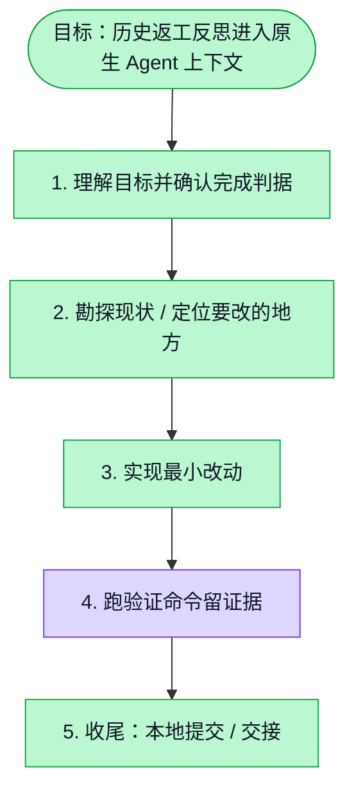

# 执行计划 — A2 历史返工反思只读上下文

> 规范：`.harness/instructions/execution-plan-visualization.md`。
> 改状态用 `node .harness/scripts/execution-plan.mjs set <本文件> <节点> <状态>`，
> 改完 `check` 一遍；不要手改 classDef 颜色。

## 我理解的目标
- **目标**：将第6步已确认历史反思只读带入目标返回步骤的原生教学上下文
- **完成判据**：针对性 loader/host 测试先失败后通过；模块边界回归、类型检查；读取失败可重试且不阻断 Chat
- **不做什么**：不改父组件、Skill、服务或权限契约；不部署、不外发、不代签
- **假设与待确认**：root 统一 init；父组件集成 returnRevision 可选 prop；历史修订不按日期过期，旧作用域/取消请求不得入上下文

## 执行计划

图例：⬜ 灰=未开始 · 🟨 黄=已开始 · 🟩 绿=已完成 · 🟪 紫=已测试（有证据） · 🟥 红=被堵塞

## 进度日志（append-only，每次改颜色追加一行）
| 时间 | 节点 | 状态变化 | 依据（命令 / 证据 / 堵塞原因） |
|---|---|---|---|
| 2026-11-16 | G, S1 | todo → doing | 接到目标，开始理解 |
