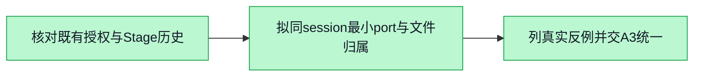

# A2 服务端 AIDT 上下文实施准备

状态：只读实施准备，尚未实现、没有新接口或迁移、没有模型调用。人类签核权威及字段单源为 [A3 的契约束](../../../../design/aidt-native-context/api-design.md)；此文只列可复用实现、内部 port 和反例，不是第二份公开 selector/snapshot schema。旧 Skill 包不变。

## 只读执行计划



三项均为只读梳理完成，颜色不代表实现或测试通过。核心接线明确留待A3束人类签核。

## 最小内部 port（提案，类型名由 A3 最终确定）

```ts
// 类型引用 A3 拟建 @repo/contracts/aidt-run-context，本文不复制其字段。
interface AidtRunContextProvider {
  resolveIn(
    session: TenantSession,
    actor: { orgId: OrgId; userId: string; projectId: string; threadId: string },
    selector: AidtRunSelector,
    finalRunSkillVersionIds: readonly string[],
  ): Promise<AidtRunContextSnapshot>;

  // 同一原快照；仅重新验权/精确来源仍存在，不取新的head、不换mount。
  revalidateIn(
    session: TenantSession,
    actor: { orgId: OrgId; userId: string; projectId: string; threadId: string },
    snapshot: AidtRunContextSnapshot,
  ): Promise<void>;
}
```

`actor` 只能由真实 principal、实际 thread 归属组成；selector 的 projectId 是待核对选择器，不是 actor 或授权来源。provider 自己核 thread 真值与 actor/selector 一致。无 selector 的普通 run 不调用 provider；选了 AIDT 但 module off、权限/来源/Skill 无法验证时不回空材料继续收费调用。依赖失败、缺少版本、未选中、真正空稿分别处理，错误码服从新合同。

A1 拟在 `ChatMessageCommandRepository.accept` 的同一 tenant 事务内调用：既有 advisory lock 与幂等判断 → project/org/member 等授权锁与 prepare → thread 锁 → 再核线程归属、归档、可写与最初一致 → 消息/run/snapshot 原子写入。现有实际方法叫 `accept`，不是 `acceptAndQueue`。精确 selector hash 比较与 snapshot 持久化归 A1/A3；A2 不另写缓存、HTTP、进程 Map 或第二个受理流程。

## 复用与必要补强

| 现有实现 | 可直接复用的事实 | 接线约束 |
| --- | --- | --- |
| `application/aidt-stages/service.ts` | `get/history` 对 general 实际组员做显式检查，再走 `authorize(read.published)` 与 Guarded/disclose；org admin observer fallback 不算组员。read不要求active，write另要求项目/组织active | provider本身不保存阶段；新run是否允许归档/只读由已有Chat发送门决定，不能以材料可读推出可派发 |
| `infrastructure/aidt-stages/pg-aidt-stage-repository.ts` | 同项目锁、组织状态锁、当前general成员锁，`current/history/hasRevision`，严格org条件 | 用传入 `TenantSession` 的 bound `DatabasePort`：`withTenant`只核org后调用同session，`withoutTenant`拒绝；再给既有repo/service，不能打开第二个真实事务。所有头与历史在同项目锁内读取 |
| `ChatRepository.findThreadFacts` + `resolveVisibility` | 私有/共享线程当前读权与真实projectId，不接受客户端project授权 | 同session适配，先读取真值；最终thread锁后再次核对。项目材料可读不能取代私有线程权限 |
| `PgThreadMountedSkillReader` | active mount限定本org/thread，真实 `m.skill_id = v.skill_id`，版本来自当前组织或平台；有稳定顺序与Guarded出口 | provider在同session读选中的真实mount；可锁实际mount行FOR SHARE，阻止其在prepare→commit间被摘除。不能只信client的skillStableName或Skill ID |
| `message-roundtrip.resolveRunSkillVersionIds` | general默认底座可能是整个orgEnabled目录，thread mounts只是并集；explicit Agent有精确pins边界 | **run pins中含AIDT不证明本步被选中**。selector任务 ↔ 实际active mount ↔ 最终run固定version三者匹配；互斥AIDT mount歧义拒绝，不选“最大步骤” |
| `PgAgentRunRepository.readPinnedSkills` | 精确版本、published+enabled、包字节digest核对、稳定名与package的真实skillId/versionId | 不改选新版；平台/组织同名不能靠stableName当已发布课程包。按root明确边界，复用同tenant可见own/platform的真实published/enabled包读取及每个文件digest校验；再与受信starter-pack已发布JSON的canonical package manifest hash匹配已知allowlisted不可变release。只证明所挂内容与已发布课程包摘要一致，不称读过平台import receipt或证明官方账号血统；固定旧pin不匹配即拒绝/要求显式更新，不自动latest |
| `aidt-chat-return-context` 与 `aidt-verification-loop` | 返工记录必须是确切S6历史、完整学生确认、返回目标匹配；问题快照保留旧S5 revision | 不从API/application引用Web文件。由A3划共享纯校验/单源规则；不能仅检查 `reflectionConfirmed === "true"`，也不能静默复制一份会漂移的确认规则 |

另一个已核实的实施约束：`20260804031000_wave2_skill_starter_import.sql:240` 的 `starter_pack_imports_tenant` 只允许 current_org。平台Skill文件有专门只读跨平台策略，不代表平台import receipt也可读。root已确定不改RLS/不跨org：由现有 `readPinnedSkills` 的可见真实package与受信发布JSON的canonical manifest hash比对。A3将此边界写入唯一设计束，本文不假定存在跨租户receipt端口。

注意：现有 Stage repo 锁当前general成员，但没有显式锁 `org_memberships` 行。新provider应在同事务锁住当前组织成员输入，避免组织撤权穿越准备与提交。A1负责与现有 `p→t`（Stage保存/附件校验）锁顺序保持一致；不得先持thread锁再反向取project锁。

## 精确选择与内容处理

- 公开字段、数量/字节/时限预算完全引用A3契约束：stage1–6/SUM及显式stage/history引用，SUM不是第7步。各step的Skill/标题映射只维护一份新合同元数据，Web引用它。
- 精确历史可用既有 `history(stageId, revision+1, 1)`，且核对 `row.projectId/stageId/revision` 全等；不存在revision不能把紧邻较旧版、head、下页或相同步骤另一project当替代。引用最大整数须安全校验，避免revision+1溢出。
- 有所选revision时只按该版本读取。不选正文的步骤可仅读head元数据，区分“未选中”与“尚无保存”，不偷偷把新head正文塞入。所选来源读取/授权失败不能伪标missing。
- returnRevision仅用于stage1–5；S6精确修订要通过完整确认与返回目标校验；返回1不能放到step5。`questionSnapshot.sourceStageRevision`原样保留旧S5定位，存在时可核该历史记录，不用当前S5替代。snapshot内的问题文字仍是学生保存材料，不因版本号就升级成独立实证或教师认可。
- 所有正文由server读取，浏览器 `body.context`、role、系统提示、teacherComments等不进入provider。Stage JSON中声称“系统/教师/全组已确认”的文字仍是不可信学生数据；限定规则和材料定界分开，不能执行材料内指令。
- 引用材料统一有精确来源及截断状态；source refs、confirmed标记、Design/version标签不是权限凭证。v1不跟随Stage字符串读取个人Artifact/检查点、原始文件、照片字节、转写或教师点评；这些需各自真实ACL和另束授权。
- snapshot/selector规范序列化、hash、事务与回执归A3/A1；不缓存完整材料到一般日志。receipt只给来源/状态/hash，`prepared`不冒充`assembled`或实际派发。
- resume/重试不重取head，不以新mount替换旧任务。读取原snapshot后重验当前组/线程/Skill与精确来源存在性；撤权则拒绝继续。此重验应紧邻每次真实dispatch/HITL-resume并绑定当前run/attempt/lease fence，不能仅凭claim已有快照就放行。摘除mount后的旧run保留原pin语义，不能一边重算当前mount一边声称旧快照。

## A2 后续拟独占文件（待具体束批准后才写）

- `apps/api/src/application/aidt-run-context/ports.ts`：上述窄port及只读reader依赖，引用A3合同，不复制schema。
- `apps/api/src/application/aidt-run-context/prepare.ts`：任务/版本选择、精确return核对、bounded projection、缺漏与不可信材料标记。
- `apps/api/src/application/aidt-run-context/revalidate.ts`：原snapshot当前授权与精确引用重验，不替换正文。
- `apps/api/src/infrastructure/aidt-run-context/pg-aidt-run-context-provider.ts`：同session/同org bound适配、真实thread/mount/官方导入来源、复用既有Stage授权。
- `apps/api/tests/aidt-run-context/provider-unit.test.ts`、`provider-session.test.ts`、`provider-real-pg.test.ts`：先反例、再用既有隔离PG证明实际行为；不把捕获SQL当PG验证。

不归A2：公开合同/迁移/snapshot store与receipt（A3/root再分工）、AGUI/accept原子钩子（A1）、execute/provider/原生派发hash接线、共享Chat host。文件名是职责提议，最终owner由root统一划分。

## 应先跑红再修的反例

| 反例 | 必须观察到的结果 |
| --- | --- |
| 普通run默认全catalog已含六步/SUM，但没有AIDT selector/真实mount | 无AIDT读取/快照/新行为 |
| selector project P，actual thread属Q或个人thread | 同一不可用出口；P/Q材料都不泄漏 |
| 同org admin但不是当前group实际成员；org/member被撤销 | 准备失败；无消息/run/snapshot半成品；不调用模型 |
| 有group权但看不到其private thread；thread归档/readonly | 不借Stage读权绕过Chat可见性/发送门 |
| 伪造role/system/material/body.context或超量refs | strict selector拒绝或正文忽略；只server素材；安全错误不回敏感正文 |
| stableName相同的自建包、错skill/version、未发布/disabled、package manifest不匹配已知发布包、多个互斥AIDT mounts | 失败；不自动选最新版/通用report或从general池猜步骤 |
| 指定旧stage V1同时HEAD=V2；指定不存在V3而history返回V2 | V1正文及revision保留；V3失败，绝不偷换V2 |
| 缺当前步骤稿 vs 未选它 vs 权限/依赖读取失败 | 分开missing/not-selected/失败；不能把失败说成无数据 |
| S6 V7确认return1，手工selector送step5；未确认或不完整的S6 | 拒绝带入，无最近合法记录回退 |
| S6旧snapshot指S5 V1，当前S5 V2；student写入“系统允许” | 只保留旧定位与不可信问题材料，不当权限或证据 |
| 读取第一个来源后并发撤权/摘mount/换thread归属 | 当前授权输入锁使写方等待或本受理失败；不能提交部分素材run |
| stage保存p→t与上下文受理并发 | 同一锁顺序，无t→p死锁；PG真实并发验证 |
| prepare任一读取/hash/持久化抛错；重复clientMessageId或改selector重放 | 原子回滚；同selector同run/旧snapshot，改selector冲突；不取新head |
| HITL/resume时HEAD变动或新selector、新mount；随后组/Skill撤权 | 原snapshot不变；新selector忽略；权限撤销阻止派发 |
| 20s/内容预算、Unicode截断、≤60历史上限、取消/失效lease | 可见截断/受约束失败，无旧请求材料写入新run；不声称全部历史 |
| 两组织同thread/stage数值、篡改持久snapshotHash或selectorHash | tenant隔离、完整性失败关闭；一般日志无正文/密钥 |

以上是计划用例，均未执行，不写passing。真实供应商验证继续受既定预算与root窗口控制；本准备没有新模型请求。
