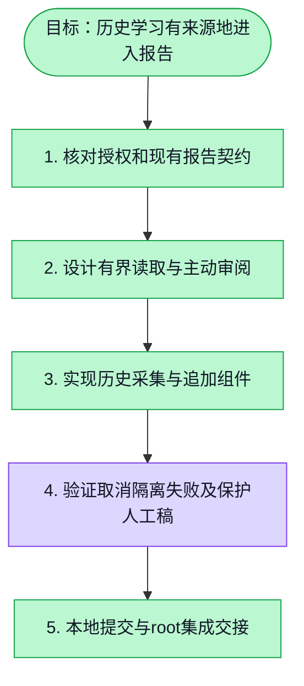

# 执行计划 — A3 历史学习报告追溯

> 规范：`.harness/instructions/execution-plan-visualization.md`。
> 改状态用 `node .harness/scripts/execution-plan.mjs set <本文件> <节点> <状态>`，
> 改完 `check` 一遍；不要手改 classDef 颜色。

## 我理解的目标
- **目标**：读取授权小组历史，审阅后追加有来源的报告章节，保留当前人工稿。
- **完成判据**：报告历史helper/UI定向测试、既有报告回归、web typecheck及定向eslint。
- **不做什么**：不改后端契约、原生Chat、父级project-aidt接线、共享Backlog或设计签核；不部署/合并/外发GitHub。
- **假设与待确认**：root统一init；真实模型/课堂验收另计；服务器修订不等同独立学习轮次。

## 执行计划

图例：⬜ 灰=未开始 · 🟨 黄=已开始 · 🟩 绿=已完成 · 🟪 紫=已测试（有证据） · 🟥 红=被堵塞

## 进度日志（append-only，每次改颜色追加一行）
| 时间 | 节点 | 状态变化 | 依据（命令 / 证据 / 堵塞原因） |
|---|---|---|---|
| 2026-11-16 | G, S1 | todo → doing | 接到目标，开始理解 |
