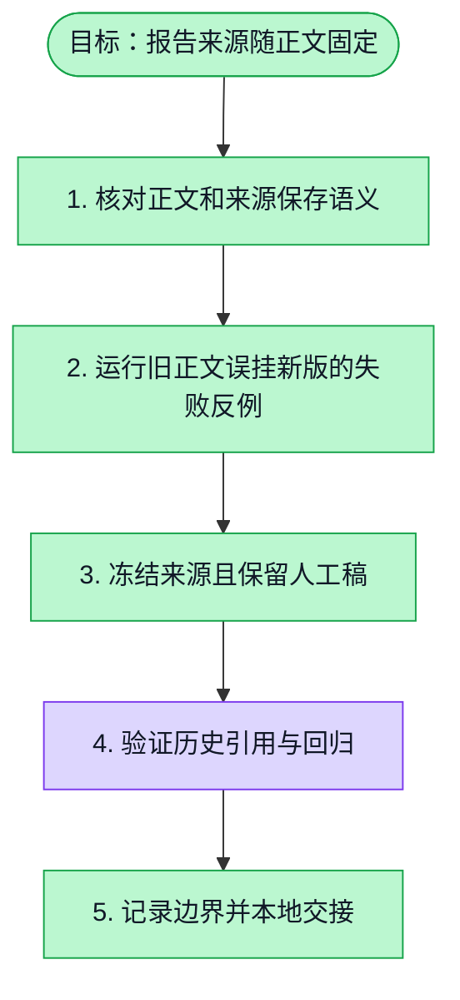

# 执行计划 — 报告正文来源冻结修复

> 规范：`.harness/instructions/execution-plan-visualization.md`。
> 改状态用 `node .harness/scripts/execution-plan.mjs set <本文件> <节点> <状态>`，
> 改完 `check` 一遍；不要手改 classDef 颜色。

## 我理解的目标
- **目标**：证明并修复旧报告正文误挂新阶段修订，保留学生文字和原始来源。
- **完成判据**：真正失败反例转绿，共享hook定向回归与eslint通过；核对现有后端接受旧修订。
- **不做什么**：不改父级接线、后端契约、权限或服务；不自动覆盖报告、不伪造或静默清除已知来源。
- **假设与待确认**：sourceRevision只是本地变更计数；root负责集成typecheck和真服务器往返。

## 执行计划

图例：⬜ 灰=未开始 · 🟨 黄=已开始 · 🟩 绿=已完成 · 🟪 紫=已测试（有证据） · 🟥 红=被堵塞

## 进度日志（append-only，每次改颜色追加一行）
| 时间 | 节点 | 状态变化 | 依据（命令 / 证据 / 堵塞原因） |
|---|---|---|---|
| 2026-11-16 | G, S1 | todo → doing | 接到目标，开始理解 |
