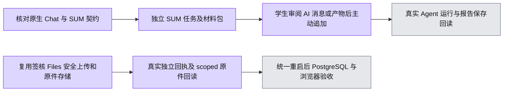

# A3：V2 SUM 与原始材料接口

2026-11-16，根工作树中的开发结果，未独立提交或部署。先前报告历史/来源修复证据保留在同目录；本页不替代真实模型和原生验收结果。

## SUM 实现与审阅边界

- SUM 为第六步之后的报告任务，仍只有六个教学步骤；独立 `summaryThread`，普通 `thread`、六步 Skill 和固定版本行为保持既有逻辑。原生 Chat v2 shell、线程、挂载、composer、消息与产物 API 复用。
- 真实目录仅匹配 `dt-summarize-project`；不存在或未启用时拒绝，不以通用报告 Skill 别名冒充。A2 所加独立 optional pack 和 A1 的实际目录读取是各自证据，不等于已经生成报告。
- 学生主动读取本组实际保存的六步材料及有界历史，明确缺失、失败、截断、学生解释、AI 推测和缺少教师点评。材料放入原生 TeachingContext；点击仅将请求带入原生输入框，学生仍需主动发送。原稿和占用中的输入框保留。
- 主动读取原生线程里的真实 agent/run 消息及有关联的产物，选择时重新鉴权并核对版本；预览后勾选审阅才追加到最新报告编辑稿，仍需主动保存。没有以模型文字冒充文件导出。
- 当前 SUM mount 不证明每条历史消息生成时的 Skill/provider 配置，界面已明确“历史草稿的生成配置尚未逐条核验”。真实新 SUM run 的专业行为需独立运行审阅。
- 当前材料 V2 字段去重，避免重复正文挤掉预算。原生 Chat/报告相关 5 文件 68 测试通过（`summary-tests.txt`）；此后去重及提示回归 2 文件 10 项通过（`summary-review-tests.txt`），后者是重跑子集，不相加成唯一用例总数。

## 原始材料接口

复用已有 `uploadArtifact` F35 校验/隔离/安全告警、`materializeArtifact` 写入与读回校验、现有 ObjectStore、ArtifactRepository、provenance 和真实 ingestion outbox，不创建 Chat 消息、Agent run 或额外存储服务。

| 接口 | 本轮行为 |
| --- | --- |
| `POST /projects/:projectId/artifacts/upload` | multipart `meta` 为既有签核输入 JSON（projectId 可由 path 注入，若 body 提供必须相同），`files` 为一个真实二进制文件；metadata 的 filename/sizeBytes/sha256 与实际字节核对 |
| `GET /ingestion-runs/:ingestionRunId` | 既有签核输出；projectId 查询可省，若传必须与真实 run 项目一致，学生端始终传入 |
| `GET /ingestion-runs/:ingestionRunId/content?projectId=...` | 新 transport 原件读取，projectId 必传；真实字节、私有缓存/no-sniff/attachment、实际 MIME、原始 SHA256 与 artifact/version 回执头 |

- 每个成功请求新建独立 ingestion receipt，与真实 artifact/version/outbox job 的身份分开。新增表 `aidt_raw_upload_runs` 为不可变映射，RLS tenant、SELECT/INSERT 权限及既有组织冻结/项目归档政策；没有把 versionId 当 runId。
- 仅显式启用 AIDT 的 general 项目可用；必须是当前真实项目成员，并通过既有 Files 的较严格 `read.allHands` 及 artifact ACL。组织管理员 observer fallback、跨租户、错误项目上下文均不能取材料。
- Project/member/org 行锁贯穿实际写事务；上传前 guard 先于 multipart 缓冲检查，缓冲后写事务再检查。归档仅保留授权读取，禁止新上传。general 原始材料本切片仅接受 `agendaSegmentId:null`。
- 原件/dedup 都复用 `wsx_visible_artifacts` 同一可见集合（包括团队范围与逻辑删除），不会为来源链接扩权。重复对象元数据或保密/范围不同则创建独立对象，不重绑旧对象可见范围。
- `use-existing` 显式回执 duplicateHit、保留旧版本并创建独立上传回执；`as-new-version` 经完整既有安全检查后实际追加不可变版本及 outbox，旧回执仍指旧版。不是 UI 伪造版本号。
- 当前真实落盘为 `STORED`，读取实际 pinned version history；没有把排队、可下载原件当作已转写、已分析、已检索、READY 或研究证据。下游失败明确 `INGESTION_FAILED`，仍可在授权范围内读取完整原件。
- 缺失或不可达的对象为 `DEPENDENCY_UNAVAILABLE` / 503；已读取但 hash/size/version hash/MIME 不符为 `INTEGRITY_CHECK_FAILED` / 422（与现有 Files 完整性失败状态对齐），禁止返回损坏字节。
- 本轮只支持每请求单文件，前端逐文件显示实际状态。service 对批量明确 422；multipart 上限也会在缓冲阶段拒绝多文件。不能据此宣称完整 Files 批量部分失败合同已实现。
- 原有物化流程在 DB 提交失败时可能留下无引用对象，选择保留字节而非产生指向不存在字节的版本；本轮没有增加新的物理删除通道，也没有声称自动清除这种孤立对象。

## 已实际执行的验证

| 验证 | 结果及证据层 |
| --- | --- |
| Raw application/controller 定向测试 | 32 项通过；真实 F35/物化逻辑 + 内存 I/O ports/控制器，`raw-unit-final.txt`；不是 PostgreSQL 或浏览器验收 |
| API 完整 TypeScript 检查 | 退出 0，`raw-typecheck.txt`；含新增后端和初版 31 项测试，后续仅完整性错误 HTTP 状态与其断言由 409 对齐 422，并补充第 32 项存储不可达测试 |
| API 架构依赖检查 | 2303 文件通过，`raw-architecture.txt` |
| API 租户 guarded read 路径检查 | 2308 文件通过，`raw-permission-paths.txt` |
| 实际 API 迁移 | A1 通知正常 migrate 退出 0；本页未独立运行 PG 验收，且当时 API 进程加载的是后续权限/完整性修复前快照 |
| 真实浏览器上传/跨域头/成员撤权/重新登录/重启恢复 | 待 root 统一重启最新源码后由 A4/A6 验证，不能由上述内存测试替代 |
| 新 SUM 真实 Agent、审阅导入、保存导出闭环 | 等待与 A6 串行窗口；本页不记未运行结果为通过 |

没有更改设计签核状态、后端既有 contracts exports、默认模型、现有 Chat 写入或成员权限，也没有部署或 GitHub 外发。

## 后续：本次上传提交者投影

经 root 授权，原件 content transport 增加 `X-Upload-Submitted-By` / `X-Upload-Submitted-At`，严格来自真实 `aidt_raw_upload_runs.created_by/created_at`。表示**本次回执提交者和时间**，不是原文件作者或原版本创建者。另一当前成员读取不会把元数据改成读取人；重复上传新回执可以指向同一版本，但有其自己的真实提交者和提交时间。没有新迁移，也没有更改既有 JSON 合同。root 单独维护既有 CORS 的精确头曝光。

新增后完整 raw 定向组 35 项通过（含既有 32，不累加），见 `raw-submitter-tests.txt`。覆盖两个成员的原回执/重复提交回执、Pg adapter 的 SQL-port 列投影和 controller 原样响应头/拒绝读取不发原件或元数据头。SQL-port 假库测试不等于 PostgreSQL 验收；新头需统一 API 重启后实际浏览器跨成员读取验证。
