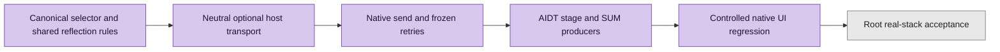

# A4 — Native host selector bridge

User-approved context bridge; implementation prepared locally without deployment, model requests, permission configuration changes, or a new Chat UI. Root controls the final build, integration, and real browser/model acceptance.

## Behavior

- Ordinary Chat has no host selector by default. The generic Chat layer imports no AIDT module.
- AIDT supplies only canonical project/task/exact stage/history/return revision coordinates through optional forwarded transport data. Student bodies, session identity, permissions, and client guidance are not copied into that selector. Previous material registration via `useAgentContext` was removed from the two AIDT producers.
- Each explicit send deeply freezes its selector with its existing client message ID. Both native error-banner and task-timeline retries reuse that pair; updating selection does not remount the composer. New idle sends capture current selection.
- Local scope includes organization, user, token, project, real thread and task, with a monotonic generation. A→B→A and unmount invalidate delayed work; sender rechecks a resolved thread before dispatch. Frozen retries preserve original coordinates while the same scope remains active.
- Host sends cannot enter the existing ordinary message queue, whose schema does not retain selectors. Both running-send and force-queue actions refuse before enqueue/clear and retain the real composer draft. Ordinary running-reply behavior remains unchanged.
- New sends bind the canonical run ID through an authorized exact human-message read after the matching SDK request receives the server acceptance acknowledgment. Authoritative restoration remains scoped and cannot overwrite a newer attempt. SDK correlation IDs route the acknowledgment only; they and timestamps are never used as backend run IDs. Source receipt GET is independent of user message text.
- SUM history coordinates come directly from collected structured history entries, separately from current stage revisions; no Markdown guessing or latest-version substitution.
- Shared reflection validation and prototype reference schemas are imported/reexported from the canonical contract subpath; Web formatting and draft editing retain their established APIs.

## Evidence

- `/tmp/aidt-context-a4-selector-red.log`: before the producer implementation, the new selector import was missing and the existing summary collector returned no exact history coordinates. The focused tests failed.
- `/tmp/aidt-context-a4-selector-green.log`: 4 files / 23 checks pass (selector, exact SUM history, existing report import workflow, neutral host port).
- `/tmp/aidt-context-a4-native-regression.log`: 7 files / 78 checks pass, including existing native permission-gate and ordinary running-reply behavior, project host lifecycle/preview/navigation, shared reflection rules, prototype references, and the formatting poison boundary.
- `/tmp/aidt-context-a4-native-panel-04.log`: 2 files / 15 checks pass; real native Panel + CopilotKit core controlled tests cover both native retries, fresh-send selection, unready draft preservation, busy UI actions with zero queue writes, and canonical run observation. Network fetch is intercepted in these tests; no model or real account interaction is claimed.
- `/tmp/aidt-context-a4-eslint-02.log`: all 15 touched source/test files pass ESLint with `--max-warnings 0`.

Initial native test failures in `native-panel-01` and `native-panel-03` were harness sequencing issues (nested async `act`, and simulating a terminal thrown error instead of the real error-bus-owned timeline retry). Their corrected tests drive the native subscriptions and actual retry controls; production behavior was not weakened to satisfy them.

## Boundaries

These are controlled regressions, not proof of a real provider receiving context or permission-resume checkpoint inheritance. Root/A6 must verify actual selector HTTP transport, server-authorized snapshot creation, real run receipt dispatch state, actual model turn, forbidden/cross-project selection denial, and refresh/continuation behavior on the final built snapshot. Native printing/PDF and prior multiuser member Chat are separate earlier acceptance tracks, not repeated or relabeled as context-bridge evidence here.

## Final readiness boundary

Root authorized one parent prop after read-only review found `shared.read !== ready` had been collapsed to the same empty array as a successful empty result. Parent `project-aidt.tsx` now passes `sharedContextReady`; an unreadable/pending stage selection supplies an unready host port and a short status, while a confirmed empty result remains a valid first-step selector. Existing local previews, composer and Chat UI remain mounted. A frozen retry also checks current readiness before dispatch, without substituting the newly selected versions when readiness returns.

- `/tmp/aidt-context-a4-selection-ready-red.log`: committed-render producer case fails before the readiness prop was consumed; an unreadable selection incorrectly produced an empty selector.
- `/tmp/aidt-context-a4-retry-ready-red.log`: existing frozen retry incorrectly bypassed the temporarily unready host.
- `/tmp/aidt-context-a4-final-ready-green.log`: all 5 affected test files / 60 checks pass, including both counterexamples, both native retries, busy queue prevention, SUM import/selection and scope lifecycle checks.
- `/tmp/aidt-context-a4-eslint-final.log`: final readiness changes plus the canonical report-skill export pass with zero ESLint warnings. `git diff --check` passes.
- `/tmp/aidt-context-a4-canonical-summary.log`: 3 files / 13 checks pass after `AIDT_REPORT_SKILL` was changed to reexport the canonical summary identity rather than declare a second literal.

Production source was handed back as `sourceReady`; root retains the full typecheck/build/E2E and release decision.

## Frozen source revision correction

A6/root read-only review found that the actual `ProjectAidt` parent still derived Chat references from all stage heads even though the existing shared-stage controller already retained a teaching lock. The resulting native selector could mix a saved S6 test question tied to S5 V2 with S5 head V3. The same defect affected confirmed S3 discoveries tied to an older S2 card revision.

The initial correction reused `shared.lockedSourceStage` when selecting coordinates, overriding that one head without mutating its source record. The subsequent unsaved-draft review below supersedes that selection rule with persisted source provenance. Pending/failed source reads still cannot become intentional empty selectors. The page preview uses the existing immutable history endpoint (`beforeRevision=selected+1`, `limit=1`) when the selected coordinate predates its head, then strictly requires exact project, stage and revision. A closest revision, foreign result, denied read, or missing history is never substituted. The preview labels now say “页面回读” and defer actual adoption/dispatch to the run receipt.

- `/tmp/aidt-context-a4-locked-parent-red-02.log`: three meaningful failures before the fix: actual parent + actual shared-stage hook selected S5 V3 instead of locked V2; selected S2 V4 instead of locked V2; exact historical preview incorrectly failed. The first harness attempt omitted the module opt-in and is not counted as product reproduction.
- `/tmp/aidt-context-a4-locked-parent-green.log`: 5 files / 57 checks pass after the reference and immutable preview correction, including existing locked round tests.
- `/tmp/aidt-context-a4-locked-final.log`: after the preview label correction, 4 files / 68 checks pass, including the existing full parent workspace tests.
- `/tmp/aidt-context-a4-locked-eslint.log`: 7 touched source/test files pass with zero ESLint warnings; `git diff --check` passes.

Root/A1's concurrently built health-only snapshot predates this correction and must not be cited as validation of it. The final built snapshot must be rebuilt and the actual native selector/receipt verified by A6. No model or service was started by A4.

## Final saved-provenance and queued-acceptance correction

A further real UI counterexample proved that the initial controller-derived lock was still a local-draft value: starting a new S6 draft, bringing in S5 V3 and returning to Chat without saving selected S5 V3 alongside the old saved S6 round tied to V2. Reconfirming S3 cards produced the same mix of new S2 cards and old saved S3. Both cases now live in `aidt-native-context-parent.test.tsx`; they operate the real UI and shared controller, assert no save call, and verify that the saved source record stayed unchanged. The final selector derives overrides **only from the saved current stage's `sourceStageRevisions`**. If that stage has no saved row, it uses saved heads. The working draft's existing teaching locks remain unchanged for editing and saving.

The first real prepared-only browser attempt also found a separate receipt gap: a genuinely accepted queued run has no execution event when the executor is intentionally off. New neutral `lib/chat/host-run-acceptance.ts` resolves this without inventing an event or adding an API. It binds this SDK request's correlation ID at initialization, waits for its server `RUN_STARTED` acknowledgment (emitted after database acceptance), and then uses the existing authorized paginated message read to match the captured human author, client message ID and exact sent text. Only that row's canonical `agentRunId` is published. A rejected retry cannot bind an old row without this request's acknowledgment. Ordinary Chat does not start this lookup.

The read has a total 25-second deadline, at most 40 passes and 10 pages per pass, repeated-cursor detection, scope checks after awaits, and immediate logical cancellation/denial handling. The existing transport does not accept an AbortSignal, so a bounded race cancels the wait and discards a late result; it does not claim that an already started HTTP request was physically aborted. Reaching a cap means acceptance remains unknown. It never chooses another message or claims model execution.

An explicit neutral attempt-start callback clears the previous receipt when a new actual send starts. Frozen retry IDs retain their original selection. Provider and AIDT producer both bind ownership to the current client attempt, with scope generations and duplicate suppression; late previous acceptances and null-client restoration cannot overwrite a newer turn. Readiness/busy refusal happens before attempt-start and retains the draft.

- `/tmp/aidt-context-a4-unsaved-boundary-red.log`: two real UI counterexamples fail before the final saved-provenance fix. The external test/config remain under `/tmp/aidt-unsaved-context-review/`; the same cases were then added to the repository parent test file.
- `/tmp/aidt-context-a4-queued-red.log`: queued canonical receipt and explicit attempt ownership fail before implementation.
- `/tmp/aidt-context-a4-queued-green-02.log`: 4 files / 33 controlled checks pass, including author/id/text matching, queued acknowledgment, denial, ordinary zero-read, pagination/cursor/time/pass bounds, cancellation and A→B→A, and the two unsaved UI cases.
- `/tmp/aidt-context-a4-final-acceptance-green.log`: final 8 files / 89 controlled checks pass, including real native Panel ordinary-send zero extra reads, both frozen retries, unready/busy zero attempt-start, producer receipt clearing, the original permission gate and ordinary running-reply regressions.
- `/tmp/aidt-context-a4-final-acceptance-eslint.log`: all 11 touched source/test files pass with `--max-warnings 0`; `git diff --check` passes. PanelBody remains 1953 lines; the new helper/hook is 72 lines.

These controlled checks do not turn the prepared-only browser failure into a pass. Root/A6 must rerun its unchanged assertion against the newly built snapshot with the executor off, confirm the actual canonical receipt, and clean up the queued run. No paid execution, model call or stack was started by A4. Final production source was frozen and returned to root.
