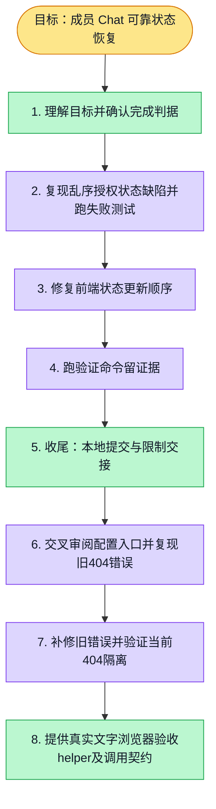

# 执行计划 — A4 成员文字讨论状态恢复

> 规范：`.harness/instructions/execution-plan-visualization.md`。
> 改状态用 `node .harness/scripts/execution-plan.mjs set <本文件> <节点> <状态>`，
> 改完 `check` 一遍；不要手改 classDef 颜色。

## 我理解的目标
- **目标**：复现并修复获准 B 范围内的成员 Chat 可用性缺口，保留草稿、真实回执与访问隔离。
- **完成判据**：先失败测试再修复；成员 Chat 定向组件、适配器和导航测试通过，定向 lint 与 diff 检查通过。
- **不做什么**：不改后端契约、AIDT 父组件、人类签核、AI Chat、权限矩阵；不新增通知/未读或语音；不部署、合并或发布 GitHub。
- **假设与待确认**：用户批准的 A+B 沿用；本轮只交付独立 worktree 提交。root 统一运行 init 和整体 typecheck。

## 执行计划

图例：⬜ 灰=未开始 · 🟨 黄=已开始 · 🟩 绿=已完成 · 🟪 紫=已测试（有证据） · 🟥 红=被堵塞

## 进度日志（append-only，每次改颜色追加一行）
| 时间 | 节点 | 状态变化 | 依据（命令 / 证据 / 堵塞原因） |
|---|---|---|---|
| 2026-11-16 | G, S1 | todo → doing | 接到 A4 明确分工，阅读根规则与 mod-chat 技能 |
