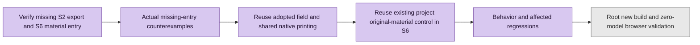

# A4 — S2 adopted interview guide and S6 test materials

2026-11-16 UTC. Root approved the existing V2 scope and the concrete minimal UI design before production edits. No new contract, service, permissions, model request, recorder, ASR, deployment or independent service stack was introduced.

## Findings and implementation

S2's approved deliverable and `adoptedGuide` existed, but the full AIDT search found no S2 print entry. `printAidtUiText` was used by the report, and the stage's existing print actions were S4 idea sheets. The shared original-material upload block was present only in S2, leaving S6 without its own test-material entry.

`AidtInterviewGuideExport` now mounts only in S2. A nonempty student `adoptedGuide` enables preview and native PDF print preview. The original `guide` remains a separate folded comparison and is never substituted or included in the printed list. Student text is plain text, including literal markup; line breaks are preserved. This exports the current adopted form text, not a claim that the stage was shared, interviews happened or a file was saved. Read-only users may inspect/print; neither field is mutated by export.

Printing directly reuses `printResearchPdf`, including its actual isolated clone and final cancellation guard. There is no reverse import of `stage-output`, new export engine or automatic model call. Failure retains the preview and both form fields and permits explicit retry. Content A→B→A and project/principal/permission scope changes invalidate the old print.

The existing original-material block now also appears in S6 with the label **测试原始材料**. It reuses the existing `AidtResearchMaterialControl` and `Preview` plus authorized upload/read APIs. A verified reference is added to the current S6 draft as `researchFile:<uuid>`; association/removal invalidates local reflection confirmation without rewriting the frozen question or earlier saved history. The original remains in the project when the stage association is removed. Shared stage saving remains an explicit separate action. Project filtering and the existing content/hash/MIME/ID verification remain unchanged; this does not copy S2 fields or automatically read original bytes into AI context.

## Behavior evidence

- `/tmp/aidt-a4-s2-pdf-s6-materials-red.log`: **7/7 fail** before implementation because the actual S2 print/preview and S6 material controls are absent.
- `/tmp/aidt-a4-s2-pdf-s6-materials-green.log`: **2 files / 7 tests pass** after implementation.
- `/tmp/aidt-a4-s2-pdf-s6-materials-regression.log`: **6 files / 52 tests pass**, exit 0 (new behavior 7, existing classification 20, original-material control 9, UI v3 8, UI v2 8).
- `/tmp/aidt-a4-s2-pdf-s6-materials-eslint.log`: both production and both new test files pass `--max-warnings 0`; `git diff --check` passes.
- Root reported full Web TypeScript exit 0 in `/tmp/aidt-ui-gap-web-types.log`.

The S2 tests use the real shared printer and inspect its actual cloned iframe document. Only the browser `window.print` action is replaced by a controlled spy; they prove exact adopted text, original exclusion, literal markup, read-only nonmutation, retry and final cancellation, **not an actual PDF file**. S6 integration tests control the existing material component's callback to verify stage fields, confirmation invalidation, read-only actions and foreign-project filtering; the existing material component tests exercise its verified receipt/failure behavior. These are not new real upload or persistence acceptance results.

## Browser handoff

After root's rebuilt snapshot, A6 can use:

- `aidt-interview-guide-preview-toggle` — 预览采纳清单
- `aidt-interview-guide-print` — PDF 打印预览
- `aidt-interview-guide-preview` / `aidt-interview-guide-original` / `aidt-interview-guide-status`
- Actual print iframe title: `访谈问题清单 · 学生采纳稿`
- S6 existing `aidt-research-materials`, input label `测试原始材料选择文件`; existing upload/save controls and project-scoped APIs remain unchanged.

Root/A6 must verify the actual printed PDF bytes/file and real S6 original upload → verified readback → explicit stage save → fresh readback, with synthetic classroom materials labeled as such. The running old stack and its paid S2 Agent step do not contain this new UI and cannot count as its validation. A4 did not start a browser, model, build or service, and returned production source frozen for root's commit/build.
