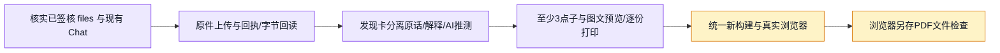

# A4 · V2 原始材料、发现卡、点子描述单

范围：FR05 / FR06 / FR07 / FR17；本记录区分受控验证、待统一真栈验证和人工另存 PDF。

## 实现边界

- 原件走已签核 `files.uploadArtifact` 的真实 multipart 路径；不借 `chat.createMessage` 储存材料，因为该操作会启动 AgentRun。
- 每次上传只发一个文件；元数据 SHA-256、大小、原名与原始字节对应。学生显式选择重复时复用原件或另存新版本。
- 收到真实 runId 后，独立读取上传状态和原始字节；校验正文 SHA-256、服务端 hash、artifactId、实际 versionId、字节数。状态 STORED 不等于已抽取、转写、检索或验证。
- 上传回读通过后，原件已在项目服务中；阶段关联仅在本页草稿，仍须“保存到小组”。失败保留原有选择；已有回执的重试只读取回执，不重新 POST。
- 原始文件引用保存在既有 SharedStage.fields 的 researchFile / discoveryFile / discoveryPhoto / ideaFile 字段中；不冒充 Chat imageAttachment，不新增服务或权限词表。内容读取必须携带并校验项目范围。
- 原生 Chat 图片 picker 仅复用本项目 plenary、非小组线程中已发送图片；增加跨步骤共享对话选择。发现卡原文 picker 只列 human 消息，AI 回答不能充当受访者原话。
- 发现卡原话、学生概括、AI推测与材料定位分别保存，选择材料不覆盖原话。摘要和报告保留可追溯定位与待核实状态。录音与转写入口后置。
- 描述单检查至少3个不同名称的点子，每份图像及2–3句话；三种分类可重叠，仍独立于学生拟选择。预览与打印使用同一审阅内容，每个候选可单独打印，也可合并打印。
- PDF 是原生浏览器打印；请求打印不是已保存文件。自动验证不能声称已生成或下载 PDF 字节；人工需在打印对话框另存并打开检查。图片解码失败、准备期间内容变动均保留草稿并停止旧稿打印。

## 已复现的反例

| 反例 | 修复 | 证据 |
|---|---|---|
| 单句或4句仍可当作“2–3句”齐备 | 透明标点/换行计数，界面显示当前数量 | readiness-red.log |
| 单份打印丢失候选ID；解码期间改稿仍可打印旧快照 | 打印文档保留实际候选ID，打印前核对当前草稿 | print-red.log / print-green.log |
| 发现卡没有独立AI推测交接 | 独立字段，不覆盖原话或学生解释 | discovery-red.log / discovery-green.log |
| A→B→A切换重现旧来源列表 | 单调消费代次并取消旧请求 | source-lifecycle-red.log / source-lifecycle-green.log |
| 原文快照字符数受限但JSON转义后超过6000；删卡遗留隐藏推测/来源 | 按序列化字符数截短并标记；删卡清关联不删原件 | source-size-red.log / source-size-green.log |
| FileReader迟到覆盖后选的真实原件 | 更换源/删除时使先前本地图读取失效 | original-image-red.log / original-image-green.log |

本目录定向测试使用受控网络/存储与组件输入，不证明真实多人、模型调用或数据库已通过。统一浏览器结果由 root / A6 的真实验收日志补充，未到达的断言不算通过。

## 本轮定向验证

2026-11-16：10 个文件、75 项 Vitest 全绿（单 worker、`--no-cache`），见 [final-targeted.log](./final-targeted.log)。scoped TypeScript 和定向 ESLint 均退出 0（成功无输出），`git diff --check` 无错误。TypeScript 临时配置 `/tmp/aidt-v2-a4-tsconfig.json` extends Web 原配置，包含本轮 A4 组件/helpers/tests 与 DOM setup，不替代 root 全 Web/build 门控。

本 worker 没有 commit、部署、启动服务、改变权限、发布 GitHub 或伪造真人研究。新后端真实路径须随 root 统一 API/Web snapshot 启动后，由 A6 使用教学夹具实际 PNG/文字上传、重启回读及组间拒绝完成验收。

## 交叉审阅补修

- 明确的 `422 INGESTION_FAILED` 仅表示下游处理失败；继续调用同项目鉴权 content 并校验全部原件字节及版本。失败分支返回 `status=null` 与独立 `processingFailed`，不制造 STORED/READY。401/403/404/503 及其他422均不尝试原件 fallback。见 original-readable-red.log / original-readable-green.log；最终75项覆盖。
- 原始图片 Control 保持组件实例，用 value / selectionScope 单调代次撤销旧请求。服务器恢复新引用后，旧回读不回写；自身 onChange 的父组件重渲染保留“原件已保存并回读，已加入草稿；请保存到小组”。A3 独立两反例 /tmp/aidt-cross-review-green.txt 已绿（原red同目录保留）。
- 真实提交者/时间仅取 content 的 X-Upload-Submitted-By / X-Upload-Submitted-At，严格成对及日期校验，兼容旧稿无字段。来源拒绝时显示“无法核对”，不把学生可编辑字段的署名当成真实服务回执。见 submit-metadata-red.log / final-targeted.log。
- 文件提交者指本次上传 run 的提交者，不是当前读者、原文件作者或阶段关联保存者。新版本、回执ID、哈希与提交信息折叠到“来源与版本”，重复策略折叠到“重复文件设置”，主要动作/测试锚点保留。

## 最终回归：恢复纯格式化边界

root 的全模块回归揭示 formatter 间接导入了 Chat / files 网络层。原 `aidt-prototype-formatting-boundary.test.ts` poison 反例先复现为红（format-boundary-red.log），未删除或放宽任何 poison。引用结构/校验/标签分别提纯到 `aidt-research-material-reference.ts` 和 `aidt-discovery-source-reference.ts`，网络 adapter 仅 import / reexport 同一实现；`aidt-ui-drafts` 和描述单格式化只读取纯 helper。列表筛选也复用纯 helper，不复制字段识别规则。

原边界用例及新增真实结构的研究文件/人类消息/AI推测格式化用例共2项绿；提纯后的8个受影响文件53项全部通过（format-boundary-green.log），scoped TS / ESLint 退出0，diffcheck0。另将父回写测试等待“移除引用”按钮最终 enabled，仍验证同一条件，避免成功提示出现早于异步 finally 收尾的一帧造成误报。未启动服务或模型。

## 打印独立审阅补修

- 实际反例：逐份打印只解码所选图片，坏的第三张仍可打印（all-images-red.log）；改为所有候选先共用 `preparePrintImages` 有界预检。第三图永不返回时，10秒失败后保留预览、草稿并恢复重试。
- 共享打印函数在真实 iframe importNode 后将图片设为 eager，等待所有克隆图 decode / load 及非零自然尺寸；超时/损坏移除临时 iframe，不调用 print。rAF 等待有100ms兜底。保留原 afterprint 成功清理语义，不宣称 PDF 文件已保存。
- `printIdeas`、`printAidtUiText`、报告预览及 guided report 全部处理 async 返回；报告失败保留编辑。真正 print 前检查宿主有效性；AIDT 额外核对身份/页面/草稿、图片状态与学生审阅的单调代次。
- 实际反例：三个不同名称却重复/空 id 的点子被标 ready（idea-identifiers-red.log）；仅收紧前端 readiness 阻止错误逐份导出，保留可编辑草稿，不改 Stage 契约。
- 新 `research-print-images.test.tsx` 操作真实 JSDOM iframe 内的克隆节点，覆盖延迟、全部图片、失败重试、零尺寸/超时、最终 scope、普通无图报告。它 mock 原生 print，不代表真实浏览器保存 PDF。

最终6文件50项绿（final-print-green.log）；scoped TS/ESLint退出0，root随后完整API/Web tsc均退出0。A5独立静态复核无新阻塞。生产源码已向root声明冻结，本worker不再修改生产源、不起栈、不发模型；等待root/A6新构建真实 raw/print E2E。
