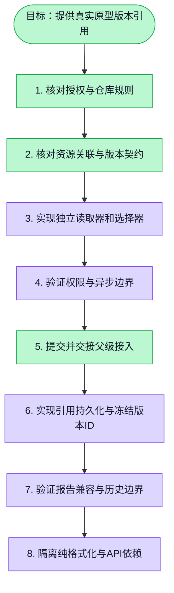

# 执行计划 — A5 — 原型真实版本引用

> 规范：`.harness/instructions/execution-plan-visualization.md`。
> 改状态用 `node .harness/scripts/execution-plan.mjs set <本文件> <节点> <状态>`，
> 改完 `check` 一遍；不要手改 classDef 颜色。

## 我理解的目标
- **目标**：提供当前项目已关联、当前 owner 可读的真实 Design 原型版本选择器，向父级返回实际 ID 与摘要。
- **完成判据**：独立 helper 与组件测试覆盖权限、失败/空态、只读、切项目/身份及真实版本确认；父级获得集成说明。
- **不做什么**：不更改后端契约、权限、Chat/Design 引擎或父级 stage/snapshot；不部署、merge、GitHub 外发或冒签。
- **假设与待确认**：root 统一 init；现有 listMyProjects 仅 owner，可选范围收窄为关联资源与 owner 列表交集；非 owner 不扩大权限。

## 执行计划

图例：⬜ 灰=未开始 · 🟨 黄=已开始 · 🟩 绿=已完成 · 🟪 紫=已测试（有证据） · 🟥 红=被堵塞

## 进度日志（append-only，每次改颜色追加一行）
| 时间 | 节点 | 状态变化 | 依据（命令 / 证据 / 堵塞原因） |
|---|---|---|---|
| 2026-11-16 | G, S1 | todo → doing | 接到目标，开始理解 |
